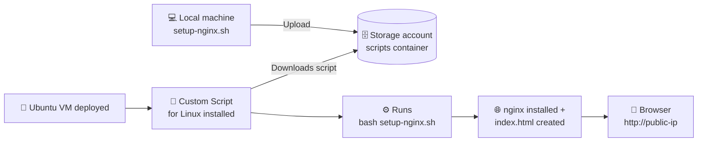

<div align="center">

# 🐧 Azure Custom Script Extensions for Linux — nginx Demo

**Deploy an Ubuntu VM that installs nginx and publishes a web page by itself, set up entirely in the Azure Portal.**


</div>

---

> 📘 **Part 2 of 2.** Part 1 used the Custom Script Extension to install **IIS on Windows Server**. This part applies the same idea to **Linux**, with a bash script that installs **nginx**.

---

## 📑 Table of Contents

- [What You'll Build](#-what-youll-build)
- [How It Works](#-how-it-works)
- [Windows vs Linux at a Glance](#-windows-vs-linux-at-a-glance)
- [Prerequisites](#-prerequisites)
- [The Script](#-the-script)
- [Step 1 — Upload the Script to Storage](#-step-1--upload-the-script-to-storage)
- [Step 2 — Create the Ubuntu VM with the Extension](#-step-2--create-the-ubuntu-vm-with-the-extension)
- [Step 3 — Test It](#-step-3--test-it)
- [Troubleshooting](#-troubleshooting)
- [Clean Up](#-clean-up)
- [AZ-104 Exam Notes](#-az-104-exam-notes)

---

## 🎯 What You'll Build

| Component | Purpose |
|:--|:--|
| 🗄️ **Storage account** *(existing)* | Holds the bash script |
| 📦 **Blob container** `scripts` *(existing)* | Location for `setup-nginx.sh` |
| 🐧 **Ubuntu Server 24.04 VM** | Runs the script after it's deployed |
| 🧩 **Custom Script for Linux** | Linux agent that downloads and runs the script |
| 🌐 **nginx web page** | Served at `http://<public-ip>` |

---

## 🔄 How It Works



1. You upload `setup-nginx.sh` to the existing `scripts` container.
2. You create an Ubuntu VM and attach **Custom Script for Linux**, pointing it at that file.
3. Once the VM is deployed, the Linux agent downloads the script and runs it as **root**.
4. The script installs nginx, writes `index.html` to `/var/www/html` and restarts nginx.

---

## ⚖️ Windows vs Linux at a Glance

| | 🪟 Windows (Part 1) | 🐧 Linux (Part 2) |
|:--|:--|:--|
| **Script type** | PowerShell (`.ps1`) | Bash (`.sh`) |
| **Web server** | IIS | nginx |
| **Web root** | `C:\inetpub\wwwroot` | `/var/www/html` |
| **Page** | `default.html` | `index.html` |
| **Extension name** | `Custom Script Extension` | `Custom Script for Linux` |
| **Command to run** | Set by the portal | **You type it**: `bash setup-nginx.sh` |
| **VM size used** | `Standard_B2s` | `Standard_B1s` |

---

## ✅ Prerequisites

- [ ] The **storage account** and **`scripts` container** from Part 1 *(or create them as described in Part 1, Steps 1–2)*
- [ ] The **resource group**, **virtual network** and **subnet** from Part 1, still in place
- [ ] **[VS Code](https://code.visualstudio.com/)** or any text editor
- [ ] The `setup-nginx.sh` script from this repo

> 💡 **Tip:** Keeping the Part 1 resources means the new VM can join the same network.

---

## 📜 The Script

Save this as **`setup-nginx.sh`**.

<details>
<summary><b>👉 Click to expand <code>setup-nginx.sh</code></b></summary>

```bash
#!/bin/bash
# ==============================================================
#  setup-nginx.sh
#  Installs nginx and publishes a demo web page on an Azure VM.
#  Runs as root through the Custom Script Extension for Linux.
# ==============================================================

set -euo pipefail

# Settings
WEB_ROOT="/var/www/html"
PAGE_PATH="${WEB_ROOT}/index.html"
export DEBIAN_FRONTEND=noninteractive   # no interactive prompts during install

log() {
    echo "[$(date '+%H:%M:%S')] $*"
}

trap 'log "ERROR: setup failed on line ${LINENO}"; exit 1' ERR

# Step 1 - Update the package index
log "Updating package index..."
apt-get update -y

# Step 2 - Install nginx
log "Installing nginx..."
apt-get install -y nginx

# Step 3 - Build and save the HTML page
log "Creating demo page at ${PAGE_PATH}..."
HOST_NAME="$(hostname)"
DEPLOYED="$(date '+%Y-%m-%d %H:%M:%S')"

cat > "${PAGE_PATH}" <<EOF
<!DOCTYPE html>
<html lang="en">
<head>
  <meta charset="UTF-8">
  <title>Custom Script Extensions Demo - Linux</title>
  <style>
    body {
      margin: 0; height: 100vh;
      display: flex; align-items: center; justify-content: center;
      font-family: 'Ubuntu', 'Segoe UI', Arial, sans-serif;
      background: linear-gradient(135deg, #009639, #e95420);
    }
    .card {
      background: #ffffff; padding: 40px 50px; border-radius: 12px;
      box-shadow: 0 10px 30px rgba(0,0,0,0.2); text-align: center; max-width: 600px;
    }
    h1 { color: #009639; margin-top: 0; }
    p  { color: #444; }
    .meta { font-size: 0.9em; color: #888; margin-top: 20px; }
  </style>
</head>
<body>
  <div class="card">
    <h1>&#9989; nginx is running</h1>
    <p>We now have nginx running as the web server on this machine.</p>
    <p>Installed automatically by the <strong>Azure Custom Script Extension for Linux</strong>.</p>
    <div class="meta">Server: ${HOST_NAME} &middot; Deployed: ${DEPLOYED}</div>
  </div>
</body>
</html>
EOF

# Step 4 - Enable and restart nginx
log "Enabling and restarting nginx..."
systemctl enable nginx
systemctl restart nginx

log "Done. Browse to http://<public-ip>"
exit 0
```

</details>

### 🔍 What each part does

| # | Section | What it does |
|:-:|:--|:--|
| 1️⃣ | `set -euo pipefail` + `trap ... ERR` | Stops at the first error so the extension reports **Failed** in the portal |
| 2️⃣ | `apt-get update -y` | Refreshes the package index |
| 3️⃣ | `apt-get install -y nginx` | Installs the nginx web server without prompting |
| 4️⃣ | `WEB_ROOT="/var/www/html"` | The folder nginx serves web content from |
| 5️⃣ | `cat > ... <<EOF` | Writes `index.html`, filling in the hostname and deploy time |
| 6️⃣ | `systemctl enable` / `restart nginx` | Starts nginx now and on every reboot |

> ⚠️ **Line endings:** if you write the script on Windows, save it with **LF** line endings, not CRLF. In VS Code, click `CRLF` in the bottom-right status bar and switch it to `LF`. CRLF endings cause errors like `$'\r': command not found`.

---

## 📦 Step 1 — Upload the Script to Storage

> 🧭 **Portal path:** **Storage accounts** → *your storage account* → **Data storage** → **Containers** → **`scripts`**

```
┌──────────────────────────────────────────────┐
│  Storage account: stcsedemo12345             │
│  └── 📦 Containers                           │
│       └── 📂 scripts                         │
│            ├── setup.ps1        (Part 1)     │
│            └── setup-nginx.sh   ⬆️ upload    │
└──────────────────────────────────────────────┘
```

1. Open the **`scripts`** container
2. Click **⬆️ Upload** → **Browse for files** → choose `setup-nginx.sh` → **Upload**

✅ Both scripts are now in the container.

---

## 🐧 Step 2 — Create the Ubuntu VM with the Extension

> 🧭 **Portal path:** `☰ Menu` → **Virtual machines** → **➕ Create** → **Azure virtual machine**

### 🔹 Tab 1: Basics

| Setting | Value |
|:--|:--|
| **Resource group** | `rg-cse-demo` *(existing)* |
| **Virtual machine name** | `linuxvm01` |
| **Region** | `East US` |
| **Availability options** | `No infrastructure redundancy required` |
| **Image** | `Ubuntu Server 24.04 LTS` |
| **Size** | `Standard_B1s` |
| **Authentication type** | `Password` |
| **Username / Password** | *Your admin credentials* |
| **Public inbound ports** | `Allow selected ports` |
| **Select inbound ports** | ✅ `HTTP (80)`  ✅ `SSH (22)` |

> 💡 **Tip:** Don't forget **HTTP (80)**. Without it the browser can't reach nginx.

### 🔹 Tab 2: Disks
➡️ Keep the defaults → **Next**

### 🔹 Tab 3: Networking 🔗

| Setting | Value |
|:--|:--|
| **Virtual network** | *Your existing VNet from Part 1* |
| **Subnet** | *Your existing subnet* |
| **Public IP** | **(new)** `linuxvm01-ip` |

### 🔹 Tab 4: Management / Monitoring
➡️ Keep the defaults → **Next**

### 🔹 Tab 5: Advanced ⭐ *(the important one)*

1. Under **Extensions**, click **Select an extension to install**
2. Search for **`Custom Script`** → choose **`Custom Script for Linux`** → **Next**

   > ⚠️ Pick the **Linux** version. The Windows extension won't work on Ubuntu, because Linux uses a different agent.

3. Next to **Script files**, click **Browse** → *storage account* → **`scripts`** → **`setup-nginx.sh`** → **Select**
4. In **Command**, type exactly:

   ```bash
   bash setup-nginx.sh
   ```

   > ❗ The file name in **Command** must match the uploaded file name exactly. Linux file names are case-sensitive.

5. Click **Create** to add the extension

```
Advanced tab
└── Extensions
     └── ➕ Select an extension to install
          └── 🔎 "Custom Script for Linux"
               ├── Script files: stcsedemo12345 / scripts / setup-nginx.sh ✅
               └── Command:      bash setup-nginx.sh                      ✅
```

### 🔹 Final: Review + create
➡️ Click **Review + create** → **Create** 🚀

> ⏱️ **Expect a wait:** the extension runs once the VM is deployed. Allow a few minutes for the package update and nginx install.

---

## 🌐 Step 3 — Test It

1. Open **Virtual machines** → **`linuxvm01`**
2. Copy the **Public IP address** from the **Overview** page
3. In a new browser tab, open:

| URL | Expected result |
|:--|:--|
| `http://<public-ip>` | 🎉 Your custom **"nginx is running"** page |

> ✅ Your page appears instead of the stock "Welcome to nginx!" page because nginx serves `index.html` first.

---

## 🛠️ Troubleshooting

<details>
<summary><b>❌ The page doesn't load</b></summary>

- Wait a few more minutes. The extension runs after the VM is deployed.
- Check that the **HTTP (80)** inbound rule exists: **VM** → **Networking** → **Network settings**.
- Make sure you're using `http://`, not `https://`.

</details>

<details>
<summary><b>🔍 How do I check the extension status?</b></summary>

**Portal:** **VM** → **Settings** → **Extensions + applications** → click **CustomScript** → read **Status** and the **detailed status** message.

**On the VM itself (over SSH):**
```bash
# Extension log
sudo cat /var/log/azure/custom-script/handler.log

# Script output (stdout / stderr)
sudo ls /var/lib/waagent/custom-script/download/0/
sudo cat /var/lib/waagent/custom-script/download/0/stdout
sudo cat /var/lib/waagent/custom-script/download/0/stderr

# Is nginx running?
systemctl status nginx
```

</details>

<details>
<summary><b>⚠️ Error: <code>$'\r': command not found</code></b></summary>

The script has Windows (CRLF) line endings. Switch it to **LF** in VS Code, upload it again, and redeploy the extension.

</details>

<details>
<summary><b>🔁 I changed the script. How do I run it again?</b></summary>

Remove **CustomScript** from **Extensions + applications**, upload the new script, then add the extension again. A VM can have only **one** Custom Script Extension at a time.

</details>

---

## 🧹 Clean Up

> 💸 **Avoid charges:** delete everything when you're finished.

🧭 **Portal path:** **Resource groups** → **`rg-cse-demo`** → **🗑️ Delete resource group** → type the name to confirm → **Delete**

This removes both VMs from Part 1 and Part 2, the storage account and the network.

---

## 📝 AZ-104 Exam Notes

| ✅ Know this | ❌ Not tested |
|:--|:--|
| The Custom Script Extension works on **Windows and Linux** | Writing bash scripts |
| Linux uses its own extension: **Custom Script for Linux** | The HTML content |
| Scripts can come from **Azure Storage** or a public URL such as **GitHub** | nginx configuration |
| Extensions can be added **when creating** a VM (Advanced tab) or **afterwards** | |
| Opening ports (**HTTP 80**, **SSH 22**) from the VM wizard | |

> 🧠 **Remember:** It's the same concept on both operating systems, with a different agent. Windows uses the Custom Script Extension; Linux uses Custom Script for Linux. Both download a script from storage and run it after the VM is deployed.

---

<div align="center">

**⭐ If this helped you study for AZ-104, give the repo a star.**

Made with 🐧 + ☁️ for Azure learners

</div>
