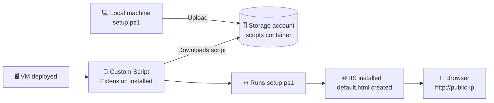

<div align="center">

# ☁️ Azure Custom Script Extensions — IIS Demo

**Deploy a Windows Server VM that installs IIS and publishes a web page by itself, set up entirely in the Azure Portal.**


</div>

---

## 📑 Table of Contents

- [What You'll Build](#-what-youll-build)
- [How It Works](#-how-it-works)
- [Prerequisites](#-prerequisites)
- [The Script](#-the-script)
- [Step 1 — Create a Storage Account](#-step-1--create-a-storage-account)
- [Step 2 — Create a Container and Upload the Script](#-step-2--create-a-container-and-upload-the-script)
- [Step 3 — Create the VM with the Extension](#-step-3--create-the-vm-with-the-extension)
- [Step 4 — Test It](#-step-4--test-it)
- [Troubleshooting](#-troubleshooting)
- [Clean Up](#-clean-up)
- [AZ-104 Exam Notes](#-az-104-exam-notes)

---

## 🎯 What You'll Build

| Component | Purpose |
|:--|:--|
| 🗄️ **Storage account** | Holds the PowerShell script |
| 📦 **Blob container** (`scripts`) | Folder-like location for `setup.ps1` |
| 🖥️ **Windows Server VM** | Runs the script after it's deployed |
| 🧩 **Custom Script Extension** | Agent that downloads and runs the script |
| 🌐 **IIS web page** | Served at `http://<public-ip>/default.html` |

---

## 🔄 How It Works



1. You upload `setup.ps1` to a blob container.
2. You create a VM and attach the **Custom Script Extension**, pointing it at that file.
3. Once the VM is deployed, the extension agent downloads the script and runs it.
4. The script installs IIS and writes `default.html` to `C:\inetpub\wwwroot`.

---

## ✅ Prerequisites

- [ ] An active **Azure subscription**
- [ ] Access to the **[Azure Portal](https://portal.azure.com)**
- [ ] A text editor: **[VS Code](https://code.visualstudio.com/)** works, and so does Notepad
- [ ] The `setup.ps1` script from this repo

> 💡 **Tip:** `Network Watcher` may already be in your subscription. It's created automatically and costs nothing.

---

## 📜 The Script

Save this as **`setup.ps1`**.

<details>
<summary><b>👉 Click to expand <code>setup.ps1</code></b></summary>

```powershell
<#
.SYNOPSIS
    Installs IIS and publishes a demo web page on an Azure VM.

.DESCRIPTION
    Meant to be run by the Azure Custom Script Extension (CSE) when a
    Windows Server VM is deployed. The script:
      1. Installs the IIS (Web-Server) role and its management tools
      2. Creates a styled HTML page
      3. Saves it as default.html in the IIS web root
#>

$ErrorActionPreference = 'Stop'

# ------------------------------------------------------------
# Settings
# ------------------------------------------------------------
$WebRoot  = 'C:\inetpub\wwwroot'
$PageName = 'default.html'
$PagePath = Join-Path -Path $WebRoot -ChildPath $PageName

function Write-Step {
    param([string]$Message)
    Write-Output ("[{0}] {1}" -f (Get-Date -Format 'HH:mm:ss'), $Message)
}

try {
    # Step 1 - Install IIS
    Write-Step 'Installing IIS (Web-Server) role...'
    $result = Install-WindowsFeature -Name Web-Server -IncludeManagementTools
    Write-Step ("IIS install finished. Success: {0}, Restart needed: {1}" -f $result.Success, $result.RestartNeeded)

    # Step 2 - Build the HTML page
    Write-Step 'Building the demo HTML page...'
    $hostName = $env:COMPUTERNAME
    $deployed = Get-Date -Format 'yyyy-MM-dd HH:mm:ss'

    $html = @"
<!DOCTYPE html>
<html lang="en">
<head>
  <meta charset="UTF-8">
  <title>Custom Script Extensions Demo</title>
  <style>
    body {
      margin: 0; height: 100vh;
      display: flex; align-items: center; justify-content: center;
      font-family: 'Segoe UI', Arial, sans-serif;
      background: linear-gradient(135deg, #0078d4, #50e6ff);
    }
    .card {
      background: #ffffff; padding: 40px 50px; border-radius: 12px;
      box-shadow: 0 10px 30px rgba(0,0,0,0.2); text-align: center; max-width: 600px;
    }
    h1 { color: #0078d4; margin-top: 0; }
    p  { color: #444; }
    .meta { font-size: 0.9em; color: #888; margin-top: 20px; }
  </style>
</head>
<body>
  <div class="card">
    <h1>&#9989; IIS is running</h1>
    <p>We now have Internet Information Services running on the machine.</p>
    <p>Installed automatically by the <strong>Azure Custom Script Extension</strong>.</p>
    <div class="meta">Server: $hostName &middot; Deployed: $deployed</div>
  </div>
</body>
</html>
"@

    # Step 3 - Save the page to the IIS web root
    Write-Step "Saving page to $PagePath ..."
    Set-Content -Path $PagePath -Value $html -Encoding UTF8 -Force

    Write-Step 'Done. Browse to http://<public-ip>/default.html'
    exit 0
}
catch {
    Write-Error ("Setup failed: {0}" -f $_.Exception.Message)
    exit 1
}
```

</details>

### 🔍 What each part does

| # | Section | What it does |
|:-:|:--|:--|
| 1️⃣ | `Install-WindowsFeature -Name Web-Server` | Installs the IIS web server role and its management tools |
| 2️⃣ | `$WebRoot = 'C:\inetpub\wwwroot'` | The folder IIS serves web content from |
| 3️⃣ | `$html = @" ... "@` | A here-string holding the HTML page, with the server name and deploy time filled in |
| 4️⃣ | `Set-Content ... -Force` | Writes the page to disk, overwriting any old copy |
| 5️⃣ | `try / catch` + `exit 1` | Makes the extension report **Failed** in the portal if something breaks |

---

## 🗄️ Step 1 — Create a Storage Account

> 🧭 **Portal path:** `☰ Menu` → **Storage accounts** → **➕ Create**

| Setting | Value |
|:--|:--|
| **Subscription** | *Your subscription* |
| **Resource group** | **Create new** → e.g. `rg-cse-demo` |
| **Storage account name** | Must be globally unique, e.g. `stcsedemo12345` |
| **Region** | `East US` |
| **Preferred storage type** | Azure Blob Storage or Azure Data Lake Storage Gen2 |
| **Performance** | `Standard` |
| **Redundancy** | `Locally-redundant storage (LRS)` |

Then click **Review + create** → **Create**.

> ⚠️ **Note:** "Storage account" is just the name of the service. You are **not** creating an account inside your Azure account.

> 💡 **Tip:** Names must be 3–24 characters, lowercase letters and numbers only. Add a few digits to make yours unique.

---

## 📦 Step 2 — Create a Container and Upload the Script

> 🧭 **Portal path:** **Your storage account** → **Data storage** → **Containers**

```
┌──────────────────────────────────────────────┐
│  Storage account: stcsedemo12345             │
│  ├── 📂 Data storage                         │
│  │    └── 📦 Containers  ◀── click here      │
│  │         └── ➕ Add container              │
│  │              Name: scripts                │
│  │              └── ⬆️ Upload → setup.ps1    │
└──────────────────────────────────────────────┘
```

1. Click **➕ Add container**
2. Set **Name** to `scripts` and click **Create**
3. Open the **`scripts`** container
4. Click **⬆️ Upload** → **Browse for files** → choose `setup.ps1` → **Upload**

✅ The script is now in Azure Storage.

---

## 🖥️ Step 3 — Create the VM with the Extension

> 🧭 **Portal path:** `☰ Menu` → **Virtual machines** → **➕ Create** → **Azure virtual machine**

### 🔹 Tab 1: Basics

| Setting | Value |
|:--|:--|
| **Resource group** | `rg-cse-demo` *(the existing one)* |
| **Virtual machine name** | `webvm01` |
| **Region** | `East US` |
| **Availability options** | `No infrastructure redundancy required` |
| **Image** | `Windows Server 2022 Datacenter` |
| **Size** | `Standard_B2s` |
| **Username / Password** | *Your admin credentials* |
| **Public inbound ports** | `Allow selected ports` |
| **Select inbound ports** | ✅ `HTTP (80)`  ✅ `RDP (3389)` |

> 💡 **Tip:** Ticking **HTTP (80)** here adds the NSG inbound rule for you, so you don't need to edit the Network Security Group afterwards.

### 🔹 Tab 2: Disks
➡️ Keep the defaults → **Next**

### 🔹 Tab 3: Networking
➡️ A new **virtual network** and **public IP** are created for you. Keep the defaults → **Next**

### 🔹 Tab 4: Management / Monitoring
➡️ Keep the defaults → **Next**

### 🔹 Tab 5: Advanced ⭐ *(the important one)*

1. Under **Extensions**, click **Select an extension to install**
2. Search for **`Custom Script Extension`** → select it → **Next**
3. Next to **Script file**, click **Browse**
4. Go to **Storage account** → **`scripts`** container → choose **`setup.ps1`** → **Select**
5. Click **Create** to add the extension

```
Advanced tab
└── Extensions
     └── ➕ Select an extension to install
          └── 🔎 "Custom Script Extension"
               └── Script file: [ Browse ]
                    └── stcsedemo12345 / scripts / setup.ps1 ✅
```

### 🔹 Final: Review + create
➡️ Click **Review + create** → **Create** 🚀

> ⏱️ **Expect a wait:** after the VM is deployed, the extension takes about **5–8 minutes** to download and run the script.

---

## 🌐 Step 4 — Test It

1. Open **Virtual machines** → **`webvm01`**
2. Copy the **Public IP address** from the **Overview** page
3. In a new browser tab, open:

| URL | Expected result |
|:--|:--|
| `http://<public-ip>` | 🟦 Default IIS welcome page |
| `http://<public-ip>/default.html` | 🎉 Your custom **"IIS is running"** page |

> ✅ If both pages load, the Custom Script Extension worked.

---

## 🛠️ Troubleshooting

<details>
<summary><b>❌ The page doesn't load</b></summary>

- Wait the full **5–8 minutes**. The extension runs after the VM is deployed.
- Check that the **HTTP (80)** inbound rule exists: **VM** → **Networking** → **Network settings**.
- Make sure you're using `http://`, not `https://`.

</details>

<details>
<summary><b>🔍 How do I check the extension status?</b></summary>

**Portal:** **VM** → **Settings** → **Extensions + applications** → click **CustomScriptExtension** → read **Status** and the **detailed status** message.

**On the VM itself (over RDP):**
```text
C:\WindowsAzure\Logs\Plugins\Microsoft.Compute.CustomScriptExtension\
C:\Packages\Plugins\Microsoft.Compute.CustomScriptExtension\
```

</details>

<details>
<summary><b>🔁 I changed the script. How do I run it again?</b></summary>

Remove the **CustomScriptExtension** from **Extensions + applications**, upload the new script, then add the extension again. A VM can have only **one** Custom Script Extension at a time.

</details>

---

## 🧹 Clean Up

> 💸 **Avoid charges:** delete everything when you're finished.

🧭 **Portal path:** **Resource groups** → **`rg-cse-demo`** → **🗑️ Delete resource group** → type the name to confirm → **Delete**

---

## 📝 AZ-104 Exam Notes

| ✅ Know this | ❌ Not tested |
|:--|:--|
| What the Custom Script Extension **does** | Writing the PowerShell script |
| That scripts can be stored in **Azure Storage** or **GitHub** | The HTML content |
| Adding extensions **when creating** a VM (Advanced tab) or **afterwards** | VS Code |
| Opening ports from the VM creation wizard | |
| Managing VMs with the **Azure CLI** / **PowerShell** | |

> 🧠 **Remember:** The Custom Script Extension downloads and runs scripts on Azure VMs. It's used for **post-deployment configuration**, software installs, and other config or management tasks.

---

<div align="center">

**⭐ If this helped you study for AZ-104, give the repo a star.**

Made with ☁️ for Azure learners

</div>
