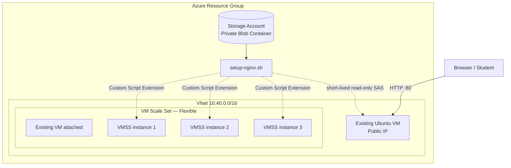
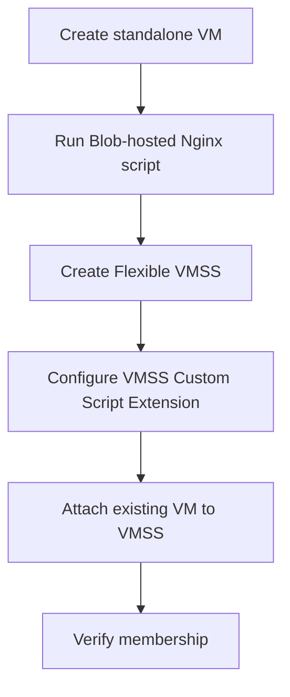
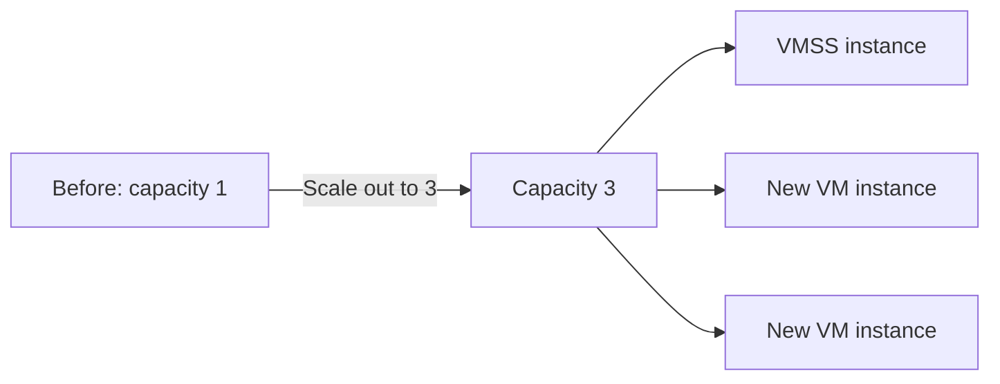
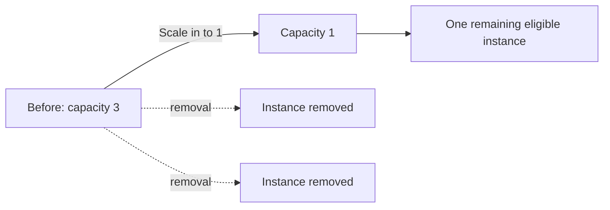

<div align="center">

# 🚀 Azure VMSS Flexible Orchestration
### Existing VM onboarding • Blob-hosted Nginx bootstrap • Scale-out • Scale-in


**A practical lab that starts with a standalone Linux VM, attaches it to a Flexible VM Scale Set, and demonstrates scale-out and scale-in.**

</div>

---

## 🧭 Lab navigation

| Part | What you will do | Result |
|---|---|---|
| 01 | Prepare Azure CLI and variables | Ready-to-run environment |
| 02 | Create VNet, NSG and Storage Account | Private script storage |
| 03 | Upload the Nginx bootstrap script | `setup-nginx.sh` in Blob Storage |
| 04 | Create a standalone Ubuntu VM | Existing VM with a public web page |
| 05 | Create a Flexible VMSS | VMSS with one model-created instance |
| 06 | Attach the existing VM | Standalone VM becomes a VMSS member |
| 07 | Scale out | Increase VMSS capacity |
| 08 | Scale in | Reduce VMSS capacity |
| 09 | Verify and clean up | Confirm results and delete resources |

> [!IMPORTANT]
> This lab creates billable Azure resources. Use a test subscription, check VM SKU availability in your region, and run `scripts/cleanup.sh` when finished.

## 🎯 What the finished architecture looks like



**Important distinction:** Flexible orchestration manages regular Azure VM resources. A VM attached to a Flexible VMSS remains a normal VM resource with its own VM name, NIC and disks. Attaching it does not automatically add it to a Load Balancer backend pool or install the VMSS application. This lab configures Nginx on the standalone VM separately and configures the VMSS Custom Script Extension for VMSS-created instances.

## 🧠 Flexible vs Uniform — teaching checkpoint

| Flexible orchestration | Uniform orchestration |
|---|---|
| Uses standard Azure VM resources | Uses VMSS VM instance resources |
| Can attach eligible existing VMs | Cannot attach existing standalone VMs |
| Supports mixed VM configurations | Designed around a consistent VM model |
| Individual VM resources are visible/manageable through standard VM APIs | Instance management is primarily through VMSS APIs |

For this lab, **Flexible** is mandatory. The orchestration mode is selected at VMSS creation and cannot be changed later.

---

## 01 — Prerequisites

Run the commands from **Azure Cloud Shell (Bash)** or an Ubuntu machine with Azure CLI installed.

```bash
az login
az account set --subscription "<SUBSCRIPTION_ID>"
az account show --output table
az version
```

You need:
- Permission to create Resource Groups, networking, Storage Accounts, VMs and VMSS.
- Azure CLI and Python 3.
- An SSH key pair. Generate one if needed:

```bash
ssh-keygen -t rsa -b 4096 -f ~/.ssh/id_rsa
```

If you already have a key, keep using it. The public key path is `~/.ssh/id_rsa.pub`.

### Download / extract the project

Upload and extract this ZIP in Cloud Shell, or clone/copy the project folder to an Ubuntu machine. Then:

```bash
cd vmss-flexible-nginx-demo
cp config.env.example config.env
nano config.env
```

Edit these values:

| Variable | Example | Notes |
|---|---|---|
| `LOCATION` | `centralindia` | Choose a region with the selected VM SKU |
| `STORAGE` | `stvmssflex12345` | Must be globally unique, lowercase, 3–24 characters |
| `SSH_SOURCE` | `203.0.113.10/32` | Replace with your public IP in CIDR format |
| `SSH_KEY` | `$HOME/.ssh/id_rsa.pub` | Your public SSH key |

Find your public IP using a trusted IP-check service, then set `SSH_SOURCE` to that IP followed by `/32`. Do not expose SSH to the whole Internet (`0.0.0.0/0`) for this lab.

> [!NOTE]
> The example uses `centralindia`, Ubuntu 22.04 and `Standard_B2s`. If the VM size is unavailable in your chosen region or subscription, change `VM_SIZE` in `config.env`.

---

## 02 — Create the Azure foundation and upload the Bash script

The script `scripts/create-infrastructure.sh` creates:

- Resource Group
- Network Security Group
- Inbound HTTP rule (TCP 80)
- Inbound SSH rule (TCP 22, restricted to your IP)
- VNet and subnet
- Storage Account
- Private Blob container named `scripts`
- Blob named `setup-nginx.sh`
- Short-lived, read-only SAS URL stored in a protected-settings file

Run:

```bash
chmod +x scripts/*.sh
./scripts/create-infrastructure.sh
```

### What is stored in Blob Storage?

`setup-nginx.sh` installs Nginx, detects the VM hostname and IP information, and writes a polished HTML page to `/var/www/html/index.html`.

The Blob container is private. The VM extension receives a short-lived read-only SAS URL through **protected settings**, not as a public anonymous blob.

> [!WARNING]
> `generated/cse-protected-settings.json` contains a temporary SAS credential. Do not commit it to Git, paste it into screenshots, or share it. It is excluded by `.gitignore`. The SAS expires after approximately 24 hours; rerun the infrastructure script to generate a fresh one if it expires.

### Inspect the uploaded blob

```bash
az storage blob list \
  --account-name "$STORAGE" \
  --container-name scripts \
  --auth-mode login \
  --output table
```

If your current identity does not have Storage Blob Data Reader permissions, use the account key as the infrastructure script does, or assign the appropriate data-plane role.

---

## 03 — Create the existing standalone VM

The deployment script creates a standalone VM first. It is deliberately created **before** the VMSS so we can demonstrate attaching an already-existing machine.

The VM uses:
- Ubuntu 22.04
- The lab VNet and subnet
- The lab NSG
- A public IP for browser access
- Your existing SSH public key

The same Storage Account script is run on this VM using the Linux Custom Script Extension.

## 04 — Create a Flexible VMSS

The script creates a VMSS with:

- `orchestration-mode`: `Flexible`
- `platform-fault-domain-count`: `1`
- `single-placement-group`: `false`
- One VMSS-created Ubuntu instance
- The same VNet and subnet

Why fault-domain count 1? **Attaching or detaching an existing VM requires the Flexible VMSS to have `platformFaultDomainCount` set to 1.**

The VMSS Custom Script Extension is then configured with the same Blob-hosted Nginx setup script. The extension is part of the VMSS model so newly created scale-out instances receive the application bootstrap.

## 05 — Attach the existing VM to the VMSS

The key command used by the deployment is:

```bash
VMSS_ID=$(az vmss show \
  --resource-group "$RG" \
  --name "$VMSS" \
  --query id -o tsv)

az vm update \
  --resource-group "$RG" \
  --name "$EXISTING_VM" \
  --set "virtualMachineScaleSet.id=$VMSS_ID"
```

This sets the existing VM's `virtualMachineScaleSet` association to the target VMSS.

### Existing VM attachment requirements

Before trying this with a real production VM, check all of these:

- VM and VMSS are in the same Resource Group.
- VMSS uses Flexible orchestration.
- VMSS has platform fault-domain count 1.
- VMSS has `singlePlacementGroup=false`.
- VM and VMSS placement are compatible: regional VM to regional VMSS, or zonal VM to a VMSS whose zone configuration includes that VM's zone.
- VM is not in a self-defined Availability Set.
- VM is not in a Proximity Placement Group or Azure Dedicated Host.
- VM uses a managed OS disk.
- VM is not an unsupported RDMA-capable HB-series or N-series VM.

For this lab, both the VM and VMSS are regional (non-zonal) and in the same Resource Group.

> [!IMPORTANT]
> Attaching a VM does not automatically change its NIC, NSG, Load Balancer membership, routes, or application configuration. This lab uses the same subnet/NSG and installs Nginx on the standalone VM before attachment. A production load-balanced design needs an explicit backend-pool integration step.

---

## 06 — Run the complete deployment

After editing `config.env` and creating the Azure foundation:

```bash
./scripts/deploy-demo.sh
```

This performs the following sequence:



The existing VM is already running Nginx. The VMSS-created instance is configured by the VMSS extension. Allow several minutes for extension execution and package installation.

---

## 07 — Verify the deployment

```bash
./scripts/verify.sh
```

Check orchestration mode and capacity:

```bash
az vmss show -g "$RG" -n "$VMSS" \
  --query '{name:name,mode:orchestrationMode,faultDomains:platformFaultDomainCount,capacity:sku.capacity}' \
  --output yaml
```

List VMSS members:

```bash
az vmss list-instances -g "$RG" -n "$VMSS" \
  --query "[].{name:name,instanceId:instanceId,provisioningState:provisioningState,powerState:powerState}" \
  --output table
```

Check the existing VM's VMSS association:

```bash
az vm show -g "$RG" -n "$EXISTING_VM" \
  --query '{name:name,vmssId:virtualMachineScaleSet.id}' -o yaml
```

Open the existing VM's public IP in a browser:

```bash
az vm list-ip-addresses -g "$RG" -n "$EXISTING_VM" \
  --query "[0].virtualMachine.network.publicIpAddresses[0].ipAddress" -o tsv
```

Open `http://<PUBLIC_IP>`.

You should see a page similar to this:

- Azure Compute — Nginx online
- Hello from Azure
- VM hostname
- Private IP
- Public IP (if available)
- Provisioned timestamp

The page prints the hostname of the VM that is serving it.

---

## 08 — Scale OUT: increase capacity

Run:

```bash
./scripts/scale-out.sh
```

The script changes VMSS capacity to **3**:

```bash
az vmss scale \
  --resource-group "$RG" \
  --name "$VMSS" \
  --new-capacity 3
```

### What happens?



Azure provisions additional VMs from the VMSS scaling profile. The VMSS Custom Script Extension installs Nginx on newly created instances.

Check the members repeatedly while provisioning:

```bash
watch -n 5 "az vmss list-instances -g $RG -n $VMSS --query '[].{name:name,state:provisioningState}' -o table"
```

Stop `watch` with `Ctrl+C`.

> [!TIP]
> The scale-out command is asynchronous in terms of the application becoming ready. A VM may appear in the instance list before Nginx has finished installing. Check provisioning and extension status before testing HTTP.

---

## 09 — Scale IN: reduce capacity

Run:

```bash
./scripts/scale-in.sh
```

The deployment script attempts to enable scale-in protection for the attached existing VM. This is a safety guard for the classroom scale-in exercise; verify the protection flag in the portal/CLI before proceeding. The script reduces capacity to **1**:

```bash
az vmss scale \
  --resource-group "$RG" \
  --name "$VMSS" \
  --new-capacity 1
```

### What happens?



Azure removes eligible VMSS instances until the requested capacity is reached. The demo attempts to protect the attached existing VM from scale-in before the exercise. Confirm that protection is enabled before running the scale-in command. Other unprotected instances are eligible for removal. In production, use explicit protection and scale-in policies that match workload ownership and availability requirements.

After scaling in, run:

```bash
az vmss list-instances -g "$RG" -n "$VMSS" \
  --query "[].{name:name,instanceId:instanceId,powerState:powerState}" -o table
```

Then rerun `scripts/verify.sh`.

---

## 10 — Optional: inspect the Custom Script Extension

For the standalone VM:

```bash
az vm extension list \
  --resource-group "$RG" \
  --vm-name "$EXISTING_VM" \
  --output table
```

For the VMSS:

```bash
az vmss extension list \
  --resource-group "$RG" \
  --vmss-name "$VMSS" \
  --output table
```

For an individual VMSS instance, use the VM extension / instance view commands available in your Azure CLI version. Also inspect the Linux extension logs on the VM:

```bash
sudo tail -n 100 /var/log/azure/custom-script/handler.log
sudo journalctl -u nginx --no-pager -n 50
```

If the page does not load, check:
1. VM power state and provisioning state.
2. NSG inbound TCP 80.
3. Nginx service: `sudo systemctl status nginx`.
4. Custom Script Extension status and logs.
5. Whether the Blob SAS has expired or the VM can reach the Storage endpoint.

---

## 11 — Cleanup

This lab can leave billable compute, disks, public IPs and storage behind. When finished:

```bash
./scripts/cleanup.sh
```

The cleanup script asks you to type a confirmation string before deleting the entire Resource Group.

---

## 🧪 Suggested classroom exercise

| Challenge | Student task |
|---|---|
| A | Change the HTML page title and accent colors in `setup-nginx.sh` |
| B | Change the initial VMSS instance count |
| C | Scale out to 4 and record the new VM names |
| D | Scale in to 2 and identify which instances remain |
| E | Attach another eligible standalone VM to the same Flexible VMSS |
| F | Explain why attaching a VM does not automatically put it behind a Load Balancer |
| G | Explain the difference between VMSS capacity and the number of VMs visible in the Resource Group |

## 🧯 Troubleshooting quick reference

| Symptom | Check |
|---|---|
| Attach operation rejected | Flexible mode, same RG, fault-domain count 1, placement and managed-disk requirements |
| Storage download fails | SAS expiry, Blob URL, HTTPS and outbound connectivity |
| Extension reports failure | `handler.log`, extension status, script exit code |
| Browser cannot connect | Public IP, NSG TCP 80, Nginx status |
| VM size unavailable | Select another SKU available in the region/subscription |
| Scale-out VM has no page yet | Wait for provisioning and extension completion |

## 📚 Microsoft Learn references

- [Attach or detach a VM to or from a VMSS](https://learn.microsoft.com/azure/virtual-machine-scale-sets/virtual-machine-scale-sets-attach-detach-vm)
- [VMSS orchestration modes](https://learn.microsoft.com/azure/virtual-machine-scale-sets/virtual-machine-scale-sets-orchestration-modes)
- [Install applications with Azure CLI and VMSS](https://learn.microsoft.com/azure/virtual-machine-scale-sets/tutorial-install-apps-cli)
- [Azure CLI — VMSS commands](https://learn.microsoft.com/cli/azure/vmss)

---

<div align="center">

**End of lab — Create → Attach → Scale out → Scale in → Verify**

</div>
