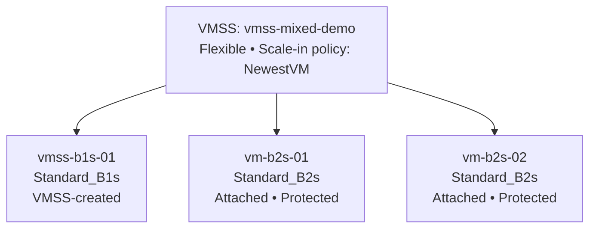
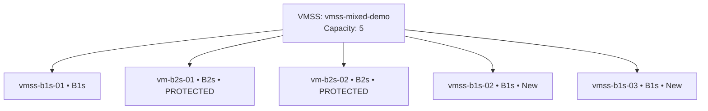
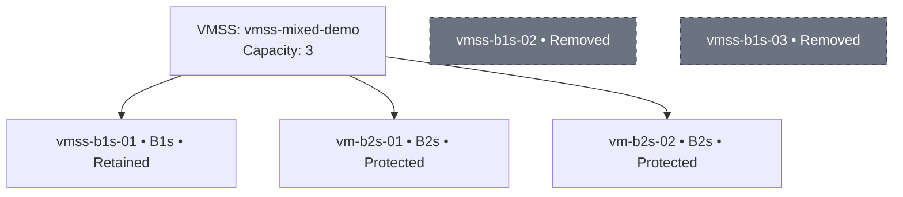

<div align="center">

# Azure VMSS Flexible — Mixed SKU, Protection & Scale-in Policy Lab

### 1 × B1s + 2 × B2s → Scale out by 2 → Scale in by 2


**Learn how Flexible orchestration can group different VM sizes, how scale-in protection works, and how an explicit scale-in policy chooses among eligible instances.**

</div>

---

## 1. What you will build

This lab deliberately uses a mixed-SKU VMSS:

| Stage | VM | Size | How it joins the VMSS | Protection |
|---|---|---|---|---|
| Initial | `vmss-b1s-01` | Standard_B1s | Created by VMSS model | No |
| Initial | `vm-b2s-01` | Standard_B2s | Existing VM attached | Protect from scale-in |
| Initial | `vm-b2s-02` | Standard_B2s | Existing VM attached | Protect from scale-in |
| Scale out | `vmss-b1s-02` | Standard_B1s | Created by VMSS scale-out | No |
| Scale out | `vmss-b1s-03` | Standard_B1s | Created by VMSS scale-out | No |

The scale set's scaling profile uses `Standard_B1s`. The two B2s VMs are attached as independently created VMs. Scaling the VMSS model from 3 to 5 creates two additional B1s instances.

> **Important:** This is a Flexible orchestration lab, not Uniform. Flexible supports standard Azure VM resources and mixed VM configurations. In this example, scale-out through the VMSS capacity command uses the VMSS model's B1s size; it does not automatically choose B2s for the new instances.

## 2. Expected result

### Before scale-out — 3 VMs



### After scale-out — 5 VMs



### After scale-in — 3 VMs

With the two B2s VMs protected and `NewestVM` configured, the two newest **eligible** B1s instances should be selected for scale-in. The original B1s and both protected B2s VMs should remain.



> The diagrams show the expected result for this controlled, non-zonal lab. Always inspect the actual VMSS instance IDs and protection flags before scaling in. Do not rely on a name-only assumption.

---

## 3. Understand the two controls

These settings solve different problems.

### A. Instance protection — should this VM be eligible?

`protectFromScaleIn=true` tells Azure to exclude that VM from scale-in selection.

```bash
az vmss update \
  --resource-group "$RG" \
  --name "$VMSS" \
  --instance-id "<INSTANCE_ID_OF_B2S_VM>" \
  --protect-from-scale-in true
```

For this lab, protect both B2s VMs. Do **not** protect the original B1s, because we want the scale-in policy to be able to consider it if the policy selects it.

Important distinctions:

- Protect from scale-in is not the same as protect from scale-set actions.
- Scale-in protection excludes the instance from scale-in selection; it does not prevent a user from manually deleting the VM.
- Protect from scale-set actions is stronger and also protects against certain scale-set initiated operations such as reimage or upgrade.
- Protection is applied to individual instances, not as a general VMSS-wide policy.
- Verify current Flexible orchestration API/CLI support and version before the lab. Flexible instance protection requires Compute API version `2023-09-01` or later.

### B. Scale-in policy — in what order should eligible VMs be considered?

The VMSS scale-in policy controls the selection order:

| Policy | Meaning |
|---|---|
| `Default` | Azure's default selection behavior, with balancing considerations where applicable |
| `NewestVM` | Prefer the newest eligible VM for removal |
| `OldestVM` | Prefer the oldest eligible VM for removal |

This lab uses:

```bash
az vmss update \
  --resource-group "$RG" \
  --name "$VMSS" \
  --scale-in-policy NewestVM
```

**How they work together:**

1. Azure first excludes instances protected from scale-in.
2. The configured scale-in policy is applied to the remaining eligible instances.
3. With `NewestVM`, the newest eligible instances are preferred for removal.
4. The two protected B2s VMs are not candidates, even if they are newer than the original B1s.

The scale-in policy is not a promise that Azure will ignore zone/fault-domain balancing requirements. This lab is regional/non-zonal to make the behavior easier to observe.

---

## 4. Prerequisites

Run the commands in **Azure Cloud Shell (Bash)** or Ubuntu with Azure CLI.

- An Azure subscription with permission to create VMs, VMSS, VNet, NSG and disks.
- Latest Azure CLI recommended; use Azure CLI `2.66.0+` for current instance-mix related capabilities.
- Quota and regional availability for `Standard_B1s` and `Standard_B2s`.
- SSH public key at `~/.ssh/id_rsa.pub` (or update `SSH_KEY`).
- A test Resource Group. This lab creates billable VMs and disks.

Login and select your subscription:

```bash
az login
az account set --subscription "<SUBSCRIPTION_ID>"
az account show --output table
az version
```

Set variables. Change the region and names if required:

```bash
export RG="rg-vmss-mixed-protection"
export LOCATION="centralindia"
export VNET="vnet-vmss-mixed"
export SUBNET="snet-vmss"
export NSG="nsg-vmss-mixed"
export VMSS="vmss-mixed-demo"
export ADMIN="azureuser"
export SSH_KEY="$HOME/.ssh/id_rsa.pub"
```

Check that the public key exists:

```bash
test -f "$SSH_KEY" && echo "SSH key found: $SSH_KEY"
```

## 5. Create networking

```bash
az group create --name "$RG" --location "$LOCATION"

az network nsg create \
  --resource-group "$RG" \
  --name "$NSG" \
  --location "$LOCATION"

az network nsg rule create \
  --resource-group "$RG" \
  --nsg-name "$NSG" \
  --name Allow-SSH-From-My-IP \
  --priority 100 \
  --direction Inbound \
  --access Allow \
  --protocol Tcp \
  --source-address-prefixes "<YOUR_PUBLIC_IP>/32" \
  --source-port-ranges '*' \
  --destination-address-prefixes '*' \
  --destination-port-ranges 22

az network vnet create \
  --resource-group "$RG" \
  --name "$VNET" \
  --location "$LOCATION" \
  --address-prefixes 10.50.0.0/16 \
  --subnet-name "$SUBNET" \
  --subnet-prefixes 10.50.1.0/24 \
  --network-security-group "$NSG"
```

Replace `<YOUR_PUBLIC_IP>/32` with your own public IP in CIDR format. Do not expose SSH to the whole Internet.

## 6. Create the Flexible VMSS with one B1s instance

The VMSS scaling profile uses `Standard_B1s`. Its first instance is created by the VMSS.

```bash
az vmss create \
  --resource-group "$RG" \
  --name "$VMSS" \
  --location "$LOCATION" \
  --orchestration-mode Flexible \
  --platform-fault-domain-count 1 \
  --single-placement-group false \
  --instance-count 1 \
  --image Ubuntu2204 \
  --vm-sku Standard_B1s \
  --admin-username "$ADMIN" \
  --ssh-key-values "$SSH_KEY" \
  --vnet-name "$VNET" \
  --subnet "$SUBNET" \
  --nsg "$NSG" \
  --scale-in-policy NewestVM
```

Check the VMSS mode and scaling profile:

```bash
az vmss show \
  --resource-group "$RG" \
  --name "$VMSS" \
  --query '{name:name,mode:orchestrationMode,faultDomains:platformFaultDomainCount,capacity:sku.capacity,scaleInPolicy:virtualMachineProfile.scaleInPolicy}' \
  --output yaml
```

Expected key values:

```yaml
name: vmss-mixed-demo
mode: Flexible
faultDomains: 1
scaleInPolicy:
  rules:
  - NewestVM
```

The exact output structure can vary with Azure CLI/API versions.

## 7. Create two standalone B2s VMs

Create the two B2s VMs in the **same Resource Group, region and VNet/subnet**. They are initially normal standalone Azure VMs.

```bash
az vm create \
  --resource-group "$RG" \
  --name vm-b2s-01 \
  --location "$LOCATION" \
  --image Ubuntu2204 \
  --size Standard_B2s \
  --admin-username "$ADMIN" \
  --ssh-key-values "$SSH_KEY" \
  --vnet-name "$VNET" \
  --subnet "$SUBNET" \
  --nsg "$NSG"
```

```bash
az vm create \
  --resource-group "$RG" \
  --name vm-b2s-02 \
  --location "$LOCATION" \
  --image Ubuntu2204 \
  --size Standard_B2s \
  --admin-username "$ADMIN" \
  --ssh-key-values "$SSH_KEY" \
  --vnet-name "$VNET" \
  --subnet "$SUBNET" \
  --nsg "$NSG"
```

Check all three VM resources:

```bash
az vm list \
  --resource-group "$RG" \
  --show-details \
  --query "[].{name:name,size:hardwareProfile.vmSize,location:location,power:powerState}" \
  --output table
```

## 8. Attach both B2s VMs to the Flexible VMSS

Get the VMSS resource ID:

```bash
VMSS_ID=$(az vmss show \
  --resource-group "$RG" \
  --name "$VMSS" \
  --query id -o tsv)

echo "$VMSS_ID"
```

Attach VM 1:

```bash
az vm update \
  --resource-group "$RG" \
  --name vm-b2s-01 \
  --set "virtualMachineScaleSet.id=$VMSS_ID"
```

Attach VM 2:

```bash
az vm update \
  --resource-group "$RG" \
  --name vm-b2s-02 \
  --set "virtualMachineScaleSet.id=$VMSS_ID"
```

Check VMSS members:

```bash
az vmss list-instances \
  --resource-group "$RG" \
  --name "$VMSS" \
  --query "[].{name:name,instanceId:instanceId,sku:hardwareProfile.vmSize}" \
  --output table
```

You should now have three members:

- One `Standard_B1s`
- Two `Standard_B2s`

If the attached VMs do not appear, stop here and troubleshoot attachment before continuing.

## 9. Configure explicit scale-in protection

We want the two B2s VMs to survive the upcoming scale-in.

First identify their VMSS instance IDs:

```bash
az vmss list-instances \
  --resource-group "$RG" \
  --name "$VMSS" \
  --query "[].{name:name,instanceId:instanceId,size:hardwareProfile.vmSize}" \
  --output table
```

Copy the exact `instanceId` for `vm-b2s-01` and `vm-b2s-02`.

Set them individually:

```bash
az vmss update \
  --resource-group "$RG" \
  --name "$VMSS" \
  --instance-id "<INSTANCE_ID_VM_B2S_01>" \
  --protect-from-scale-in true
```

```bash
az vmss update \
  --resource-group "$RG" \
  --name "$VMSS" \
  --instance-id "<INSTANCE_ID_VM_B2S_02>" \
  --protect-from-scale-in true
```

Verify the protection state before moving on:

```bash
az vmss list-instances \
  --resource-group "$RG" \
  --name "$VMSS" \
  --query "[].{name:name,instanceId:instanceId,protectFromScaleIn:protectionPolicy.protectFromScaleIn,size:hardwareProfile.vmSize}" \
  --output table
```

Expected logical state:

| VM | Size | Protect from scale-in |
|---|---|---|
| vmss-b1s-01 | B1s | false |
| vm-b2s-01 | B2s | true |
| vm-b2s-02 | B2s | true |

If the protection field is missing or either B2s VM is not protected, do not proceed until you have verified the instance configuration using the current CLI/API.

### Portal verification

1. Open Azure Portal.
2. Navigate to your VM Scale Set.
3. Select **Instances**.
4. Open `vm-b2s-01`.
5. Find **Protection policy**.
6. Confirm **Protect from scale-in** is enabled.
7. Repeat for `vm-b2s-02`.

## 10. Confirm the explicit scale-in policy

We configured `NewestVM` during VMSS creation. Verify it:

```bash
az vmss show \
  --resource-group "$RG" \
  --name "$VMSS" \
  --query "virtualMachineProfile.scaleInPolicy" \
  --output json
```

If you need to set it again:

```bash
az vmss update \
  --resource-group "$RG" \
  --name "$VMSS" \
  --scale-in-policy NewestVM
```

The intended selection order for this lab is:

1. Exclude `vm-b2s-01` because it is protected.
2. Exclude `vm-b2s-02` because it is protected.
3. Consider the remaining B1s instances.
4. Prefer the newest eligible instances for removal.

## 11. Scale OUT by two — capacity 3 to 5

The initial VMSS membership is 3. Run:

```bash
az vmss scale \
  --resource-group "$RG" \
  --name "$VMSS" \
  --new-capacity 5
```

The VMSS model uses B1s, so the two new model-created instances should be B1s.

Wait for provisioning and inspect:

```bash
az vmss list-instances \
  --resource-group "$RG" \
  --name "$VMSS" \
  --query "[].{name:name,instanceId:instanceId,size:hardwareProfile.vmSize,state:provisioningState,protectFromScaleIn:protectionPolicy.protectFromScaleIn}" \
  --output table
```

Expected logical state:

| VM | Size | Protection |
|---|---|---|
| Original VMSS instance | B1s | No |
| Attached VM 1 | B2s | Yes |
| Attached VM 2 | B2s | Yes |
| New scale-out instance | B1s | No |
| New scale-out instance | B1s | No |

Wait until all five instances are provisioned before scaling in.

> **Teaching note:** `az vmss scale --new-capacity 5` changes VMSS capacity. It uses the VMSS model to create the two additional instances. It is not the same as manually attaching two custom-sized VMs. The B2s VMs were attached separately so that the initial set could have mixed sizes.

## 12. Scale IN by two — capacity 5 to 3

Before executing, inspect all five instances and confirm:

- Both B2s VMs have `protectFromScaleIn=true`.
- The original B1s and the two new B1s are not protected.
- Scale-in policy is `NewestVM`.
- All five VMs are healthy enough for the lab and no important workload is running on the two new VMs.

Now run:

```bash
az vmss scale \
  --resource-group "$RG" \
  --name "$VMSS" \
  --new-capacity 3
```

Azure should select two newest eligible instances. The protected B2s VMs should be excluded from scale-in selection.

Check the remaining instances:

```bash
az vmss list-instances \
  --resource-group "$RG" \
  --name "$VMSS" \
  --query "[].{name:name,instanceId:instanceId,size:hardwareProfile.vmSize,protectFromScaleIn:protectionPolicy.protectFromScaleIn}" \
  --output table
```

Expected result:

| VM | Size | Expected state |
|---|---|---|
| Original VMSS B1s | B1s | Remains |
| `vm-b2s-01` | B2s | Remains — protected |
| `vm-b2s-02` | B2s | Remains — protected |
| Newest B1s instance 1 | B1s | Removed |
| Newest B1s instance 2 | B1s | Removed |

**Important:** Scale-in policy is a selection policy, not a hard guarantee that a named VM will be deleted in every topology. Azure can account for zone/fault-domain balancing, and protected instances are excluded. This lab is deliberately non-zonal and uses a controlled creation sequence to make the expected result easier to see. Always inspect the actual result.

---

## 13. Experiment: change the policy

You can repeat the lab to compare the three scale-in policies.

### Test A — NewestVM

```bash
az vmss update -g "$RG" -n "$VMSS" --scale-in-policy NewestVM
```

Newest eligible VMs are preferred.

### Test B — OldestVM

```bash
az vmss update -g "$RG" -n "$VMSS" --scale-in-policy OldestVM
```

Oldest eligible VMs are preferred. The protected B2s VMs remain excluded.

### Test C — Default

```bash
az vmss update -g "$RG" -n "$VMSS" --scale-in-policy Default
```

Azure uses its default selection behavior, including balancing considerations where applicable.

To safely repeat a policy test, return to five instances, check protection flags, change the policy, and then scale back to three. Do not assume that an instance deleted in a previous test can be restored by increasing capacity; a new VM may be created instead.

---

## 14. Troubleshooting

| Problem | What to check |
|---|---|
| B2s VM cannot attach | Same Resource Group, Flexible mode, fault-domain count 1, compatible zone/placement, managed OS disk and other attachment requirements |
| `Standard_B1s` unavailable | Region capacity, subscription quota, VM SKU availability |
| B2s not listed in VMSS | Confirm `az vm update` completed and inspect VMSS membership |
| Protection update fails | Use current Azure CLI and Compute API; Flexible protection requires API `2023-09-01` or later |
| Scale-in removes an unexpected eligible VM | Verify policy, protection, creation timestamps, zones and fault-domain balancing |
| Scale-in cannot reach target capacity | Check whether enough unprotected eligible VMs exist |
| Scale-out VMs are not ready | Wait for provisioning; inspect VM and extension status |

List VM sizes available in a region:

```bash
az vm list-skus \
  --location "$LOCATION" \
  --resource-type virtualMachines \
  --size Standard_B \
  --output table
```

## 15. Cleanup

This removes the entire Resource Group and all resources inside it:

```bash
az group delete --name "$RG" --yes --no-wait
```

Confirm that you are deleting the correct Resource Group before running this command.

---

## 16. Classroom questions

1. Why can a Flexible VMSS contain both B1s and B2s VMs?
2. Does `protectFromScaleIn=true` stop a user from manually deleting the VM?
3. What is the difference between `protectFromScaleIn` and `protectFromScaleSetActions`?
4. Does `NewestVM` mean Azure always deletes the newest VM, even if it is protected?
5. What happens if all five VMs are protected and we request capacity 3?
6. Why does scaling out with this VMSS model create B1s instances?
7. Does attaching a VM automatically add it to a Load Balancer backend pool?
8. Why should we inspect VMSS instance IDs rather than assume that instance IDs equal VM names?

## 17. Microsoft documentation

- [Attach or detach VMs to/from a Flexible VMSS](https://learn.microsoft.com/azure/virtual-machine-scale-sets/virtual-machine-scale-sets-attach-detach-vm)
- [Instance protection for VMSS instances](https://learn.microsoft.com/azure/virtual-machine-scale-sets/virtual-machine-scale-sets-instance-protection)
- [Scale-in policies](https://learn.microsoft.com/azure/virtual-machine-scale-sets/virtual-machine-scale-sets-scale-in-policy)
- [Create a VMSS using instance mix](https://learn.microsoft.com/azure/virtual-machine-scale-sets/instance-mix-create)
- [Azure CLI VMSS reference](https://learn.microsoft.com/cli/azure/vmss)

---

<div align="center">

**Create → Attach → Protect → Scale OUT → Scale IN → Verify**

</div>
