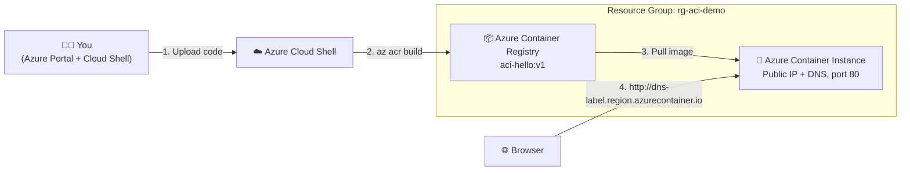

# 🚀 Azure Container Instances (ACI): End-to-End Demo (Portal / UI)

Deploy a containerized Python web app to **Azure Container Instances** using the **Azure Portal UI**, from creating a resource group to opening the app in a browser and cleaning up.

> ⏱️ **Time:** ~25 minutes  ·  💰 **Cost:** a few cents if you clean up afterwards  ·  🧰 **Skill level:** Beginner

---

## 📑 Table of Contents

1. [What you will build](#-what-you-will-build)
2. [Architecture](#-architecture)
3. [Project files](#-project-files)
4. [Prerequisites](#-prerequisites)
5. [Step 1: Create a Resource Group](#step-1-create-a-resource-group)
6. [Step 2: Create an Azure Container Registry (ACR)](#step-2-create-an-azure-container-registry-acr)
7. [Step 3: Enable the ACR Admin user](#step-3-enable-the-acr-admin-user)
8. [Step 4: Upload the code and build the image](#step-4-upload-the-code-and-build-the-image)
9. [Step 5: Verify the image in ACR](#step-5-verify-the-image-in-acr)
10. [Step 6: Create the Container Instance](#step-6-create-the-container-instance)
11. [Step 7: Open and test the app](#step-7-open-and-test-the-app)
12. [Step 8: Monitor, logs and console](#step-8-monitor-logs-and-console)
13. [Step 9: Update to a new version](#step-9-update-to-a-new-version)
14. [Step 10: Clean up](#step-10-clean-up)
15. [Optional: Run locally with Docker](#-optional-run-locally-with-docker)
16. [Optional: Same deployment with Azure CLI](#-optional-same-deployment-with-azure-cli)
17. [Troubleshooting](#-troubleshooting)

---

## 🎯 What you will build

A small **Flask** web app packaged as a Docker image, stored in **Azure Container Registry**, and run on **Azure Container Instances** with a public URL like:

```
http://aci-hello-<yourname>.centralindia.azurecontainer.io
```

| Endpoint     | Description                                  |
|--------------|----------------------------------------------|
| `/`          | Web UI page showing container status         |
| `/health`    | Health check (JSON)                          |
| `/api/info`  | App info: version, hostname, time (JSON)     |

**App preview:**

```
┌─────────────────────────────────────────────┐
│  AZURE CONTAINER INSTANCES                  │
│  Hello from Azure Container Instances       │
│  Your container is running in Azure. 🎉     │
│  ─────────────────────────────────────────  │
│  Status           ● Running                 │
│  Environment      demo                      │
│  Version          1.0.0                     │
│  Container host   SandboxHost-6384...       │
│  Server time      2026-11-09 10:15:02 UTC   │
└─────────────────────────────────────────────┘
```

---

## 🏗️ Architecture



---

## 📁 Project files

```
azure-aci-demo/
├── README.md               ← this guide
├── Dockerfile              ← builds the container image
├── .dockerignore
├── .gitignore
├── app/
│   ├── app.py              ← Flask application
│   ├── requirements.txt    ← Python dependencies
│   └── templates/
│       └── index.html      ← web page UI
└── scripts/
    ├── deploy-cli.sh       ← optional: full deploy with Azure CLI
    └── cleanup.sh          ← deletes all demo resources
```

### `app/app.py`

```python
import os
import socket
from datetime import datetime, timezone

from flask import Flask, jsonify, render_template

app = Flask(__name__)

APP_TITLE = os.getenv("APP_TITLE", "Hello from Azure Container Instances")
APP_ENV = os.getenv("APP_ENV", "demo")
APP_VERSION = os.getenv("APP_VERSION", "1.0.0")


@app.route("/")
def index():
    return render_template(
        "index.html",
        title=APP_TITLE,
        env=APP_ENV,
        version=APP_VERSION,
        hostname=socket.gethostname(),
        time=datetime.now(timezone.utc).strftime("%Y-%m-%d %H:%M:%S UTC"),
    )


@app.route("/health")
def health():
    return jsonify(status="healthy", version=APP_VERSION), 200


@app.route("/api/info")
def info():
    return jsonify(
        title=APP_TITLE,
        environment=APP_ENV,
        version=APP_VERSION,
        hostname=socket.gethostname(),
        utc_time=datetime.now(timezone.utc).isoformat(),
    )


if __name__ == "__main__":
    app.run(host="0.0.0.0", port=int(os.getenv("PORT", "80")))
```

### `app/requirements.txt`

```text
flask==3.0.3
gunicorn==22.0.0
```

### `app/templates/index.html`

<details>
<summary>Click to expand</summary>

```html
<!DOCTYPE html>
<html lang="en">
<head>
  <meta charset="UTF-8" />
  <meta name="viewport" content="width=device-width, initial-scale=1.0" />
  <title>{{ title }}</title>
  <style>
    * { box-sizing: border-box; margin: 0; padding: 0; }
    body {
      font-family: "Segoe UI", system-ui, sans-serif;
      background: linear-gradient(135deg, #0078d4 0%, #003a6c 100%);
      min-height: 100vh; display: flex; align-items: center; justify-content: center;
      color: #1b1b1b; padding: 24px;
    }
    .card {
      background: #fff; border-radius: 14px; max-width: 560px; width: 100%;
      padding: 36px; box-shadow: 0 20px 50px rgba(0,0,0,.25);
    }
    .badge {
      display: inline-block; background: #e6f2fb; color: #0078d4; font-weight: 600;
      font-size: 12px; padding: 4px 10px; border-radius: 999px; letter-spacing: .5px;
    }
    h1 { font-size: 26px; margin: 14px 0 8px; }
    p.sub { color: #555; margin-bottom: 24px; }
    table { width: 100%; border-collapse: collapse; }
    td { padding: 10px 0; border-bottom: 1px solid #eee; font-size: 15px; }
    td:first-child { color: #666; width: 40%; }
    td:last-child { font-family: Consolas, monospace; }
    .ok { color: #107c10; font-weight: 600; }
    footer { margin-top: 22px; font-size: 13px; color: #888; }
    a { color: #0078d4; }
  </style>
</head>
<body>
  <div class="card">
    <span class="badge">AZURE CONTAINER INSTANCES</span>
    <h1>{{ title }}</h1>
    <p class="sub">Your container is running in Azure. 🎉</p>
    <table>
      <tr><td>Status</td><td class="ok">● Running</td></tr>
      <tr><td>Environment</td><td>{{ env }}</td></tr>
      <tr><td>Version</td><td>{{ version }}</td></tr>
      <tr><td>Container host</td><td>{{ hostname }}</td></tr>
      <tr><td>Server time</td><td>{{ time }}</td></tr>
    </table>
    <footer>Endpoints: <a href="/health">/health</a> · <a href="/api/info">/api/info</a></footer>
  </div>
</body>
</html>
```

</details>

### `Dockerfile`

```dockerfile
FROM python:3.12-slim

ENV PYTHONDONTWRITEBYTECODE=1 \
    PYTHONUNBUFFERED=1 \
    PORT=80

WORKDIR /app

COPY app/requirements.txt .
RUN pip install --no-cache-dir -r requirements.txt

COPY app/ .

EXPOSE 80

CMD ["gunicorn", "--bind", "0.0.0.0:80", "--workers", "2", "app:app"]
```

### `.dockerignore`

```text
.git
__pycache__/
*.pyc
.venv/
README.md
scripts/
docs/
```

---

## ✅ Prerequisites

| Requirement | Notes |
|---|---|
| Azure subscription | Free trial works → <https://azure.microsoft.com/free> |
| Role | **Contributor** (or Owner) on the subscription / resource group |
| Browser | Everything is done in the Azure Portal and Azure Cloud Shell. **No local Docker needed.** |
| Project files | This folder, zipped as `azure-aci-demo.zip` |

### 🔖 Names used in this guide

Replace `<yourname>` with something unique (e.g. your initials + a number).

| Resource | Example name | Rule |
|---|---|---|
| Resource group | `rg-aci-demo` | Unique within your subscription |
| Region | `Central India` | Use the **same region** for everything |
| Container registry | `acrdemo<yourname>` | Globally unique, **lowercase letters & numbers only**, 5–50 chars |
| Image | `aci-hello:v1` | `repository:tag` |
| Container instance | `aci-hello-demo` | Lowercase, numbers, hyphens |
| DNS name label | `aci-hello-<yourname>` | Unique within the region |

---

## Step 1: Create a Resource Group

A resource group is a folder that holds all demo resources, so you can delete everything with one click at the end.

1. Sign in to the **[Azure Portal](https://portal.azure.com)**.
2. In the top search bar, type **`Resource groups`** and select it.
3. Click **➕ Create**.
4. Fill in the **Basics** tab:

   | Field | Value |
   |---|---|
   | Subscription | *your subscription* |
   | Resource group | `rg-aci-demo` |
   | Region | `Central India` |

5. Click **Review + create** → **Create**.

> ✅ **Check:** You get the notification *“Resource group created”*.

---

## Step 2: Create an Azure Container Registry (ACR)

ACR is your private Docker image store in Azure.

1. In the top search bar, type **`Container registries`** and select it.
2. Click **➕ Create**.
3. **Basics** tab:

   | Field | Value |
   |---|---|
   | Subscription | *your subscription* |
   | Resource group | `rg-aci-demo` |
   | Registry name | `acrdemo<yourname>` |
   | Location | `Central India` |
   | Pricing plan (SKU) | **Basic** |

4. Leave **Networking**, **Encryption** and **Tags** at their defaults.
5. Click **Review + create** → **Create**.
6. Wait about 1 minute, then click **Go to resource**.

> 📝 **Note:** On the **Overview** page, copy the **Login server**, e.g. `acrdemo<yourname>.azurecr.io`. You will need it later.

---

## Step 3: Enable the ACR Admin user

The portal's Container Instance wizard uses the registry's admin credentials to pull images, so turn them on.

1. In your container registry, open **Settings → Access keys** in the left menu.
2. Switch **Admin user** to **Enabled** (checked).
3. You will now see a **Username** and **password / password2**. ACI will pick these up automatically in Step 6.

> 🔐 **Production tip:** For real workloads, use a **managed identity** with the `AcrPull` role instead of the admin user.

---

## Step 4: Upload the code and build the image

We build the image **inside Azure** with **ACR Tasks** (`az acr build`), so you don't need Docker on your PC. Cloud Shell runs in your browser.

### 4.1 Open Cloud Shell

1. Click the **Cloud Shell** icon `>_` in the top bar of the portal.
2. Choose **Bash**.
3. If asked about storage, pick **No storage account required** (or create one), choose your subscription and click **Apply**.

### 4.2 Upload the project zip

1. In the Cloud Shell toolbar, click **Manage files → Upload** (older UI: the **⬆️ Upload/Download** icon).
2. Select `azure-aci-demo.zip` from your computer.
3. Unzip it and go into the folder:

```bash
unzip azure-aci-demo.zip
cd azure-aci-demo
ls
# Dockerfile  README.md  app  scripts
```

> 💡 **Using GitHub instead?** Run `git clone https://github.com/<you>/azure-aci-demo.git && cd azure-aci-demo`.

### 4.3 Build and push the image to ACR

```bash
ACR_NAME=acrdemo<yourname>          # ← your registry name (no .azurecr.io)

az acr build --registry $ACR_NAME --image aci-hello:v1 .
```

You'll see the Docker build output streaming, ending with something like:

```
Successfully tagged acrdemo<yourname>.azurecr.io/aci-hello:v1
...
Run ID: ca1 was successful after 45s
```

---

## Step 5: Verify the image in ACR

1. Go back to your **Container registry** in the portal.
2. Open **Services → Repositories**.
3. You should see a repository called **`aci-hello`**. Click it and you'll find the tag **`v1`**.

> ✅ **Check:** `aci-hello` → `v1` is listed with a digest and a *Last modified* date.

---

## Step 6: Create the Container Instance

1. In the top search bar, type **`Container instances`** and select it.
2. Click **➕ Create**.

### 6.1 Basics tab

| Field | Value |
|---|---|
| Subscription | *your subscription* |
| Resource group | `rg-aci-demo` |
| Container name | `aci-hello-demo` |
| Region | `Central India` |
| Availability zones | *None* |
| SKU | **Standard** |
| Image source | **Azure Container Registry** |
| Run with Azure Spot discount | *Unchecked* |
| Registry | `acrdemo<yourname>` |
| Image | `aci-hello` |
| Image tag | `v1` |
| OS type | **Linux** |
| Size | Click **Change size** → **1 vCPU, 1.5 GiB memory, 0 GPUs** → **OK** |

> ⚠️ If the **Registry** dropdown shows an error about admin credentials, go back to [Step 3](#step-3-enable-the-acr-admin-user).

Click **Next: Networking >**.

### 6.2 Networking tab

| Field | Value |
|---|---|
| Networking type | **Public** |
| DNS name label | `aci-hello-<yourname>` |
| DNS name label scope reuse | *Tenant* (default) |
| Ports | `80` / **TCP** (already there by default) |

> ✅ A green tick next to the DNS label means the name is available.

Click **Next: Monitoring >** (if shown), keep the defaults, then **Next: Advanced >**.

### 6.3 Advanced tab

| Field | Value |
|---|---|
| Restart policy | **Always** (web apps should keep running) |
| Environment variables | Add the 3 rows below |
| Command override | *leave empty* (uses the Dockerfile `CMD`) |

| Mark as secure | Key | Value |
|---|---|---|
| No | `APP_TITLE` | `Hello from Azure Container Instances` |
| No | `APP_ENV` | `demo` |
| No | `APP_VERSION` | `1.0.0` |

> 🔒 Mark an environment variable as **secure** (Yes) for secrets such as connection strings. Secure values are hidden in the portal and API.

### 6.4 Tags tab (optional)

| Name | Value |
|---|---|
| `project` | `aci-demo` |
| `owner` | `<yourname>` |

### 6.5 Review + create

1. Click **Review + create**.
2. Wait for **Validation passed**.
3. Click **Create**.
4. Deployment takes about **1–2 minutes**. Click **Go to resource** when it finishes.

---

## Step 7: Open and test the app

1. On the Container Instance **Overview** page, check:

   | Property | Expected |
   |---|---|
   | Status | **Running** |
   | IP address (Public) | e.g. `20.xx.xx.xx` |
   | FQDN | `aci-hello-<yourname>.centralindia.azurecontainer.io` |

2. Copy the **FQDN** and open it in a new browser tab:

   ```
   http://aci-hello-<yourname>.centralindia.azurecontainer.io
   ```

   > ⚠️ Use **http://**, not https. ACI does not provide TLS on its own (see [Troubleshooting](#-troubleshooting)).

3. You'll see the blue **“Hello from Azure Container Instances”** page. 🎉

4. Test the API endpoints:

   ```
   http://aci-hello-<yourname>.centralindia.azurecontainer.io/health
   → {"status":"healthy","version":"1.0.0"}

   http://aci-hello-<yourname>.centralindia.azurecontainer.io/api/info
   → {"environment":"demo","hostname":"...","title":"...","utc_time":"...","version":"1.0.0"}
   ```

   Or from Cloud Shell:

   ```bash
   curl http://aci-hello-<yourname>.centralindia.azurecontainer.io/health
   ```

---

## Step 8: Monitor, logs and console

All of this is under the Container Instance → **Settings → Containers**. Select the container `aci-hello-demo` in the list, then use the tabs at the bottom:

| Tab | What you see |
|---|---|
| **Events** | Pulling → Pulled → Created → Started |
| **Properties** | Image, ports, CPU/memory, environment variables |
| **Logs** | Gunicorn output, e.g. `Listening at: http://0.0.0.0:80` |
| **Connect** | Opens a shell inside the running container. Choose `/bin/sh` → **Connect** |

Try in **Connect**:

```sh
hostname
env | grep APP_
python -c "import flask; print(flask.__version__)"
exit
```

**Metrics:** open **Monitoring → Metrics** and add **CPU Usage**, **Memory Usage**, or **Network Bytes Received Per Second**.

**Container actions** (top of the Overview page): **Start**, **Restart**, **Stop**, **Delete**.

> 💡 **Stop** releases compute, and you are **not billed** while the container group is stopped. The public IP may change when you start it again, but the **FQDN stays the same**.

---

## Step 9: Update to a new version

ACI does not support changing the image in place from the portal, so the simplest UI flow is: **build v2 → delete the old instance → create a new one with tag v2** (same DNS label).

1. Edit the app. For example, in Cloud Shell:

   ```bash
   cd ~/azure-aci-demo
   sed -i 's/Your container is running in Azure. 🎉/Version 2 is live! 🚀/' app/templates/index.html
   az acr build --registry $ACR_NAME --image aci-hello:v2 .
   ```

2. Check **ACR → Repositories → aci-hello**. Both `v1` and `v2` are listed.
3. Delete the current container instance: **Overview → Delete → Yes**.
4. Repeat [Step 6](#step-6-create-the-container-instance) with **Image tag = `v2`**, `APP_VERSION = 2.0.0`, and the **same DNS name label**.
5. Refresh the browser. The page now says *“Version 2 is live! 🚀”*.

> 💡 With the CLI you can update in place by running `az container create` again with the same name and the new image tag.

---

## Step 10: Clean up

Delete everything so you stop paying:

1. Go to **Resource groups** → `rg-aci-demo`.
2. Click **🗑️ Delete resource group**.
3. Type the name `rg-aci-demo` to confirm → **Delete**.

Or from Cloud Shell:

```bash
bash scripts/cleanup.sh
```

> ✅ After a few minutes, the resource group, registry and container instance are all gone.

---

## 🐳 Optional: Run locally with Docker

If you have Docker Desktop installed:

```bash
docker build -t aci-hello:v1 .
docker run --rm -p 8080:80 -e APP_ENV=local aci-hello:v1
# open http://localhost:8080
```

Push a locally built image to ACR instead of using `az acr build`:

```bash
az login
az acr login --name acrdemo<yourname>
docker tag aci-hello:v1 acrdemo<yourname>.azurecr.io/aci-hello:v1
docker push acrdemo<yourname>.azurecr.io/aci-hello:v1
```

---

## ⚡ Optional: Same deployment with Azure CLI

`scripts/deploy-cli.sh` performs Steps 1–7 in one go:

```bash
cd ~/azure-aci-demo
LOCATION=centralindia bash scripts/deploy-cli.sh
# ...
# Done! Open: http://aci-hello-12345.centralindia.azurecontainer.io
```

<details>
<summary>View <code>scripts/deploy-cli.sh</code></summary>

```bash
#!/usr/bin/env bash
set -euo pipefail

RG="${RG:-rg-aci-demo}"
LOCATION="${LOCATION:-centralindia}"
ACR="${ACR:-acracidemo$RANDOM}"
ACI="${ACI:-aci-hello-demo}"
DNS="${DNS:-aci-hello-$RANDOM}"
IMAGE="aci-hello:v1"

az group create -n "$RG" -l "$LOCATION"
az acr create -g "$RG" -n "$ACR" --sku Basic --admin-enabled true
az acr build -r "$ACR" -t "$IMAGE" .

ACR_SERVER=$(az acr show -n "$ACR" --query loginServer -o tsv)
ACR_USER=$(az acr credential show -n "$ACR" --query username -o tsv)
ACR_PASS=$(az acr credential show -n "$ACR" --query "passwords[0].value" -o tsv)

az container create -g "$RG" -n "$ACI" \
  --image "$ACR_SERVER/$IMAGE" \
  --registry-login-server "$ACR_SERVER" \
  --registry-username "$ACR_USER" \
  --registry-password "$ACR_PASS" \
  --os-type Linux --cpu 1 --memory 1.5 \
  --ports 80 --ip-address Public --dns-name-label "$DNS" \
  --restart-policy Always \
  --environment-variables APP_TITLE="Hello from ACI (CLI)" APP_ENV=demo APP_VERSION=1.0.0

FQDN=$(az container show -g "$RG" -n "$ACI" --query ipAddress.fqdn -o tsv)
echo "Done! Open: http://$FQDN"
```

</details>

Useful CLI commands:

```bash
az container show   -g rg-aci-demo -n aci-hello-demo -o table   # status
az container logs   -g rg-aci-demo -n aci-hello-demo            # logs
az container attach -g rg-aci-demo -n aci-hello-demo            # live output
az container exec   -g rg-aci-demo -n aci-hello-demo --exec-command "/bin/sh"
az container restart -g rg-aci-demo -n aci-hello-demo
az container stop    -g rg-aci-demo -n aci-hello-demo
```

---

## 🛠️ Troubleshooting

| Problem | Cause | Fix |
|---|---|---|
| Registry dropdown in ACI wizard shows an error / no images | ACR admin user disabled | [Step 3](#step-3-enable-the-acr-admin-user): enable **Admin user** |
| `az acr build` fails with *registry not found* | Typo, or you used the full login server | Use only the name, e.g. `acrdemo<yourname>` |
| `az acr build` says *TasksOperationsNotAllowed* | ACR Tasks are blocked on some free/trial subscriptions | Build locally with Docker and `docker push` (see [Optional: Run locally](#-optional-run-locally-with-docker)) |
| *DNS name label not available* | Someone already uses it in that region | Choose a more unique label |
| Status stuck in **Waiting** / **Pending** | Image pull failing or region capacity | Check **Containers → Events**; try another size or region |
| State **Terminated**, restart count rising | App crashes on start | Check **Containers → Logs** |
| Browser can't connect | Wrong port, or `https://` used | Port **80/TCP** must be open; use `http://` |
| Need HTTPS | ACI has no built-in TLS | Put **Azure Application Gateway / Front Door** in front, add a Caddy/Nginx sidecar, or use **Azure Container Apps** |
| *Resource provider not registered* | `Microsoft.ContainerInstance` not registered yet | **Subscription → Resource providers** → register `Microsoft.ContainerInstance` and `Microsoft.ContainerRegistry` |

---

## 📚 Concepts recap

| Term | Meaning |
|---|---|
| **Container group** | The ACI unit of deployment. One or more containers sharing a host, network and lifecycle (like a Kubernetes pod). |
| **Restart policy** | `Always` (web apps), `OnFailure` / `Never` (batch jobs). |
| **DNS name label** | Gives a stable FQDN: `<label>.<region>.azurecontainer.io`. |
| **ACR Tasks** | Build images in the cloud with `az acr build`, no local Docker required. |
| **Billing** | Per second, based on the vCPU and memory allocated while the group is running. |

## 🔗 References

- Azure Container Instances docs: <https://learn.microsoft.com/azure/container-instances/>
- Quickstart (portal): <https://learn.microsoft.com/azure/container-instances/container-instances-quickstart-portal>
- Azure Container Registry docs: <https://learn.microsoft.com/azure/container-registry/>
- ACR Tasks quick build: <https://learn.microsoft.com/azure/container-registry/container-registry-tutorial-quick-task>
- ACI pricing: <https://azure.microsoft.com/pricing/details/container-instances/>

---

<p align="center">Made for learning · Delete your resources when you're done 🧹</p>
