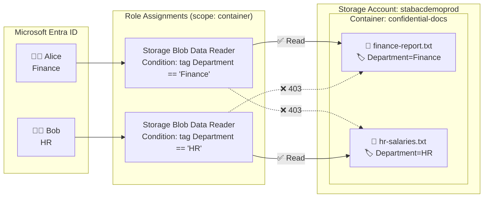
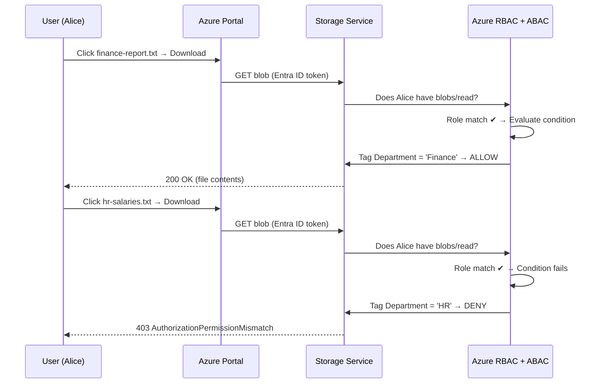

<div align="center">

# 🔐 Azure Storage Account + ABAC Demo
### Attribute-Based Access Control for Blob Storage: Production-Ready, 2-User Walkthrough


-blueviolet?style=for-the-badge)

**Two users. One container. Each user reads only the blobs tagged for their department.**

[Overview](#-overview) •
[Architecture](#-architecture) •
[Prerequisites](#-prerequisites) •
[Step-by-Step](#-step-by-step-setup-azure-portal) •
[Testing](#-test-the-demo) •
[Production Hardening](#-production-hardening-checklist) •
[Troubleshooting](#-troubleshooting)

</div>

---

## 📖 Overview

**Azure ABAC** extends Azure RBAC with **role assignment conditions**. Instead of granting a user access to an entire container, you grant access to blobs that match specific **attributes**, such as a blob index tag.

In this demo:

| | 👩‍💼 User 1 | 👨‍💼 User 2 |
|---|---|---|
| **Name** | Alice Finance | Bob HR |
| **UPN** | `alice@<yourtenant>.onmicrosoft.com` | `bob@<yourtenant>.onmicrosoft.com` |
| **Department** | Finance | HR |
| **Role** | Storage Blob Data Reader **+ condition** | Storage Blob Data Reader **+ condition** |
| **Condition** | Blob tag `Department` = `Finance` | Blob tag `Department` = `HR` |
| **Can read** | ✅ `finance-report.txt` | ✅ `hr-salaries.txt` |
| **Cannot read** | ❌ `hr-salaries.txt` | ❌ `finance-report.txt` |

> 💡 **Why ABAC?** Without it, you'd need one container per department (or per user). With ABAC, a single container scales to any number of departments with **one tag and one condition**.

---

## 🏗 Architecture



### Access Evaluation Flow



---

## ✅ Prerequisites

| Requirement | Details |
|---|---|
| 🔑 **Azure subscription** | Any subscription where you can create resources |
| 👑 **Admin permissions** | `Owner` or `User Access Administrator` + `Contributor` on the resource group (to create role assignments with conditions) |
| 🧑‍🤝‍🧑 **Entra ID permissions** | `User Administrator` (to create the 2 demo users), or use existing users |
| 🗂 **Data permissions for admin** | `Storage Blob Data Owner` on the storage account (to upload blobs and set index tags) |
| 🌐 **Browser** | Two browser profiles or one InPrivate/Incognito window to sign in as each user |

> ⚠️ **Important:** Blob index tags are **not supported** on accounts with **Hierarchical namespace (ADLS Gen2)** enabled. Keep it **disabled** for this demo.

---

## 🛠 Step-by-Step Setup (Azure Portal)

### 📋 Naming Reference

| Resource | Value used in this guide |
|---|---|
| Resource group | `rg-abac-demo-prod` |
| Region | `Central India` (or your nearest) |
| Storage account | `stabacdemoprod<unique>` (lowercase, 3–24 chars, globally unique) |
| Container | `confidential-docs` |
| Tag key | `Department` |
| Tag values | `Finance`, `HR` |

---

### Step 1️⃣ — Create the Two Demo Users

<details open>
<summary><b>🧑‍💻 Click to expand</b></summary>

1. Go to **[portal.azure.com](https://portal.azure.com)** → search **Microsoft Entra ID** → open it.
2. Left menu → **Users** → **+ New user** → **Create new user**.
3. Fill in **User 1**:

   | Field | Value |
   |---|---|
   | User principal name | `alice` @ `<yourtenant>.onmicrosoft.com` |
   | Display name | `Alice Finance` |
   | Password | Auto-generate → **copy it** |
   | *(Properties tab)* Department | `Finance` |

4. Click **Review + create** → **Create**.
5. Repeat for **User 2**:

   | Field | Value |
   |---|---|
   | User principal name | `bob` @ `<yourtenant>.onmicrosoft.com` |
   | Display name | `Bob HR` |
   | Password | Auto-generate → **copy it** |
   | *(Properties tab)* Department | `HR` |

> 📝 Both users must change their password on first sign-in. Do this now in an InPrivate window to save time later.

</details>

---

### Step 2️⃣ — Create the Resource Group

<details open>
<summary><b>📦 Click to expand</b></summary>

1. Search **Resource groups** → **+ Create**.
2. **Subscription:** your subscription
3. **Resource group:** `rg-abac-demo-prod`
4. **Region:** `Central India`
5. **Tags** tab (recommended for production):

   | Name | Value |
   |---|---|
   | `Environment` | `Production` |
   | `Owner` | `<your-team>` |
   | `Workload` | `abac-demo` |

6. **Review + create** → **Create**.

</details>

---

### Step 3️⃣ — Create the Storage Account (Production Settings)

<details open>
<summary><b>💾 Click to expand</b></summary>

Search **Storage accounts** → **+ Create**, then configure each tab:

#### 🔹 Basics

| Setting | Value |
|---|---|
| Resource group | `rg-abac-demo-prod` |
| Storage account name | `stabacdemoprod<unique>` |
| Region | `Central India` |
| Primary service | `Azure Blob Storage or Azure Data Lake Storage Gen2` |
| Performance | **Standard** |
| Redundancy | **Zone-redundant storage (ZRS)** *(or GZRS for geo-resilience)* |

#### 🔹 Advanced

| Setting | Value | Why |
|---|---|---|
| Require secure transfer for REST API operations | ✅ **Enabled** | HTTPS only |
| Allow enabling anonymous access on individual containers | ❌ **Disabled** | No public blobs |
| Enable storage account key access | ❌ **Disabled** | 🔥 **Critical:** shared keys bypass ABAC |
| Default to Microsoft Entra authorization in the Azure portal | ✅ **Enabled** | Portal uses user identity, so ABAC applies |
| Minimum TLS version | **Version 1.2** | Security baseline |
| Permitted scope for copy operations | **From storage accounts in the same Microsoft Entra tenant** | Limit data exfiltration |
| **Enable hierarchical namespace** | ❌ **Disabled** | ⚠️ Required for blob index tags |
| Access tier | **Hot** | |

#### 🔹 Networking

| Setting | Value |
|---|---|
| Network access | **Enable public access from selected virtual networks and IP addresses** |
| IP addresses | Add your client IP *(checkbox "Add your client IP address")* |

> 🏭 **Full production:** use **Disable public access and use private access** with a **Private Endpoint** (`blob` sub-resource) + Private DNS zone `privatelink.blob.core.windows.net`. For a live demo, selected-IP access is easier.

#### 🔹 Data protection

| Setting | Value |
|---|---|
| Enable soft delete for blobs | ✅ 14 days |
| Enable soft delete for containers | ✅ 14 days |
| Enable versioning for blobs | ✅ Enabled |

#### 🔹 Encryption

| Setting | Value |
|---|---|
| Encryption type | Microsoft-managed keys *(or customer-managed keys in Key Vault for regulated workloads)* |
| Enable infrastructure encryption | ✅ Enabled *(cannot be changed later)* |

Click **Review + create** → **Create** → **Go to resource**.

</details>

---

### Step 4️⃣ — Grant Yourself (Admin) Data Access

<details open>
<summary><b>👑 Click to expand</b></summary>

Because shared-key access is disabled, even the subscription Owner needs a **data-plane** role to upload blobs.

1. Storage account → **Access control (IAM)** → **+ Add** → **Add role assignment**.
2. **Role:** `Storage Blob Data Owner` → **Next**.
3. **Members:** **+ Select members** → choose **yourself** → **Select**.
4. **Review + assign**.

⏳ Wait **2–5 minutes** for the assignment to propagate.

</details>

---

### Step 5️⃣ — Create the Container

<details open>
<summary><b>🗃 Click to expand</b></summary>

1. Storage account → **Data storage** → **Containers** → **+ Container**.
2. **Name:** `confidential-docs`
3. **Anonymous access level:** `Private (no anonymous access)`
4. **Create**.

</details>

---

### Step 6️⃣ — Upload Blobs with Index Tags

<details open>
<summary><b>🏷 Click to expand</b></summary>

First, create two small text files on your machine:

| File | Content |
|---|---|
| `finance-report.txt` | `Q3 revenue: CONFIDENTIAL — Finance only` |
| `hr-salaries.txt` | `Salary bands: CONFIDENTIAL — HR only` |

Then:

1. Open container **`confidential-docs`** → **Upload**.
2. Select **`finance-report.txt`**.
3. Expand **Advanced**:
   - **Blob index tags** → Key: `Department` | Value: `Finance`
4. **Upload**.
5. Repeat for **`hr-salaries.txt`** with tag `Department` = `HR`.

**✔ Verify:** click each blob → **Blob index tags** tab → confirm the correct tag.

```
📁 confidential-docs
├── 📄 finance-report.txt   🏷 Department = Finance
└── 📄 hr-salaries.txt      🏷 Department = HR
```

> ⚠️ Tag keys and values are **case-sensitive**. `finance` ≠ `Finance`.

</details>

---

### Step 7️⃣ — Give Both Users Portal Visibility (Control Plane)

<details open>
<summary><b>👀 Click to expand</b></summary>

Data roles alone don't let a user *find* the storage account in the portal. Give them read-only visibility on the management plane:

1. Storage account → **Access control (IAM)** → **+ Add** → **Add role assignment**.
2. **Role:** `Reader` → **Next**.
3. **Members:** select **Alice Finance** and **Bob HR** → **Select**.
4. **Review + assign**.

> 🔒 `Reader` grants **no data access** and cannot list keys. It's safe to assign.

</details>

---

### Step 8️⃣ — Create the ABAC Role Assignment for Alice (Finance) ⭐

<details open>
<summary><b>🎯 Click to expand: this is the core of the demo</b></summary>

1. Go to container **`confidential-docs`** → **Access control (IAM)**.
   > Scoping to the **container** (not the account) follows least privilege.
2. **+ Add** → **Add role assignment**.
3. **Role** tab → select **`Storage Blob Data Reader`** → **Next**.
4. **Members** tab → **+ Select members** → **Alice Finance** → **Select** → **Next**.
5. **Conditions** tab → **+ Add condition**.
6. In the **Add role assignment condition** page, use the **Visual** editor:

#### 🔸 Add action

| Field | Value |
|---|---|
| Click | **+ Add action** |
| Select | ☑ **Read a blob** |
| Click | **Select** |

#### 🔸 Build expression

| Field | Value |
|---|---|
| Click | **+ Add expression** |
| Attribute source | **Resource** |
| Attribute | **Blob index tags [Values in key]** |
| Key | `Department` |
| Operator | **StringEquals** |
| Value | `Finance` |

7. Click **Save** → confirm the condition summary looks correct.
8. **Review + assign** → **Review + assign**.

#### 🧾 Equivalent condition (Code view)

Switch the editor to **Code** to see / paste:

```text
(
 (
  !(ActionMatches{'Microsoft.Storage/storageAccounts/blobServices/containers/blobs/read'} AND NOT SubOperationMatches{'Blob.List'})
 )
 OR
 (
  @Resource[Microsoft.Storage/storageAccounts/blobServices/containers/blobs/tags:Department<$key_case_sensitive$>] StringEquals 'Finance'
 )
)
```

**How to read it:** *"If the action is not a blob read, this condition doesn't apply. If it is a blob read, allow it only when the blob's `Department` tag equals `Finance`."*

</details>

---

### Step 9️⃣ — Create the ABAC Role Assignment for Bob (HR) ⭐

<details open>
<summary><b>🎯 Click to expand</b></summary>

Repeat **Step 8** with these changes:

| Field | Value |
|---|---|
| Member | **Bob HR** |
| Expression → Value | `HR` |

Code view:

```text
(
 (
  !(ActionMatches{'Microsoft.Storage/storageAccounts/blobServices/containers/blobs/read'} AND NOT SubOperationMatches{'Blob.List'})
 )
 OR
 (
  @Resource[Microsoft.Storage/storageAccounts/blobServices/containers/blobs/tags:Department<$key_case_sensitive$>] StringEquals 'HR'
 )
)
```

**✔ Verify:** container → **Access control (IAM)** → **Role assignments** tab. You should see:

| Name | Role | Scope | Condition |
|---|---|---|---|
| Alice Finance | Storage Blob Data Reader | This resource | **View/Edit** ✅ |
| Bob HR | Storage Blob Data Reader | This resource | **View/Edit** ✅ |

⏳ Wait **5–10 minutes** before testing (role assignment propagation).

</details>

---

## 🧪 Test the Demo

Open a **new InPrivate / Incognito window** for each user.

### 👩‍💼 Test as Alice (Finance)

1. Sign in to **portal.azure.com** as `alice@<yourtenant>.onmicrosoft.com`.
2. **Storage accounts** → `stabacdemoprod<unique>` → **Containers** → `confidential-docs`.
3. Confirm the top bar shows **Authentication method: Microsoft Entra user account**.
   *(If it says Access key, click **Switch to Microsoft Entra user account**.)*

| Action | Expected Result |
|---|---|
| List blobs in container | ✅ Both blob **names** are visible *(see note below)* |
| Click `finance-report.txt` → **Download** / **Edit** | ✅ **Success**: content shown |
| Click `hr-salaries.txt` → **Download** / **Edit** | ❌ **403: This request is not authorized to perform this operation using this permission** |

### 👨‍💼 Test as Bob (HR)

| Action | Expected Result |
|---|---|
| List blobs in container | ✅ Both blob **names** are visible |
| Click `hr-salaries.txt` → **Download** | ✅ **Success** |
| Click `finance-report.txt` → **Download** | ❌ **403 AuthorizationPermissionMismatch** |

### 📊 Results Matrix

| | `finance-report.txt` | `hr-salaries.txt` |
|---|:---:|:---:|
| 👩‍💼 **Alice (Finance)** | 🟢 ALLOW | 🔴 DENY |
| 👨‍💼 **Bob (HR)** | 🔴 DENY | 🟢 ALLOW |

> ℹ️ **Why can both users see both file names?** Listing blobs (`Blob.List`) cannot be filtered by blob index tags. The condition excludes it on purpose, so listing is allowed, but **reading contents is protected**. If file names themselves are sensitive, separate them by **container** or **path prefix** and use a condition on `containers:name` or `blobs:path`.

---

## 🛡 Production Hardening Checklist

| # | Control | Where in Portal | Status |
|:-:|---|---|:-:|
| 1 | Storage account **key access disabled** | Storage account → Settings → **Configuration** → *Allow storage account key access* = Disabled | ☐ |
| 2 | **Anonymous blob access disabled** | Configuration → *Allow Blob anonymous access* = Disabled | ☐ |
| 3 | **Minimum TLS 1.2** | Configuration → *Minimum TLS version* | ☐ |
| 4 | **Private Endpoint** + public access disabled | Security + networking → **Networking** | ☐ |
| 5 | **Diagnostic logs** to Log Analytics (`StorageRead`, `StorageWrite`, `StorageDelete`) | Monitoring → **Diagnostic settings** → blob → + Add | ☐ |
| 6 | **Microsoft Defender for Storage** enabled | Security + networking → **Microsoft Defender for Cloud** | ☐ |
| 7 | **Soft delete + versioning** | Data management → **Data protection** | ☐ |
| 8 | **Resource lock** (`CanNotDelete`) | Settings → **Locks** → + Add | ☐ |
| 9 | **Restrict who can set tags**: only admins hold `Storage Blob Data Owner` | Access control (IAM) | ☐ |
| 10 | Prefer **groups** over individual users for role assignments | Entra ID → Groups | ☐ |
| 11 | Use **PIM** for admin roles (just-in-time) | Entra ID → **Privileged Identity Management** | ☐ |
| 12 | **Azure Policy**: deny key access & public access across subscriptions | Policy → Assign built-in policies | ☐ |

> 🔥 **Most important rule:** ABAC conditions only apply to **Microsoft Entra ID** requests. Anyone with an **account key** or an **account SAS** bypasses ABAC completely. Keep key access disabled.

> 🔥 **Second most important rule:** whoever can **write blob tags** can change who sees a blob. Never give end users `Storage Blob Data Owner` or the `blobs/tags/write` permission.

---

## 🚀 Scaling Beyond 2 Users (Optional)

<details>
<summary><b>👥 Option A: Use Entra security groups (recommended)</b></summary>

1. Create groups `grp-finance-readers` and `grp-hr-readers`.
2. Add Alice to Finance, Bob to HR.
3. Assign the conditional roles to the **groups** instead of the users.

Onboarding a new Finance employee becomes **"add to group"**, with no IAM changes needed.

</details>

<details>
<summary><b>🏷 Option B: One role assignment for everyone, using principal attributes</b></summary>

Use **Entra custom security attributes** so a single role assignment matches the user's attribute against the blob tag.

**Requirements:** Entra ID P1/P2, and the roles **Attribute Definition Administrator** and **Attribute Assignment Administrator** (even Global Admins don't have these by default).

1. **Entra ID** → **Custom security attributes** → **+ Add attribute set** → name `Organization`.
2. Open the set → **+ Add attribute** → name `Department`, type `String`, *Allow multiple values* = No, *Only allow predefined values* = Yes → add `Finance`, `HR`.
3. **Users** → Alice → **Custom security attributes** → **+ Add assignment** → `Organization` / `Department` = `Finance`. Repeat for Bob = `HR`.
4. Create **one** `Storage Blob Data Reader` assignment for a group containing both users, with this condition:

```text
(
 (
  !(ActionMatches{'Microsoft.Storage/storageAccounts/blobServices/containers/blobs/read'} AND NOT SubOperationMatches{'Blob.List'})
 )
 OR
 (
  @Resource[Microsoft.Storage/storageAccounts/blobServices/containers/blobs/tags:Department<$key_case_sensitive$>] StringEquals @Principal[Microsoft.Directory/CustomSecurityAttributes/Id:Organization_Department]
 )
)
```

In the visual editor: Expression → Attribute source **Resource** / **Blob index tags [Values in key]** / key `Department` → Operator **StringEquals** → Value: switch **Option** to **Attribute** → source **Principal** → `Organization_Department`.

</details>

<details>
<summary><b>✏️ Option C: Let users upload only into their own department</b></summary>

Add a second assignment of `Storage Blob Data Contributor` with actions **Write to a blob with blob index tags** and **Write to a blob**, and expression:

| Attribute source | Attribute | Key | Operator | Value |
|---|---|---|---|---|
| **Request** | Blob index tags [Values in key] | `Department` | StringEquals | `Finance` |

This forces Alice to tag every upload `Department=Finance`. She can't plant a file in HR's space.

</details>

---

## 🩺 Troubleshooting

| Symptom | Likely Cause | Fix |
|---|---|---|
| User can't see the storage account | Missing control-plane role | Assign **Reader** (Step 7) |
| User sees *"You do not have permissions to list the data using your user account"* | No data role yet, or still propagating | Check Step 8/9; wait 10 min; sign out and back in |
| Portal shows **Access key** auth and fails | Key access disabled (expected) | Click **Switch to Microsoft Entra user account** |
| Alice gets 403 on **her own** file | Tag mismatch (case, typo, trailing space) | Blob → **Blob index tags**: must be exactly `Department` / `Finance` |
| Alice can read **HR** file | She has another unconditioned role (e.g. Owner/Contributor with data access, or Data Reader at account/RG scope) | IAM → **Check access** → Alice → remove extra roles |
| **Blob index tags** option missing on upload | Hierarchical namespace enabled | Recreate account with HNS **disabled** |
| Admin can't upload blobs | No data role | Assign yourself **Storage Blob Data Owner** (Step 4) |
| Conditions tab missing | Role doesn't support conditions | Use a **Storage Blob Data** role (Reader / Contributor / Owner) |

### 🔎 Audit Who Accessed What

Storage account → **Monitoring** → **Logs** (requires diagnostic settings):

```kusto
StorageBlobLogs
| where TimeGenerated > ago(1h)
| where OperationName == "GetBlob"
| project TimeGenerated, RequesterUpn, Uri, StatusCode, StatusText
| order by TimeGenerated desc
```

Look for `StatusCode == 403` with `AuthorizationPermissionMismatch` to see ABAC denials.

---

## 🧹 Clean Up

1. **Resource groups** → `rg-abac-demo-prod` → remove any **Locks** first.
2. **Delete resource group** → type the name → **Delete**.
3. **Entra ID** → **Users** → select Alice and Bob → **Delete**.

---

## 📚 References

- [What is Azure ABAC?](https://learn.microsoft.com/azure/role-based-access-control/conditions-overview)
- [Authorize access to blobs using ABAC conditions](https://learn.microsoft.com/azure/storage/blobs/storage-auth-abac)
- [Actions and attributes for Azure Storage conditions](https://learn.microsoft.com/azure/storage/blobs/storage-auth-abac-attributes)
- [Example Azure role assignment conditions for Blob Storage](https://learn.microsoft.com/azure/storage/blobs/storage-auth-abac-examples)
- [Manage blob index tags](https://learn.microsoft.com/azure/storage/blobs/storage-manage-find-blobs)
- [Prevent Shared Key authorization](https://learn.microsoft.com/azure/storage/common/shared-key-authorization-prevent)

---

<div align="center">

**Built for demos. Hardened for production.** 🔐

</div>
