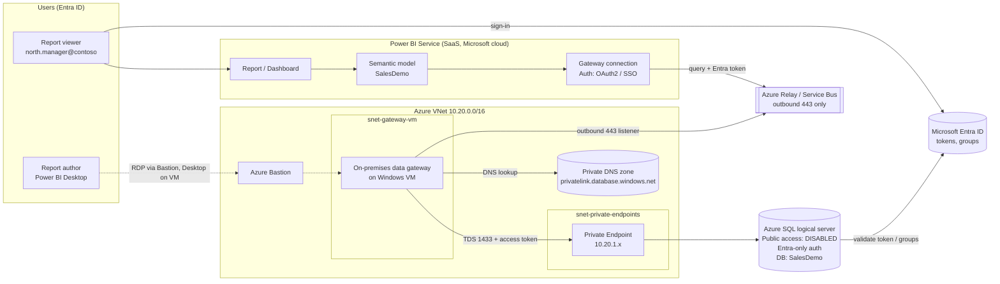
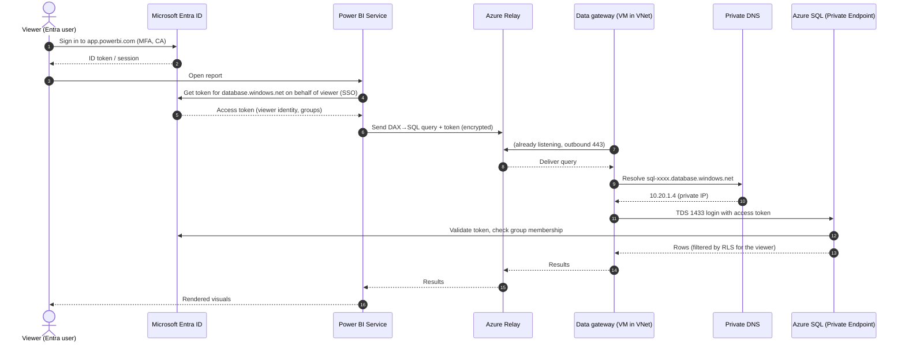

# Power BI ⇄ Azure SQL (Private Endpoint) with Microsoft Entra ID — End-to-End Demo

This demo builds a **secure analytics pipeline**:

- **Azure SQL Database** on a **logical server** with **public network access disabled** and reachable **only through a Private Endpoint**.
- **Microsoft Entra ID-only authentication** on SQL (no SQL usernames/passwords).
- **Power BI** connecting through a **data gateway inside the VNet**, authenticating with **Entra ID (OAuth2 / SSO)**.
- A **sales dataset** (≈50k rows, 2024–2025), reporting views, **row-level security (RLS)** tied to Entra users, and a Power BI report with analysis.

| File | Purpose |
|---|---|
| `README.md` | This guide (architecture, UI steps, auth flow, analysis) |
| `deploy.sh` | Azure CLI script that builds all Azure infrastructure |
| `dataset.sql` | Tables, sample data, reporting views, Entra users, RLS, analysis queries |

---

## 1. Architecture



**Key fact:** Power BI Service is a public SaaS. It **cannot reach a private endpoint by itself**. Something must sit inside (or be peered to) the VNet and relay the queries:

| Option | What it is | Licensing | When to use |
|---|---|---|---|
| **A. On-premises data gateway (standard mode) on an Azure VM** *(this demo)* | You install the gateway on a VM in the VNet. It makes **outbound-only** 443 connections to Azure Relay. | Works with Power BI Pro | Default choice, any license |
| **B. Virtual network (VNet) data gateway** | Microsoft-managed gateway injected into a **delegated subnet** (`Microsoft.PowerPlatform/vnetaccesslinks`). No VM to patch. | Requires Fabric (F) / Power BI Premium capacity (check current docs for PPU) | If you have capacity and want zero infra |
| **C. Power BI Desktop only** | Desktop runs where it can resolve the private endpoint (VM in VNet, VPN, ExpressRoute). | — | Authoring only; service refresh still needs A or B |

---

## 2. How Power BI connects & authenticates (the process, step by step)

### 2a. Authoring in Power BI Desktop
1. Author opens Power BI Desktop **on the gateway VM** (or any machine with VPN/ExpressRoute to the VNet).
2. *Get data → Azure SQL database*, server `sql-pbi-demo-xxxx.database.windows.net`.
3. Name resolution: the public name has a CNAME to `sql-pbi-demo-xxxx.privatelink.database.windows.net`; the **private DNS zone** linked to the VNet returns the **private endpoint IP** (e.g. `10.20.1.4`). Traffic never leaves the VNet.
4. Credentials dialog → **Microsoft account** → interactive Entra sign-in (MFA/Conditional Access apply).
5. Desktop receives an **OAuth2 access token** for resource `https://database.windows.net/` and passes it in the TDS login to SQL.
6. SQL validates the token against Entra, maps the user (directly or via **group** `sg-pbi-sql-readers`) to a **contained database user**, applies `GRANT SELECT ON SCHEMA::rpt`.

### 2b. Publishing & refresh in the Power BI Service
1. Author publishes the `.pbix` → Power BI creates a **semantic model** + **report** in a workspace.
2. The semantic model is bound to a **gateway connection** (the gateway on the VM) whose data source = server + database.
3. Credentials stored on the connection: **OAuth2** (Entra account) or **Service principal** (app registration). They are encrypted; the gateway only gets them at query time.
4. **Import refresh**: Power BI service → Azure Relay → gateway (which holds a long-lived *outbound* connection) → gateway resolves private DNS → connects to private endpoint on 1433 with the Entra token → results flow back the same way.
5. **DirectQuery with SSO** (optional): when a viewer opens the report, Power BI obtains a token **for that viewer**, passes it via the gateway, and SQL runs the query **as the viewer** — so `SUSER_SNAME()` = viewer's UPN and **SQL RLS** applies per user.

### 2c. Sequence (DirectQuery + SSO)



### 2d. Where Entra ID is involved

| Layer | Entra ID role |
|---|---|
| SQL server | **Microsoft Entra admin** = group `sg-sql-admins`; **Entra-only auth** enabled (SQL auth off) |
| SQL database | Contained users `FROM EXTERNAL PROVIDER` (group `sg-pbi-sql-readers`, optional service principal) |
| Power BI workspace | Workspace roles (Admin/Member/Contributor/Viewer) assigned to Entra users/groups |
| Gateway | Gateway admins & connection users are Entra identities; connection uses OAuth2/SSO or service principal |
| Report access | App/workspace sharing via Entra groups; RLS uses the viewer's UPN |
| Tenant settings | Fabric admin portal: *Microsoft Entra Single Sign-On (SSO) for Gateway* must be enabled for DirectQuery SSO through a gateway |

---

## 3. Prerequisites

- Azure subscription with Owner/Contributor on a resource group, and **Network Contributor** for private endpoints.
- Entra ID permission to create groups (or ask your identity team).
- Power BI **Pro** license (or PPU / Fabric capacity) for author and viewers; a workspace you administer.
- Azure CLI ≥ 2.60 (Cloud Shell works).

**Create Entra groups (Portal UI):** *Microsoft Entra ID → Groups → New group*

| Group | Type | Members |
|---|---|---|
| `sg-sql-admins` | Security | You (DBA) |
| `sg-pbi-sql-readers` | Security | Report authors, viewers, the gateway connection account |
| `sg-pbi-report-viewers` | Security | Business viewers (for workspace/app access) |

Optional service principal: *Entra ID → App registrations → New registration* `sp-powerbi-sqlreader` → *Certificates & secrets → New client secret*. Add it to `sg-pbi-sql-readers`.

---

## 4. Deploy Azure infrastructure

### Option 1 — Script
```bash
chmod +x deploy.sh
./deploy.sh
```

### Option 2 — Azure Portal (UI)

**4.1 Resource group** — *Resource groups → Create* → `rg-pbi-sql-demo`, region `Central India`.

**4.2 Virtual network** — *Virtual networks → Create*
- Name `vnet-pbi-demo`, address space `10.20.0.0/16`
- Subnets: `snet-private-endpoints` (10.20.1.0/24), `snet-gateway-vm` (10.20.2.0/24), `AzureBastionSubnet` (10.20.4.0/26)
- Optional for VNet data gateway: `snet-pbi-vnet-gateway` (10.20.3.0/27) → *Subnet delegation* = `Microsoft.PowerPlatform/vnetaccesslinks`

**4.3 SQL logical server + database** — *Azure SQL → Create → SQL databases (Single database)*
- **Basics**: DB name `SalesDemo`; Server → *Create new* `sql-pbi-demo-xxxx`
  - Authentication method: **Use Microsoft Entra-only authentication**
  - Set Microsoft Entra admin → select group **`sg-sql-admins`**
- Compute: *General Purpose – Serverless*, 1 vCore, auto-pause 1 hour.
- **Networking** tab:
  - Connectivity method: **Private endpoint**
  - *+ Add private endpoint*: name `pe-sql`, VNet `vnet-pbi-demo`, subnet `snet-private-endpoints`, **Integrate with private DNS zone = Yes** (`privatelink.database.windows.net`)
  - Minimum TLS: 1.2
- Create.
- After creation: *SQL server → Security → Networking → Public access* = **Disable** → Save.

**4.4 Verify private endpoint** — *Private endpoints → pe-sql → DNS configuration*: FQDN `sql-pbi-demo-xxxx.database.windows.net` → `10.20.1.x`. *Private DNS zones → privatelink.database.windows.net → Virtual network links* shows `vnet-pbi-demo`.

**4.5 Gateway VM** — *Virtual machines → Create*: `vm-pbi-gateway`, Windows Server 2022, `Standard_D4s_v5` (gateway recommends ≥ 8 cores/8 GB for production), VNet `vnet-pbi-demo`, subnet `snet-gateway-vm`, **Public IP: None**.
- Outbound internet is required (443 to Power BI/Azure Relay). Attach a **NAT gateway** to `snet-gateway-vm` (or route via Azure Firewall and allow the Power BI / Service Bus FQDNs).

**4.6 Bastion** — *VM → Connect → Bastion → Deploy Bastion* (uses `AzureBastionSubnet`).

---

## 5. Load the dataset

Public access is off, so run SQL **from inside the VNet**.

1. *VM → Connect → Bastion* → RDP into `vm-pbi-gateway`.
2. On the VM, verify DNS:
   ```powershell
   nslookup sql-pbi-demo-xxxx.database.windows.net
   # Expect: Aliases ... privatelink.database.windows.net, Address: 10.20.1.4
   Test-NetConnection sql-pbi-demo-xxxx.database.windows.net -Port 1433
   # TcpTestSucceeded : True
   ```
3. Install **SSMS** (or Azure Data Studio) on the VM.
4. Connect: Server `sql-pbi-demo-xxxx.database.windows.net`, Authentication **Microsoft Entra MFA**, sign in as a member of `sg-sql-admins`, database `SalesDemo`.
5. Open and run **`dataset.sql`**. It creates:
   - `sales.Dim*` / `sales.FactSales` star schema with ~50,000 rows
   - `rpt.vSales`, `rpt.vMonthlyKpi`, `rpt.vTopCustomers` views
   - Contained user `[sg-pbi-sql-readers] FROM EXTERNAL PROVIDER` with `SELECT` on schema `rpt`
   - RLS policy `sec.RegionPolicy` (created **OFF**)
6. Edit `sales.DimRegion.ManagerUPN` to real UPNs in your tenant for the RLS test.

> Tip: proving it's private — from your laptop, `Test-NetConnection` to the server fails / the portal Query Editor is denied, while the VM succeeds.

---

## 6. Install & register the data gateway (Option A)

On `vm-pbi-gateway`:
1. Download **On-premises data gateway (standard mode)** from the Power BI download menu (*app.powerbi.com → ⬇ → Data Gateway*).
2. Install → sign in with your **Entra work account** (becomes gateway admin).
3. *Register a new gateway* → name `gw-pbi-sql-demo`, set a **recovery key** (store it in Key Vault).
4. Confirm status *"The gateway gw-pbi-sql-demo is online and ready to be used."*
5. Network: the gateway needs **only outbound** TCP 443 (and 5671–5672/9350–9354 optional) — **no inbound ports**. In the gateway app → *Diagnostics → Network ports test* → should pass.

### Option B — VNet data gateway (no VM)
1. Fabric/Power BI → *Settings (⚙) → Manage connections and gateways → Virtual network data gateways → + New*.
2. Choose capacity, subscription, RG `rg-pbi-sql-demo`, VNet `vnet-pbi-demo`, subnet `snet-pbi-vnet-gateway` (delegated).
3. Because the delegated subnet is in the VNet linked to the private DNS zone, it resolves the private endpoint automatically.

---

## 7. Build the report in Power BI Desktop

1. Install Power BI Desktop on the VM (or a VPN-connected machine).
2. *Home → Get data → Azure → Azure SQL database*
   - Server: `sql-pbi-demo-xxxx.database.windows.net`
   - Database: `SalesDemo`
   - Data connectivity mode: **Import** (fast) *or* **DirectQuery** (for per-user SSO + SQL RLS)
3. Credentials → **Microsoft account → Sign in** (Entra, as a member of `sg-pbi-sql-readers`) → Connect.
4. Select `rpt.vSales`, `rpt.vMonthlyKpi`, `rpt.vTopCustomers` → Load.
5. Add a **Date** table (or use `Date` column) and mark as date table.

### DAX measures
```DAX
Revenue        = SUM ( vSales[SalesAmount] )
Profit         = SUM ( vSales[Profit] )
Margin %       = DIVIDE ( [Profit], [Revenue] )
Orders         = COUNTROWS ( vSales )
Avg Order Value= DIVIDE ( [Revenue], [Orders] )
Revenue LY     = CALCULATE ( [Revenue], SAMEPERIODLASTYEAR ( vSales[Date] ) )
YoY %          = DIVIDE ( [Revenue] - [Revenue LY], [Revenue LY] )
Revenue YTD    = TOTALYTD ( [Revenue], vSales[Date] )
Discount Cost  = SUMX ( vSales, vSales[Quantity] * vSales[UnitPrice] * vSales[Discount] )
Signed-in User = USERPRINCIPALNAME ()
```

### Report pages (UI)
| Page | Visuals |
|---|---|
| **Executive overview** | Cards: Revenue, Profit, Margin %, YoY %; Line: Revenue & Revenue LY by YearMonth; Slicers: Year, Region, Segment |
| **Product & category** | Donut: Revenue by Category; Bar: Top products by Profit; Scatter: Discount vs Margin % |
| **Regions & customers** | Filled map / bar: Revenue by Region; Table: `vTopCustomers`; Matrix: Region × Segment |
| **Security check** | Card: `Signed-in User`; Table: RegionName + Revenue (to see RLS effect) |

Save as `SalesDemo.pbix`.

---

## 8. Publish and configure the Power BI Service

1. **Workspace**: *Workspaces → New workspace* `WS-SalesDemo` → *Manage access* → add `sg-pbi-report-viewers` as **Viewer**, authors as **Contributor/Member**.
2. Desktop → *Publish* → `WS-SalesDemo`.
3. **Create gateway connection**: *⚙ Settings → Manage connections and gateways → + New → On-premises* (or *Virtual network*)
   - Gateway cluster: `gw-pbi-sql-demo`
   - Connection name: `conn-sql-salesdemo`
   - Type: **SQL Server** · Server: `sql-pbi-demo-xxxx.database.windows.net` · Database: `SalesDemo`
   - Authentication method: **OAuth2** → *Edit credentials* → sign in with an account in `sg-pbi-sql-readers`
     *(alternative: **Service principal** → tenant ID, client ID, secret of `sp-powerbi-sqlreader`)*
   - **For DirectQuery SSO**: tick *"Use SSO via Microsoft Entra ID for DirectQuery queries"*
   - Privacy level: Organizational → Create
   - *Manage users*: add authors who may bind models to this connection.
4. **Bind the semantic model**: Workspace → semantic model `SalesDemo` → *Settings → Gateway and cloud connections* → map data source to `conn-sql-salesdemo` → Apply.
5. **Schedule refresh** (Import mode): *Settings → Refresh → On*, e.g. daily 07:00 IST. Click *Refresh now* and check *Refresh history* = Completed.
6. Tenant admin (Fabric admin portal → *Tenant settings*): ensure **"Microsoft Entra Single Sign-On (SSO) for Gateway"** is enabled if you use SSO.
7. Optionally create an **App** for business users and share it with `sg-pbi-report-viewers`.

---

## 9. Security demo: per-user row-level security

**Approach 1 — SQL RLS (DirectQuery + SSO, identity flows to SQL)**
```sql
ALTER SECURITY POLICY sec.RegionPolicy WITH (STATE = ON);
```
- Ensure the viewer's UPN is in `sales.DimRegion.ManagerUPN` and the viewer is in `sg-pbi-sql-readers`.
- Viewer `north.manager@...` opens the report → *Security check* page shows only **North** rows. SQL sees `SUSER_SNAME()` = their UPN.
- Verify on SQL: `SELECT * FROM sys.dm_exec_sessions WHERE login_name LIKE '%north.manager%';`

**Approach 2 — Power BI RLS (Import mode, identity stays in Power BI)**
- Desktop → *Modeling → Manage roles* → role `RegionManager`, table `vSales`, DAX filter:
  ```DAX
  [RegionName] = LOOKUPVALUE ( vRegionMap[RegionName], vRegionMap[ManagerUPN], USERPRINCIPALNAME () )
  ```
  (or a static filter like `[RegionName] = "North"`)
- Service → semantic model → *Security* → add Entra users/groups to the role.

| | SQL RLS + SSO | Power BI RLS |
|---|---|---|
| Mode | DirectQuery | Import or DirectQuery |
| Identity at SQL | Each viewer | The single connection account |
| Audit at SQL | Per user | Shared account |
| Performance | Queries hit SQL live | Cached, fast |

---

## 10. Data analysis — what the dataset shows

Run section 6 of `dataset.sql` (or look at the report). Because the data is generated with a skewed date distribution and a Q4 uplift, you should observe:

1. **Growth**: 2025 revenue is noticeably higher than 2024 (the generator puts more orders in later dates) → *YoY %* positive across regions.
2. **Seasonality**: Q4 revenue per quarter is higher than the Q1–Q3 average (extra units Oct–Dec).
3. **Category mix**: *Devices* (Teams Room Kit, Surface) dominate revenue; *Software* and *Accessories* carry the highest margin %.
4. **Discount impact**: margin % falls steadily as discount rises from 0% → 20% — a pricing-policy talking point.
5. **Customers**: Top-20 customers view highlights concentration; Enterprise segment has fewer customers but higher average order value.
6. **Regions**: six regions are roughly balanced (customers are assigned round-robin), so RLS changes are easy to see visually.

> Exact numbers differ per run because the data uses `NEWID()` randomness.

---

## 11. Validation checklist

| # | Test | Expected |
|---|---|---|
| 1 | `nslookup` server FQDN from VM | Private IP 10.20.1.x |
| 2 | Connect from laptop (no VPN) | Fails — public access disabled |
| 3 | SSMS with SQL auth | Fails — Entra-only auth |
| 4 | SSMS with Entra MFA (admin group) | Succeeds |
| 5 | Gateway status | Online |
| 6 | Semantic model refresh | Completed |
| 7 | DirectQuery report, `SELECT SUSER_SNAME()` / Signed-in User card | Viewer's own UPN |
| 8 | RLS ON, regional manager views report | Only own region |
| 9 | User removed from `sg-pbi-sql-readers` | Query fails with login/permission error |

---

## 12. Troubleshooting

| Symptom | Cause / Fix |
|---|---|
| `Reason: An instance-specific error occurred` / timeout | DNS resolving to public IP. Check private DNS zone **VNet link** and that the VM uses Azure DNS (168.63.129.16) or a forwarder for `privatelink.database.windows.net`. |
| `Deny Public Network Access is set to Yes` | You are connecting from outside the VNet. Use the VM / gateway. |
| `Login failed for user '<token-identified principal>'` | User/group not created in DB: `CREATE USER [...] FROM EXTERNAL PROVIDER`. |
| Gateway offline | VM has no outbound internet (attach NAT gateway / firewall rules for Power BI & `*.servicebus.windows.net`). |
| SSO checkbox greyed out | Tenant setting *Microsoft Entra SSO for Gateway* disabled, or the mode is Import (SSO only applies to DirectQuery). |
| Refresh fails after password/MFA change | OAuth2 token expired — re-enter credentials on the connection, or use a service principal. |
| Serverless DB first query slow | DB was auto-paused; first connection resumes it (~1 min). |

---

## 13. Clean up
```bash
az group delete -n rg-pbi-sql-demo --yes --no-wait
```
Also delete the workspace, the gateway (*Manage connections and gateways*), and the Entra groups/app registration if not needed.

---

## 14. Production hardening (beyond the demo)
- Run **2+ gateway VMs in a cluster** for high availability; keep them patched and on the latest gateway version.
- Prefer **service principal** or **workload identity** connections over a personal OAuth2 account for scheduled refresh.
- Route gateway egress through **Azure Firewall** with FQDN rules; enable NSG flow logs.
- Enable **SQL Auditing** and **Microsoft Defender for SQL**; send logs to Log Analytics.
- Use **Conditional Access** for Power BI and Azure SQL apps; require compliant devices.
- Store the gateway recovery key and SP secrets in **Azure Key Vault**.
- Consider **sensitivity labels** (Microsoft Purview) on the semantic model and report.
