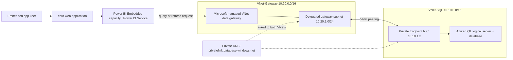

# Azure Power BI Embedded + Azure SQL Private Endpoint + VNet Data Gateway (two-VNet lab)

## What this lab demonstrates

- Azure SQL logical server and database with **Public network access disabled**.
- Azure SQL Private Endpoint in **VNet-SQL**.
- Microsoft-managed Power BI **VNet data gateway** delegated into a subnet in a different **VNet-Gateway**.
- VNet peering and Private DNS so the gateway subnet can resolve and reach the SQL private endpoint.
- A small sales dataset, SQL schema, and validation queries.
- Power BI Embedded capacity hosts the embedded report; the VNet data gateway is the private network path to SQL.

> **Important identity limitation (read before deployment):** A Fabric/Power BI workspace identity is not currently supported as the authentication method for a *gateway connection*. The Azure SQL connector documentation also says Service Principal authentication isn't supported with a VNet data gateway. Therefore this lab cannot truthfully demonstrate the Power BI workspace managed identity authenticating through this VNet gateway. The working gateway connection should use a supported credential method (for a simple lab, SQL authentication; for per-viewer authorization, configure supported Microsoft Entra SSO where available and test the connector/tenant settings).  
>
> The included `sql/03-workspace-identity-permissions.sql` shows how an Entra workspace identity would be granted least-privilege SQL permissions **for a supported direct cloud connection scenario**. It is deliberately not presented as a working credential for this VNet-gateway connection. Do not create the SQL user and assume that alone enables gateway authentication.

## Architecture



### Actual data path

1. The embedded app obtains an embed token and displays the report. **The app does not connect to SQL.**
2. Power BI Service runs a semantic-model query or refresh.
3. Power BI sends the work to the Microsoft-managed VNet data gateway in the delegated subnet of VNet-Gateway.
4. The gateway resolves `<server>.database.windows.net`. Private DNS returns the private endpoint IP.
5. The gateway connects to that private IP on TCP 1433. VNet peering carries traffic between the two VNets over Microsoft's backbone.
6. The private endpoint forwards the SQL/TDS traffic to Azure SQL. Results return through the gateway to Power BI.
7. Power BI renders the result in the report; the embed app displays it.

Power BI Embedded capacity is the hosting/embedding capacity. It is not the gateway and does not itself create a private route to SQL.

## Prerequisites

- Azure subscription with permissions to create resource groups, VNets, peering, private endpoints, DNS links, and Azure SQL.
- Azure CLI logged in: `az login` and a selected subscription: `az account set --subscription ...`.
- Power BI/Fabric tenant administrator or gateway administrator access.
- An eligible capacity for VNet data gateway: Fabric F SKU or Power BI Premium capacity (documented Power BI Premium A4+ / P). Check current licensing before purchase; VNet gateway is premium-capacity functionality and has separate/additive capacity cost implications.
- A Power BI Embedded capacity (A SKU) if you specifically need the App-owns-data embedded scenario. Do not assume an A SKU alone makes the VNet data gateway eligible; confirm supported capacity/tenant configuration for your tenant. A common teaching setup is an eligible Fabric capacity for the VNet gateway plus Embedded capacity for the embed workload, where required.

## Resource layout

| Component | Name | Address / purpose |
|---|---|---|
| Resource group | `rg-pbi-private-demo` | All Azure resources |
| SQL VNet | `vnet-sql-demo` | `10.10.0.0/16` |
| SQL PE subnet | `snet-private-endpoints` | `10.10.1.0/24` |
| Gateway VNet | `vnet-pbi-gateway-demo` | `10.20.0.0/16` |
| Gateway subnet | `snet-vnet-gateway` | `10.20.1.0/24`, delegated to `Microsoft.PowerPlatform/vnetaccesslinks` |
| Private DNS | `privatelink.database.windows.net` | Linked to both VNets |
| SQL | `sqlpbi<unique-suffix>` | Public network access disabled |

## Step 1 — configure and run deployment

1. Edit the variables at the top of `deploy.sh` (especially a globally unique SQL server name, region, and SQL admin credentials).
2. Run:

```bash
chmod +x deploy.sh
./deploy.sh
```

The script creates Azure infrastructure and a database, imports `sales_dataset.csv`, and prints the SQL server FQDN and database name. It does **not** create a VNet data gateway: that is a Microsoft-managed Power Platform resource created from the Power BI/Fabric admin experience.

The script uses SQL authentication for initial provisioning and lab loading. Use a strong temporary lab password and rotate/delete it after the exercise. For production, prefer Microsoft Entra administrator and managed/interactive identity patterns supported by the chosen connection type.

## Step 2 — verify network path before Power BI

From a test VM placed in VNet-Gateway (optional; not created by this script):

```bash
nslookup <sql-server-name>.database.windows.net
```

The answer must be the private endpoint IP (10.10.1.x), not a public SQL IP.

Test TCP 1433 from the test VM:

```bash
nc -vz <sql-server-name>.database.windows.net 1433
```

The VM test proves peering/DNS/route reachability from that VNet. It does not prove the managed gateway is configured; complete the gateway setup next.

## Step 3 — create the VNet data gateway

1. Open Power BI Service or Power Platform admin center → Manage connections and gateways / Data → Gateways.
2. Create a **Virtual network data gateway**.
3. Select the same subscription/resource group, `vnet-pbi-gateway-demo`, and `snet-vnet-gateway`.
4. The subnet must be delegated to `Microsoft.PowerPlatform/vnetaccesslinks` (the script configures this).
5. The gateway runtime is Microsoft-managed. There is no gateway VM to RDP into or install software on.
6. Create a gateway connection for **Azure SQL Database**:
   - Server: `<sql-server-name>.database.windows.net` (FQDN, not private IP)
   - Database: `SalesDemo`
   - Authentication: SQL authentication for this lab, using the SQL lab login created by the script
   - Encryption: enabled / encrypted connection
7. Share the connection with the semantic-model owner or the appropriate security group.

The VNet data gateway must be created in the Power BI tenant home region for Power BI. Confirm current regional availability and licensing.

## Step 4 — connect Power BI Desktop / semantic model

1. Open Power BI Desktop → Get Data → Azure → Azure SQL Database.
2. Enter the SQL FQDN and `SalesDemo`.
3. Select Import (easy first demo) or DirectQuery (interactive query demo).
4. Authenticate with the same lab SQL credentials used in the gateway connection.
5. Load `dbo.Sales`.
6. Create measures:

```DAX
Total Sales = SUMX(Sales, Sales[Quantity] * Sales[UnitPrice])
Total Units = SUM(Sales[Quantity])
Order Count = DISTINCTCOUNT(Sales[OrderID])
Average Order Value = DIVIDE([Total Sales], [Order Count])
```

7. Create visuals: Total Sales card, Sales by Region column chart, Sales by Category donut, Sales by Month line chart, Order Count card.
8. Publish to a workspace assigned to the appropriate capacity.
9. In the semantic model Settings → Gateway and cloud connections, map the Azure SQL data source to the VNet data gateway connection. Save.
10. Trigger a refresh (Import) or test a visual interaction (DirectQuery).

## Step 5 — Power BI Embedded

For an **App-owns-data** demo:
1. Create/choose an Entra app registration (service principal) for the embedding application.
2. Enable the relevant Power BI tenant setting for service principals and add the service principal to the workspace.
3. Assign the workspace to the Power BI Embedded capacity.
4. Your backend authenticates to Power BI APIs as the service principal, obtains report/semantic-model metadata, and generates an embed token.
5. Your browser app embeds the report using the embed URL and embed token.

This service principal is the **embedding/control-plane identity**. It is not automatically the SQL data-source identity. The VNet gateway still uses its configured data-source credentials (or a supported SSO flow).

## Step 6 — managed identity permissions (important distinction)

If you have a Fabric workspace identity and want to see the SQL-side permission grant, run `sql/03-workspace-identity-permissions.sql` after replacing the placeholder with the exact workspace identity display name. It creates a contained Entra user and grants read access to the reporting schema.

This is useful for a supported direct cloud connection pattern, but **it does not make workspace identity work through this VNet gateway**. Microsoft documents workspace identity as unsupported for gateway connections, and the Azure SQL connector documents service-principal authentication as unsupported with a VNet data gateway. Use the SQL-auth lab path above to complete this exact two-VNet VNet-gateway practical.

If you need user-specific SQL permissions instead of a shared SQL login, investigate Microsoft Entra SSO for VNet data gateways and Azure SQL connector support in your tenant. In that model, SQL evaluates the signed-in report viewer's identity; it is not the workspace managed identity. Enable the Fabric tenant SSO setting only after reviewing security implications.

## Step 7 — validation checklist

- [ ] SQL public network access is disabled.
- [ ] Private endpoint connection state is Approved.
- [ ] Private DNS zone has the SQL server A record.
- [ ] Private DNS zone is linked to both VNets.
- [ ] VNet peering is Connected in both directions.
- [ ] Gateway subnet delegation is `Microsoft.PowerPlatform/vnetaccesslinks`.
- [ ] Gateway connection uses SQL FQDN, not private IP.
- [ ] Gateway connection test succeeds.
- [ ] Semantic model is mapped to the VNet gateway.
- [ ] Refresh succeeds (Import) or visuals query successfully (DirectQuery).
- [ ] SQL audit / query history shows the expected queries.

## Cleanup

```bash
az group delete --name rg-pbi-private-demo --yes --no-wait
```

This deletes Azure resources in the resource group. Delete the VNet data gateway and its Power BI connection separately in Power BI / Power Platform admin center. Capacity billing is separate; pause/delete any paid capacity you created.

## Official references

- VNet gateway architecture: https://learn.microsoft.com/en-us/data-integration/vnet/data-gateway-architecture
- VNet gateway FAQs (licensing, connectivity, cross-VNet reachability): https://learn.microsoft.com/en-us/data-integration/vnet/data-gateway-faqs
- Use VNet gateway and data sources in Power BI: https://learn.microsoft.com/en-us/data-integration/vnet/use-data-gateways-sources-power-bi
- Azure SQL connector authentication limitations: https://learn.microsoft.com/en-us/power-query/connectors/azure-sql-database
- Workspace identity cloud connections: https://learn.microsoft.com/en-us/power-bi/connect-data/service-connect-cloud-data-sources
- Microsoft Entra SSO with VNet gateway: https://learn.microsoft.com/en-us/power-bi/connect-data/service-gateway-azure-active-directory-sso
- Power BI Embedded token-based SQL SSO (different pattern): https://learn.microsoft.com/en-us/power-bi/developer/embedded/rls-sso
