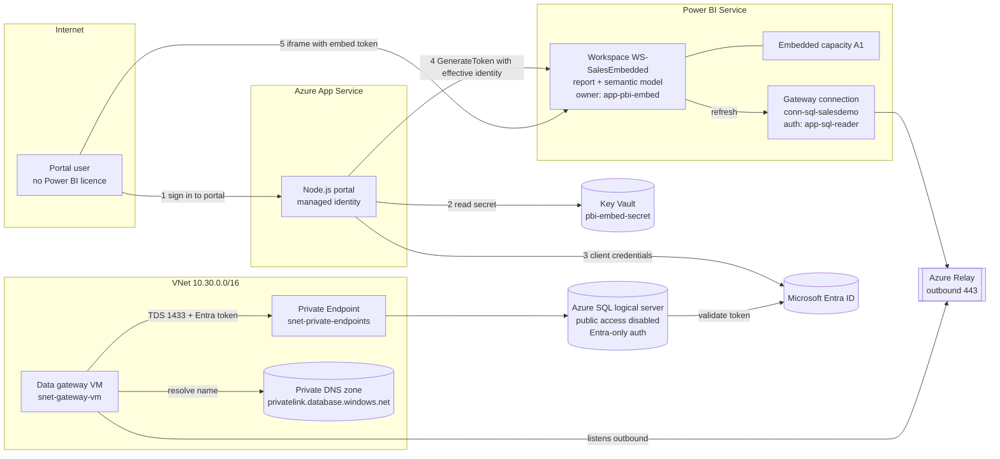
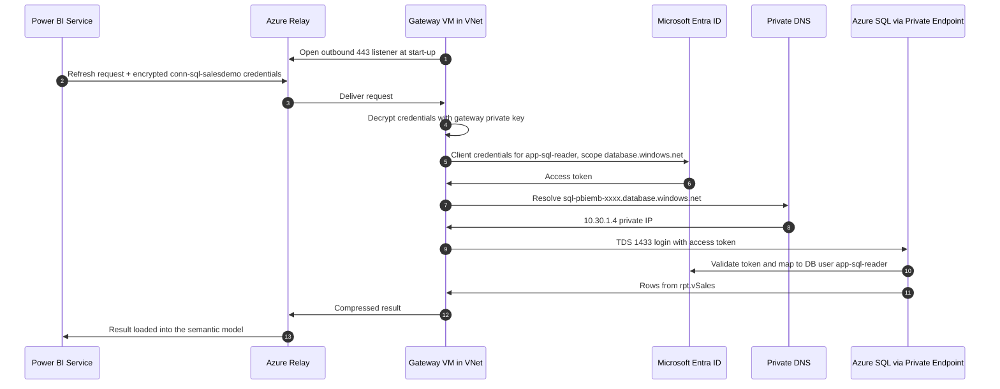
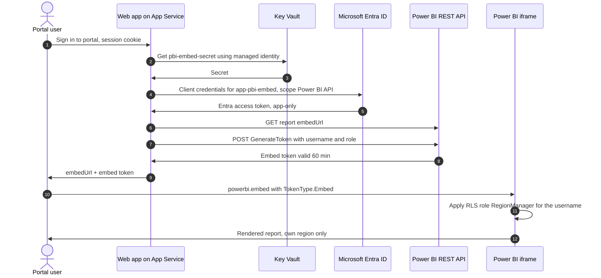
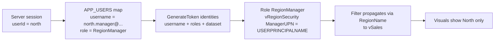

# Power BI Embedded ⇄ Azure SQL (Private Endpoint) with Microsoft Entra ID — End-to-End Demo

Build, from an empty subscription, a **customer-facing web portal** that embeds a Power BI report over data in **Azure SQL Database** that is reachable **only through a Private Endpoint**.

- **Azure SQL logical server**: public network access **disabled**, **Microsoft Entra-only authentication**.
- **Private Endpoint + Private DNS**: SQL has a private IP inside your VNet.
- **On-premises data gateway** on a VM in the VNet: the only path from Power BI to SQL.
- **Power BI Embedded capacity (A SKU)**: pays for rendering, so portal users need **no Power BI licence**.
- **Service principals (Entra app registrations)**: one owns the Power BI content and generates embed tokens, one reads SQL.
- **Node.js web app** on App Service: signs users into *your* app, then embeds the report with **row-level security (RLS)** per user.
- **Sales dataset** (~50k rows, 2024–2025) with analysis views and queries.

---

## Repository layout

```
pbi-embedded-sql-demo/
├── README.md                  ← this guide
├── infra/
│   ├── 00_identity.sh         ← Entra groups + 2 app registrations (service principals)
│   └── 01_deploy.sh           ← VNet, SQL, Private Endpoint, DNS, VM, Bastion, Embedded capacity, Key Vault, App Service
├── sql/
│   └── dataset.sql            ← star schema, sample data, reporting views, Entra DB users, analysis queries
├── powerbi/
│   ├── setup_powerbi.py       ← workspace, capacity, SP access, import .pbix, bind gateway, refresh
│   └── SalesDemo.pbix         ← you build this in Power BI Desktop (step 8)
└── app/
    ├── server.js              ← Express API: AAD token → GenerateToken (effective identity)
    ├── public/index.html      ← portal UI + powerbi-client embedding
    ├── package.json
    ├── .env.example
    └── deploy_webapp.sh       ← zip-deploy to App Service (secret from Key Vault)
```

---

## 1. Architecture



**Two independent paths — this is the key to understanding the design:**

| Path | Who talks to whom | Crosses the private endpoint? |
|---|---|---|
| **Data path** (refresh / DirectQuery) | Power BI → Azure Relay → gateway VM → Private Endpoint → SQL | **Yes** — only via the gateway inside the VNet |
| **Embed path** (viewing) | Browser → your web app → Power BI REST API; browser → Power BI iframe | **No** — the web app never touches SQL, so it needs no VNet integration |

**Why an on-premises (standard) gateway on a VM and not a VNet data gateway?** Microsoft's documentation states that VNet data gateways need an **A4 or larger** Embedded SKU, any P SKU, or a Fabric F SKU ([Create virtual network data gateways](https://learn.microsoft.com/data-integration/vnet/create-data-gateways)). This demo uses the cheapest **A1** capacity, so it uses a gateway VM. If you scale to A4+ or a Fabric F SKU you can swap the VM for a VNet data gateway (see §15).

---

## 2. How authentication works — every hop

### 2a. Identities

| Identity | Type | Used for | Where it's granted |
|---|---|---|---|
| `sg-sql-admins` | Entra group | SQL server Entra admin (DBA) | SQL server → Microsoft Entra ID |
| `sg-pbi-sql-readers` | Entra group | Report authors in Power BI Desktop | SQL DB user, `SELECT` on schema `rpt` |
| `app-pbi-embed` | Service principal | Calls Power BI REST API, owns workspace content, generates embed tokens | Member of `sg-pbi-embed-sps` (tenant setting), **Admin** of the workspace, **user** of the gateway connection |
| `app-sql-reader` | Service principal | Credential stored in the gateway connection; the only identity SQL sees from Power BI | SQL DB user, `SELECT` on schema `rpt` |
| App Service managed identity | Managed identity | Reads `pbi-embed-secret` from Key Vault | Key Vault RBAC "Key Vault Secrets User" |
| Portal users (`north.manager@…`) | **Your app's** users | Effective identity inside the embed token → Power BI RLS | Not in Power BI at all; mapped in `sales.DimRegion.ManagerUPN` |

### 2b. Data refresh path (Power BI → SQL through the private endpoint)



Key points:
- The gateway opens **only outbound** connections; no inbound ports, no public IP.
- Credentials are encrypted with the **gateway's public key** when you create the connection; only the gateway can decrypt them.
- SQL has **no SQL logins** — it trusts only Entra tokens.

### 2c. Embed path (user → portal → Power BI)



Key points:
- The **Entra token** (step 5) never reaches the browser. The browser only gets a **scoped, short-lived embed token** for one report.
- The server — not the browser — decides `username` and `roles` from its own session, so a user cannot elevate themselves.
- `USERPRINCIPALNAME()` in DAX returns the `username` you put in the embed token.

---

## 3. Prerequisites

| Need | Detail |
|---|---|
| Azure subscription | Owner (or Contributor + User Access Administrator) on the subscription/RG |
| Entra ID | Permission to create groups and app registrations |
| Power BI | A **Pro** (or PPU) licence for *you* (to create the gateway connection and author the report); **Fabric administrator** (or someone who is) for tenant settings |
| Tools | Azure CLI ≥ 2.60, Python 3.10+, Node.js 20, Power BI Desktop (installed on the VM in step 8), bash (Cloud Shell, WSL, or macOS/Linux) |

> **Cost warning:** an A1 capacity bills every hour it runs. Pause it when not demoing (§16).

---

## Step 1 — Create Entra identities

```bash
cd infra
chmod +x *.sh
./00_identity.sh
```

What it creates (Portal equivalent: *Microsoft Entra ID → Groups / App registrations*):

| Object | Portal path |
|---|---|
| Groups `sg-sql-admins`, `sg-pbi-sql-readers`, `sg-pbi-embed-sps` | *Groups → New group → Security* |
| App `app-pbi-embed` + client secret, added to `sg-pbi-embed-sps` | *App registrations → New registration → Single tenant*; *Certificates & secrets → New client secret* |
| App `app-sql-reader` + client secret | same |

You are added to `sg-sql-admins` and `sg-pbi-sql-readers`. Secrets are written to `infra/.identity.env` — keep it out of source control.

> Do **not** add Power BI *API permissions* with admin consent to `app-pbi-embed`. For app-only access, Power BI authorises a service principal through the **tenant setting** (step 6) and **workspace role** (step 9). Extra consented permissions cause errors.

---

## Step 2 — Deploy Azure infrastructure

```bash
./01_deploy.sh
```

| Resource | Purpose |
|---|---|
| `vnet-pbiemb` 10.30.0.0/16 | `snet-private-endpoints` 10.30.1.0/24, `snet-gateway-vm` 10.30.2.0/24, `AzureBastionSubnet` 10.30.4.0/26 |
| `nat-pbiemb` | Explicit outbound internet for the gateway VM (Power BI / Azure Relay on 443) |
| `sql-pbiemb-xxxx` + `SalesDemo` | Entra-only auth, admin = `sg-sql-admins`, serverless GP, **public access disabled** |
| `pe-sql` + `privatelink.database.windows.net` | Private endpoint, DNS zone linked to the VNet, zone group |
| `vm-pbi-gateway` | Windows Server 2022, **no public IP** |
| `bas-pbiemb` | Azure Bastion for RDP |
| `pbiembcapxxxx` | **Power BI Embedded capacity A1**, you as capacity admin |
| `kv-pbiemb-xxxx` | Key Vault (RBAC) holding `pbi-embed-secret` |
| `asp-pbiemb` / `app-pbiemb-xxxx` | App Service (Linux, Node 20) with system-assigned managed identity |

Outputs go to `infra/.infra.env`.

### Portal (UI) equivalent for the important pieces

**SQL server + private endpoint** — *Azure SQL → Create → SQL database*
1. *Basics*: server **Create new** → *Authentication method* = **Use Microsoft Entra-only authentication** → *Set admin* = `sg-sql-admins`.
2. *Compute*: General Purpose, **Serverless**, 1 vCore.
3. *Networking*: *Connectivity method* = **Private endpoint** → **+ Add private endpoint** → VNet `vnet-pbiemb`, subnet `snet-private-endpoints`, **Integrate with private DNS zone = Yes**.
4. After creation: *SQL server → Security → Networking → Public access* = **Disable**.

**Power BI Embedded capacity** — *Create a resource → search "Power BI Embedded" → Create*
1. Resource name `pbiembcapxxxx` (lowercase/digits), region **same as your Power BI home region if possible**.
2. *Size* = **A1**, *Power BI capacity administrator* = your account.
3. Review + create. The capacity starts **Active** (billing).

---

## Step 3 — Load the dataset (from inside the VNet)

1. *Portal → vm-pbi-gateway → Connect → Bastion* → sign in as `azureadmin`.
2. Prove name resolution is private:
   ```powershell
   nslookup sql-pbiemb-xxxx.database.windows.net
   # ... Aliases: sql-pbiemb-xxxx.privatelink.database.windows.net  Address: 10.30.1.4
   Test-NetConnection sql-pbiemb-xxxx.database.windows.net -Port 1433   # TcpTestSucceeded : True
   ```
3. Install **SSMS** on the VM. Connect: *Server* = `sql-pbiemb-xxxx.database.windows.net`, *Authentication* = **Microsoft Entra MFA**, sign in with your account (member of `sg-sql-admins`), *Database* = `SalesDemo` (Options → Connection Properties).
4. Copy `sql/dataset.sql` to the VM (paste into a query window) and **Execute**. It creates:
   - `sales.DimRegion / DimProduct / DimCustomer / DimDate / FactSales` (~50,000 rows)
   - Reporting views `rpt.vSales`, `rpt.vMonthlyKpi`, `rpt.vTopCustomers`, `rpt.vRegionSecurity`
   - Contained Entra users `[app-sql-reader]` and `[sg-pbi-sql-readers]` with `SELECT` on schema `rpt` only
5. The last result set of section 5 should list both users with `authentication_type_desc = EXTERNAL`.

> Proof that SQL is private: from your laptop the connection fails with *"Deny Public Network Access is set to Yes"*.

---

## Step 4 — Install the on-premises data gateway (on the VM)

1. On the VM, browse to **app.powerbi.com → Download (⬇) → Data gateway** → *Standard mode*.
2. Install → sign in with **your Entra work account** → **Register a new gateway on this computer**.
3. Name `gw-pbiemb`, set a **recovery key** (save it in Key Vault: `az keyvault secret set --vault-name kv-pbiemb-xxxx -n gateway-recovery-key --value '...'`).
4. Status page shows **"The gateway gw-pbiemb is online and ready to be used."**
5. *Diagnostics → Start new test* (network ports) — all should pass via the NAT gateway.

> Gateway region: make it the same as your Power BI home region (default) to avoid cross-region data movement.

---

## Step 5 — Check the capacity in Power BI (UI)

1. **app.powerbi.com → Settings (⚙) → Admin portal → Capacity settings → Power BI Embedded** tab.
2. You should see `pbiembcapxxxx` (A1) with **Active** status. You are listed as capacity admin.
3. Optional: *Capacity → Contributor permissions* → leave as admins only (the setup script assigns the workspace as you).

---

## Step 6 — Power BI tenant settings (Fabric admin, UI)

*app.powerbi.com → Settings (⚙) → Admin portal → Tenant settings*

| Section → Setting | Value |
|---|---|
| **Developer settings → Embed content in apps** | Enabled (entire org, or a group containing you and `sg-pbi-embed-sps`) |
| **Developer settings → Service principals can use Fabric APIs** *(older name: "Allow service principals to use Power BI APIs")* | Enabled → **Specific security groups** → `sg-pbi-embed-sps` |
| **Workspace settings → Create workspaces** | Enabled for you |

Click **Apply** on each. Changes can take **up to 15 minutes** to take effect.

---

## Step 7 — Create the gateway connection (UI)

*app.powerbi.com → Settings (⚙) → Manage connections and gateways → Connections → + New*

| Field | Value |
|---|---|
| Type | **On-premises** |
| Gateway cluster name | `gw-pbiemb` |
| Connection name | `conn-sql-salesdemo` *(the setup script looks for this exact name)* |
| Connection type | **SQL Server** |
| Server | `sql-pbiemb-xxxx.database.windows.net` *(must match the .pbix exactly)* |
| Database | `SalesDemo` |
| Authentication method | **Service principal** → Tenant ID, Client ID = `SQLREADER_APP_ID`, Client secret = `SQLREADER_SECRET` (from `infra/.identity.env`) |
| Privacy level | Organizational |

Click **Create**. A green tick means the gateway reached SQL through the private endpoint and the service principal logged in.

> If *Service principal* is not offered in your gateway version, update the gateway, or use **OAuth2** with a dedicated, non-MFA service account that is a member of `sg-pbi-sql-readers` (re-enter credentials when its token expires).

You don't need to add `app-pbi-embed` here by hand — the script does it in step 9 via the REST API.

---

## Step 8 — Build `SalesDemo.pbix` with RLS roles (Power BI Desktop on the VM)

1. Install **Power BI Desktop** on the VM.
2. *Home → Get data → Azure → Azure SQL database*
   - Server `sql-pbiemb-xxxx.database.windows.net`, Database `SalesDemo`
   - Data connectivity mode: **Import**
   - Credentials: **Microsoft account → Sign in** (you are in `sg-pbi-sql-readers`)
3. Select **`rpt.vSales`** and **`rpt.vRegionSecurity`** → *Load*.
   (`vMonthlyKpi` is not region-aware, so leave it out of an RLS model — otherwise every user sees company totals.)
4. *Model view*: relationship `vRegionSecurity[RegionName]` (1) → `vSales[RegionName]` (*), single direction.
5. *Modeling → New measure* — create:
   ```DAX
   Revenue         = SUM ( vSales[SalesAmount] )
   Profit          = SUM ( vSales[Profit] )
   Margin %        = DIVIDE ( [Profit], [Revenue] )
   Orders          = COUNTROWS ( vSales )
   Avg Order Value = DIVIDE ( [Revenue], [Orders] )
   Revenue LY      = CALCULATE ( [Revenue], SAMEPERIODLASTYEAR ( vSales[Date] ) )
   YoY %           = DIVIDE ( [Revenue] - [Revenue LY], [Revenue LY] )
   Revenue YTD     = TOTALYTD ( [Revenue], vSales[Date] )
   Viewing As      = USERPRINCIPALNAME ()
   ```
   For time intelligence, add a date table: *New table* `Calendar = CALENDAR ( DATE(2024,1,1), DATE(2025,12,31) )`, relate `Calendar[Date]` → `vSales[Date]`, *Mark as date table*, and use `Calendar[Date]` in the LY/YTD measures.
6. **RLS roles** — *Modeling → Manage roles → New*:

   | Role | Table | DAX filter |
   |---|---|---|
   | `RegionManager` | `vRegionSecurity` | `[ManagerUPN] = USERPRINCIPALNAME()` |
   | `AllRegions` | `vRegionSecurity` | `TRUE()` |

   Names must match `RLS_ROLE_REGION` / `RLS_ROLE_ALL` in `app/.env`.
7. **Report pages**:

   | Page | Visuals |
   |---|---|
   | Overview | Cards: Revenue, Profit, Margin %, YoY %; Line: Revenue & Revenue LY by month; Slicers: Year, Segment |
   | Products | Bar: Revenue by Category; Table: ProductName, Revenue, Margin %; Scatter: Discount vs Margin % |
   | Customers | Table: CustomerName, Segment, Revenue (Top N = 20 filter); Matrix: RegionName × Segment |
   | Security | Card: `Viewing As`; Bar: Revenue by RegionName |

8. **Test RLS in Desktop**: *Modeling → View as → Other user* = `north.manager@contoso.onmicrosoft.com` + role **RegionManager** → only *North* appears.
9. *File → Save as* `powerbi/SalesDemo.pbix` and copy it to the machine where you'll run step 9 (or run step 9 on the VM).

---

## Step 9 — Automate the Power BI service setup

```bash
cd powerbi
pip install msal requests
az login                               # as you (capacity admin + gateway connection owner)
python setup_powerbi.py all --pbix SalesDemo.pbix
```

| # | Runs as | REST call | Result |
|---|---|---|---|
| 1 | You | `POST /groups?workspaceV2=True` | Workspace `WS-SalesEmbedded` |
| 2 | You | `POST /groups/{ws}/AssignToCapacity` | Workspace on A1 capacity (diamond icon) |
| 3 | You | `POST /groups/{ws}/users` (`principalType: App`) | `app-pbi-embed` = workspace **Admin** |
| 4 | You | `POST /gateways/{gw}/datasources/{ds}/users` | `app-pbi-embed` may use `conn-sql-salesdemo` |
| 5 | SP | `POST /groups/{ws}/imports` | Report + semantic model, **owned by the SP** |
| 6 | SP | `Default.DiscoverGateways` → `Default.BindToGateway` | Model bound to the gateway connection |
| 7 | SP | `POST /datasets/{id}/refreshes` | Data pulled through gateway → private endpoint → SQL |
| 8 | — | — | `app/.env` written with tenant, client, workspace, report, dataset IDs |

**UI check:** *app.powerbi.com → Workspaces → WS-SalesEmbedded*: report and semantic model are present; *semantic model → Settings → Gateway and cloud connections* shows `conn-sql-salesdemo` mapped; *Refresh history* = Completed. Optionally set a **scheduled refresh** there (the SP is the owner, so the schedule runs with the gateway connection's credential).

---

## Step 10 — Run the portal locally

```bash
cd app
npm install
npm start          # http://localhost:3000
```

1. Pick **North Region Manager** → *Sign in* → the report embeds; *Security* page shows `Viewing As = north.manager@…` and only **North**.
2. *Sign out* → **Head Office (all regions)** → all six regions.

The local app works without any VNet access because it only calls the public Power BI API — the private data path is handled by the gateway.

---

## Step 11 — Deploy the portal to App Service

```bash
cd app
./deploy_webapp.sh
```

- App settings get IDs only; `CLIENT_SECRET` is **not** set. `KEY_VAULT_NAME` makes the app read `pbi-embed-secret` from Key Vault using its **managed identity** (`DefaultAzureCredential`).
- Open `https://app-pbiemb-xxxx.azurewebsites.net` and repeat the step 10 tests.

---

## 12. Row-level security — how the identity flows



| Question | Answer |
|---|---|
| Does SQL see the portal user? | **No.** SQL only ever sees `app-sql-reader` (from the gateway). Per-user security is enforced in Power BI by the embed token's effective identity. |
| Can a user change their role in the browser? | No. The role is chosen server-side and baked into the signed embed token. |
| Is an identity required? | Once the model has RLS roles, every embed token **must** include an identity with at least one role — that's why head office gets `AllRegions`. |
| DirectQuery instead of Import? | Same pattern; queries go live through the gateway as `app-sql-reader`, with Power BI RLS still filtering per user. |

---

## 13. Data analysis — what the dataset shows

Run section 6 of `sql/dataset.sql` in SSMS, or explore the report:

1. **Growth** — 2025 revenue is clearly above 2024 (dates are skewed towards later months) → positive *YoY %* in every region.
2. **Seasonality** — Q4 revenue per quarter beats the Q1–Q3 average (extra units Oct–Dec).
3. **Category mix** — *Devices* (Teams Room Kit, Surface) dominate revenue; *Software* and *Accessories* have the highest margin %.
4. **Discount impact** — margin % drops steadily from 0% to 20% discount.
5. **Customers** — Enterprise segment: fewer customers, higher average order value.
6. **Regions** — six roughly equal regions, so RLS differences are obvious on the *Security* page.

Numbers differ per run (`NEWID()` randomness).

---

## 14. Validation checklist

| # | Test | Expected |
|---|---|---|
| 1 | `nslookup` SQL FQDN on the VM | `10.30.1.x` via `privatelink` alias |
| 2 | Connect to SQL from your laptop | Fails — public access disabled |
| 3 | SQL authentication login | Fails — Entra-only auth |
| 4 | Gateway app status | Online |
| 5 | Gateway connection test | Green tick |
| 6 | `setup_powerbi.py all` | All 8 steps succeed, refresh Completed |
| 7 | During refresh: `SELECT login_name FROM sys.dm_exec_sessions` (dataset.sql 6f) | Shows the `app-sql-reader` identity |
| 8 | Portal as North manager | Only North; `Viewing As` = north.manager@… |
| 9 | Portal as Head Office | All regions |
| 10 | Browser dev tools → network | Only an embed token is visible, never the Entra token or client secret |
| 11 | Remove `app-pbi-embed` from `sg-pbi-embed-sps`, wait | `/api/embed-config` returns 401/403 from Power BI |
| 12 | Pause capacity | Embedded report shows a capacity error (embed tokens need an active capacity) |

---

## 15. Troubleshooting

| Symptom | Fix |
|---|---|
| `SP token failed` / `401 Unauthorized` on Power BI API | Tenant setting *Service principals can use Fabric APIs* not enabled for `sg-pbi-embed-sps`, or not yet propagated (wait 15 min). Remove any admin-consented Power BI API permissions on the app. |
| `PowerBIEntityNotFound` | SP is not a member/admin of the workspace (step 9.3), or wrong IDs in `.env`. |
| `DiscoverGateways` returns empty | Server/database in the .pbix differ from the connection (case, FQDN vs short name), or SP not added as connection user (step 9.4). |
| Gateway connection test fails: timeout | VM resolving the public IP — check the private DNS zone **VNet link**; VM must use Azure DNS (168.63.129.16). |
| Connection test: `Login failed for user '<token-identified principal>'` | `CREATE USER [app-sql-reader] FROM EXTERNAL PROVIDER` not run, or the display name differs. |
| Gateway offline | No outbound internet — NAT gateway not attached to `snet-gateway-vm`, or firewall blocks `*.servicebus.windows.net` / Power BI endpoints. |
| `GenerateToken` 400: *"shouldn't have effective identity"* | Model has no RLS roles — remove `identities` from the request or add roles in the .pbix. |
| `GenerateToken` 400: *"requires effective identity"* | Model has roles but no identity sent — check `APP_USERS` role names match the .pbix. |
| Report shows no data for a manager | `username` in `APP_USERS` doesn't match `DimRegion.ManagerUPN` exactly. |
| `TokenExpired` in iframe | Token refresh logic in `index.html` calls `setAccessToken` 5 min before expiry; check `/api/embed-config` still works. |
| Want to drop the VM | Scale capacity to **A4+** or a **Fabric F SKU**, create a subnet delegated to `Microsoft.PowerPlatform/vnetaccesslinks`, then *Manage connections and gateways → Virtual network data gateways → New*. |

---

## 16. Cost control & clean-up

Pause the capacity when not in use (billing stops while paused):

```bash
source infra/.infra.env
az resource invoke-action --action suspend --ids "$CAPACITY_ARM_ID"
az resource invoke-action --action resume  --ids "$CAPACITY_ARM_ID"
```
Portal: *Power BI Embedded → pbiembcapxxxx → Pause / Resume*.

Delete everything:
```bash
az group delete -n rg-pbi-embedded-demo --yes --no-wait
az ad app delete --id "$EMBED_APP_ID";  az ad app delete --id "$SQLREADER_APP_ID"
```
In Power BI: delete the workspace and remove the gateway (*Manage connections and gateways*). Purge the soft-deleted Key Vault if needed (`az keyvault purge -n kv-pbiemb-xxxx`).

---

## 17. Production hardening

- Use a **certificate** instead of a client secret for `app-pbi-embed` and `app-sql-reader`; store it in Key Vault.
- Replace the demo login with a real identity provider (e.g. **Microsoft Entra External ID**); map its user/tenant claims to RLS usernames.
- Consider **service principal profiles** for multi-tenant ISV scenarios (one profile/workspace per customer).
- Run **2+ gateway VMs in a cluster**; patch monthly; keep the gateway current.
- Restrict App Service with **Front Door + WAF**; enable **Application Insights**.
- SQL: enable **Auditing** and **Microsoft Defender for SQL**.
- Right-size the capacity with the **Fabric Capacity Metrics** app; automate pause/resume outside business hours.
