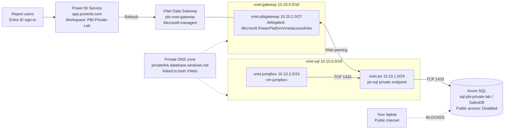

# Power BI Service → VNet Data Gateway → Azure SQL (Private Endpoint)

### End-to-end lab: build it from scratch in the Azure Portal and Power BI Service, then prove that Power BI uses the gateway

> **What this lab is:** **Power BI Service** at **https://app.powerbi.com** (workspace, semantic model and report used by signed-in Microsoft Entra users).
> **What this lab is not:** **Power BI Embedded.** There is no custom web app, no "App owns data" or "User owns data" embedding, no service principal embed token and no `A` SKU embedding API.

---

## Table of contents

1. [Objective](#1-objective)
2. [Architecture](#2-architecture)
3. [Naming and IP plan](#3-naming-and-ip-plan)
4. [Prerequisites](#4-prerequisites)
5. [Phase 1: Resource group and virtual networks](#phase-1--resource-group-and-virtual-networks)
6. [Phase 2: Azure SQL server and database](#phase-2--azure-sql-server-and-database)
7. [Phase 3: Private endpoint and private DNS](#phase-3--private-endpoint-and-private-dns)
8. [Phase 4: Jumpbox VM inside the private network](#phase-4--jumpbox-vm-inside-the-private-network)
9. [Phase 5: Create tables, data, proof view and read-only user](#phase-5--create-tables-data-proof-view-and-read-only-user)
10. [Phase 6: VNet peering and DNS for the gateway VNet](#phase-6--vnet-peering-and-dns-for-the-gateway-vnet)
11. [Phase 7: Prepare the delegated gateway subnet](#phase-7--prepare-the-delegated-gateway-subnet)
12. [Phase 8: Fabric capacity and Power BI workspace](#phase-8--fabric-capacity-and-power-bi-workspace)
13. [Phase 9: Create the VNet Data Gateway in app.powerbi.com](#phase-9--create-the-vnet-data-gateway-in-apppowerbicom)
14. [Phase 10: Create the gateway connection to SQL](#phase-10--create-the-gateway-connection-to-sql)
15. [Phase 11: Build the report in Power BI Desktop and publish](#phase-11--build-the-report-in-power-bi-desktop-and-publish)
16. [Phase 12: Bind the semantic model to the VNet gateway](#phase-12--bind-the-semantic-model-to-the-vnet-gateway)
17. [Phase 13: Enable SQL auditing (evidence source)](#phase-13--enable-sql-auditing-evidence-source)
18. [Phase 14: Prove Power BI is using the gateway](#phase-14--prove-power-bi-is-using-the-gateway)
19. [Phase 15: Prove this is Power BI Service, not Embedded](#phase-15--prove-this-is-power-bi-service-not-embedded)
20. [Final validation checklist](#final-validation-checklist)
21. [Troubleshooting](#troubleshooting)
22. [Cost control and cleanup](#cost-control-and-cleanup)
23. [Corrections to the earlier draft](#corrections-to-the-earlier-draft)

---

## 1. Objective

Show that the Power BI Service can import data from Azure SQL Database while:

- SQL **public network access is Disabled**
- SQL is reachable **only through a Private Endpoint**
- Power BI reaches SQL through a **Microsoft-managed VNet Data Gateway** (no gateway VM to install or patch)
- The gateway sits in a **different VNet** from the SQL private endpoint (cross-VNet via peering)

Then prove it with evidence: the report itself shows the private IP address the refresh came from, the SQL audit log shows the same, and breaking the private path makes the refresh fail.

---

## 2. Architecture



Refresh traffic path:

```
Power BI Service (app.powerbi.com)
   └─► VNet Data Gateway (injected into snet-pbigateway, 10.20.2.x)
         └─► DNS: sql-pbi-private-lab.database.windows.net → privatelink → 10.10.1.x
               └─► VNet peering (vnet-gateway → vnet-sql)
                     └─► pe-sql private endpoint (10.10.1.x) → Azure SQL / SalesDB
```

---

## 3. Naming and IP plan

| Resource | Name | Value / location |
|---|---|---|
| Resource group | `rg-pbi-private-lab` | Central India |
| SQL VNet | `vnet-sql` | `10.10.0.0/16` |
| Private endpoint subnet | `snet-pe` | `10.10.1.0/24` |
| Jumpbox subnet | `snet-jumpbox` | `10.10.2.0/24` |
| Bastion subnet (only if using Bastion Basic) | `AzureBastionSubnet` | `10.10.3.0/26` |
| Gateway VNet | `vnet-gateway` | `10.20.0.0/16` |
| Gateway subnet (delegated) | `snet-pbigateway` | `10.20.2.0/27` |
| SQL logical server | `sql-pbi-private-lab` | Central India (name must be globally unique; add a suffix if taken) |
| SQL database | `SalesDB` | Basic or General Purpose Serverless |
| Private endpoint | `pe-sql` | in `snet-pe` |
| Private DNS zone | `privatelink.database.windows.net` | Global |
| Jumpbox VM | `vm-jumpbox` | Windows 11 / Server 2022, in `snet-jumpbox` |
| Log Analytics workspace | `law-pbi-private-lab` | Central India |
| Fabric capacity | `fabpbiprivatelab` | F2, Central India |
| VNet Data Gateway | `pbi-vnet-gateway` | Created from app.powerbi.com |
| Gateway connection | `conn-sql-salesdb` | SQL Server, Basic auth |
| Power BI workspace | `PBI-Private-Lab` | Assigned to the Fabric capacity |

> **Rule:** the two VNet address spaces must **not overlap**, otherwise peering cannot be created.

---

## 4. Prerequisites

| Requirement | Detail |
|---|---|
| Azure subscription | Owner, or Contributor + Network Contributor on the resource group |
| Resource provider | Permission to register `Microsoft.PowerPlatform` on the subscription |
| Power BI / Fabric capacity | **Fabric F SKU** (F2 is enough) or **Power BI Premium P SKU**. A Pro-only workspace on shared capacity **cannot** use VNet Data Gateways. A Fabric trial may work for evaluation; check that the VNet gateway option offers your trial capacity. |
| Power BI license | Pro or PPU (or Fabric free license + F64 or higher) for the person publishing |
| Region | Keep everything in **Central India** for simplicity |
| Tools on the jumpbox | Power BI Desktop, SQL Server Management Studio (SSMS) or Azure Data Studio |

> **Important:** The VNet Data Gateway consumes capacity units from your Fabric/Premium capacity while it is running. Pause the F SKU when you are not working on the lab.

---

## Phase 1: Resource group and virtual networks

### 1.1 Create the resource group

1. Open **https://portal.azure.com**.
2. In the top search bar, type **Resource groups** and open it.
3. Click **+ Create**.
4. **Subscription:** your subscription
   **Resource group:** `rg-pbi-private-lab`
   **Region:** `(Asia Pacific) Central India`
5. Click **Review + create** → **Create**.

### 1.2 Create `vnet-sql`

1. Search **Virtual networks** → **+ Create**.
2. **Basics** tab:
   - Resource group: `rg-pbi-private-lab`
   - Name: `vnet-sql`
   - Region: Central India
3. **Security** tab: leave defaults (do not enable Bastion here; we handle access in Phase 4).
4. **IP addresses** tab:
   - Delete the default address space if it is not `10.10.0.0/16`, then add **`10.10.0.0/16`**.
   - Delete the `default` subnet and click **+ Add a subnet** twice:

     | Name | Starting address | Size |
     |---|---|---|
     | `snet-pe` | `10.10.1.0` | `/24` |
     | `snet-jumpbox` | `10.10.2.0` | `/24` |

5. **Review + create** → **Create**.

### 1.3 Create `vnet-gateway`

1. **Virtual networks** → **+ Create**.
2. **Basics:** Resource group `rg-pbi-private-lab`, Name `vnet-gateway`, Region Central India.
3. **IP addresses:**
   - Address space: **`10.20.0.0/16`**
   - Delete the `default` subnet. **Do not create the gateway subnet yet**; we create it with delegation in Phase 7.
   - If the portal insists on at least one subnet, add `snet-misc` = `10.20.1.0/24`.
4. **Review + create** → **Create**.

---

## Phase 2: Azure SQL server and database

1. Search **SQL databases** → **+ Create**.
2. **Basics** tab:
   - Resource group: `rg-pbi-private-lab`
   - Database name: `SalesDB`
   - Server: **Create new**
     - Server name: `sql-pbi-private-lab` (add a suffix if unavailable)
     - Location: Central India
     - Authentication method: **Use both SQL and Microsoft Entra authentication** (or *Use SQL authentication* only)
     - Set **Microsoft Entra admin** to your account (if offered)
     - Server admin login: `sqladminlab`
     - Password: a strong password (store it safely)
     - Click **OK**
   - Want to use SQL elastic pool? **No**
   - Workload environment: **Development**
   - Compute + storage: **Configure database** → choose **Basic (5 DTU)** or **General Purpose, Serverless** with auto-pause → **Apply**
   - Backup storage redundancy: **Locally-redundant**
3. **Networking** tab:
   - Connectivity method: **No access** (we add the private endpoint separately in Phase 3 so each step is visible).
4. **Security** tab: leave defaults (Microsoft Defender optional).
5. **Additional settings:** Use existing data = **None**.
6. **Review + create** → **Create**. Wait for deployment (2–5 minutes).

---

## Phase 3: Private endpoint and private DNS

### 3.1 Create the private endpoint `pe-sql`

1. Open **SQL servers** → `sql-pbi-private-lab`.
2. Left menu: **Security → Networking**.
3. Open the **Private access** tab → click **+ Create a private endpoint**.
4. **Basics:**
   - Resource group: `rg-pbi-private-lab`
   - Name: `pe-sql`
   - Network Interface Name: `pe-sql-nic` (auto-filled)
   - Region: Central India
5. **Resource:**
   - Target sub-resource: **sqlServer**
6. **Virtual Network:**
   - Virtual network: `vnet-sql`
   - Subnet: `snet-pe`
   - Private IP configuration: **Dynamically allocate IP address**
7. **DNS:**
   - Integrate with private DNS zone: **Yes**
   - Subscription / Resource group: yours / `rg-pbi-private-lab`
   - Private DNS zone: **(New) privatelink.database.windows.net**
8. **Review + create** → **Create**.

This creates the private DNS zone and automatically links it to `vnet-sql`.

### 3.2 Record the private IP

1. Open **Private endpoints** → `pe-sql` → **Settings → DNS configuration**.
2. Note the **IP address** (for example `10.10.1.4`). Write it down as **`<PE_IP>`**.

### 3.3 Confirm the endpoint is approved and public access is disabled

1. **SQL servers** → `sql-pbi-private-lab` → **Networking**.
2. **Private access** tab: `pe-sql` Connection state = **Approved**.
3. **Public access** tab: **Public network access = Disable**. If it is not, select **Disable** and click **Save**.

From this point, your laptop cannot reach SQL. The Azure Portal **Query editor also stops working**, because it uses the public endpoint. That is why the next phase builds a jumpbox.

---

## Phase 4: Jumpbox VM inside the private network

The jumpbox gives you a machine that resolves and reaches SQL privately. You use it to load data, author the report in Power BI Desktop and insert the proof record later.

### 4.1 Create the VM

1. Search **Virtual machines** → **+ Create → Azure virtual machine**.
2. **Basics:**
   - Resource group: `rg-pbi-private-lab`
   - Virtual machine name: `vm-jumpbox`
   - Region: Central India
   - Availability options: **No infrastructure redundancy required**
   - Security type: Trusted launch
   - Image: **Windows 11 Pro** or **Windows Server 2022 Datacenter: Azure Edition**
   - Size: `Standard_B2ms` (or similar, 8 GB RAM is comfortable for Power BI Desktop)
   - Username / password: your local admin credentials
   - Public inbound ports: **None**
3. **Networking:**
   - Virtual network: `vnet-sql`
   - Subnet: `snet-jumpbox`
   - Public IP: **None**
4. **Management:** enable **Auto-shutdown** (for example 22:00 IST).
5. **Review + create** → **Create**.

### 4.2 Connect with Azure Bastion

1. Open `vm-jumpbox` → **Connect → Connect via Bastion**.
2. If offered, choose **Deploy Bastion Developer** (free, lightweight). If Developer is not available in your region, deploy **Bastion Basic**; the portal will ask you to create `AzureBastionSubnet` (`10.10.3.0/26`) in `vnet-sql`.
3. Enter the VM username and password → **Connect**. A browser tab opens with the VM desktop.

### 4.3 Install tools on the jumpbox

Inside the jumpbox:

1. Install **SQL Server Management Studio** (or Azure Data Studio) from the official Microsoft download page.
2. Install **Power BI Desktop** from the Microsoft Store or the Microsoft download page.

### 4.4 Verify private DNS from the jumpbox

Open **Command Prompt** on the jumpbox:

```cmd
nslookup sql-pbi-private-lab.database.windows.net
```

Expected: the answer chain includes `sql-pbi-private-lab.privatelink.database.windows.net` and an address equal to `<PE_IP>` (10.10.1.x).

Run the same command on **your laptop**: it returns a **public** IP. Save both outputs as screenshots (Evidence E1).

---

## Phase 5: Create tables, data, proof view and read-only user

On the jumpbox, open **SSMS**:

- Server name: `sql-pbi-private-lab.database.windows.net`
- Authentication: **SQL Server Authentication**, login `sqladminlab` (or Microsoft Entra MFA with your admin account)
- **Options → Connection Properties → Connect to database:** `SalesDB`
- Encryption: **Mandatory**, Trust server certificate: unchecked
- Click **Connect**

Open **New Query** against `SalesDB` and run the scripts below in order.

### 5.1 Sales table

```sql
CREATE TABLE dbo.SalesOrders
(
    OrderID      INT IDENTITY(1001,1) PRIMARY KEY,
    OrderDate    DATE           NOT NULL,
    CustomerName NVARCHAR(100)  NOT NULL,
    Region       NVARCHAR(50)   NOT NULL,
    Product      NVARCHAR(50)   NOT NULL,
    Quantity     INT            NOT NULL,
    UnitPrice    DECIMAL(12,2)  NOT NULL,
    SalesAmount  AS (Quantity * UnitPrice) PERSISTED,
    CreatedAt    DATETIME2      DEFAULT SYSUTCDATETIME()
);
```

### 5.2 Sample records

```sql
INSERT INTO dbo.SalesOrders
    (OrderDate, CustomerName, Region, Product, Quantity, UnitPrice)
VALUES
    ('2026-10-01','Rahul', 'Pune',     'Laptop',   2, 65000),
    ('2026-10-02','Priya', 'Mumbai',   'Monitor',  3, 12000),
    ('2026-10-03','Amit',  'Delhi',    'Keyboard', 5,  1500),
    ('2026-10-04','Neha',  'Bangalore','Laptop',   1, 65000),
    ('2026-10-05','Karan', 'Pune',     'Mouse',   10,   800),
    ('2026-10-06','Sneha', 'Mumbai',   'Laptop',   2, 65000),
    ('2026-10-07','Arjun', 'Delhi',    'Monitor',  4, 12000),
    ('2026-10-08','Pooja', 'Bangalore','Keyboard', 8,  1500),
    ('2026-10-09','Rohan', 'Pune',     'Monitor',  2, 12000),
    ('2026-10-10','Meera', 'Mumbai',   'Mouse',    6,   800),
    ('2026-10-11','Dev',   'Delhi',    'Laptop',   1, 65000),
    ('2026-10-12','Ananya','Bangalore','Mouse',   12,   800);
```

### 5.3 Reporting view

```sql
CREATE VIEW dbo.vw_SalesByRegion
AS
SELECT
    Region,
    COUNT(*)         AS TotalOrders,
    SUM(Quantity)    AS TotalQuantity,
    SUM(SalesAmount) AS TotalSales
FROM dbo.SalesOrders
GROUP BY Region;
```

### 5.4 Connection proof view (key piece of evidence)

This view returns details about **the connection that is reading it**. When the Power BI Service refreshes, the value of `ClientIP` is the address SQL saw the request coming from. If the refresh goes through the VNet gateway, it is an address inside **`10.20.2.0/27`** (the gateway subnet).

```sql
CREATE VIEW dbo.vw_ConnectionProof
AS
SELECT
    CAST(CONNECTIONPROPERTY('client_net_address') AS NVARCHAR(50)) AS ClientIP,
    CAST(CONNECTIONPROPERTY('net_transport')      AS NVARCHAR(50)) AS NetTransport,
    CAST(CONNECTIONPROPERTY('protocol_type')      AS NVARCHAR(50)) AS ProtocolType,
    HOST_NAME()                                                    AS ClientHostName,
    APP_NAME()                                                     AS ClientAppName,
    SUSER_SNAME()                                                  AS LoginName,
    SYSUTCDATETIME()                                               AS QueriedAtUtc;
```

Test it in SSMS on the jumpbox:

```sql
SELECT * FROM dbo.vw_ConnectionProof;
```

Expected: `ClientIP` = the jumpbox IP (10.10.2.x). Later, in the Power BI report, it will show a **10.20.2.x** address instead.

### 5.5 Read-only database user for Power BI

```sql
CREATE USER pbi_reader WITH PASSWORD = 'ChangeThis!StrongPassword123';

GRANT SELECT ON dbo.SalesOrders        TO pbi_reader;
GRANT SELECT ON dbo.vw_SalesByRegion   TO pbi_reader;
GRANT SELECT ON dbo.vw_ConnectionProof TO pbi_reader;
```

> Change the password. `pbi_reader` is a **contained database user** in `SalesDB`, so Power BI must always specify the database `SalesDB` when connecting.

### 5.6 Verify the data

```sql
SELECT COUNT(*) AS TotalOrders, SUM(SalesAmount) AS TotalSales
FROM dbo.SalesOrders;

SELECT * FROM dbo.vw_SalesByRegion ORDER BY Region;
```

| Metric | Expected |
|---|---|
| Total orders | **12** |
| Total sales | **5,39,900** |
| Regions | **4** |

| Region | Orders | Total sales |
|---|---|---|
| Bangalore | 3 | 86,600 |
| Delhi | 3 | 1,20,500 |
| Mumbai | 3 | 1,70,800 |
| Pune | 3 | 1,62,000 |

---

## Phase 6: VNet peering and DNS for the gateway VNet

The gateway will live in `vnet-gateway`, but the private endpoint is in `vnet-sql`. The gateway needs both a **network route** (peering) and **private name resolution** (DNS zone link).

### 6.1 Create the peering (both directions in one step)

1. **Virtual networks** → `vnet-sql` → **Settings → Peerings** → **+ Add**.
2. **Remote virtual network summary** (the other side):
   - Peering link name: `gateway-to-sql`
   - Virtual network: `vnet-gateway`
   - Allow 'vnet-gateway' to access 'vnet-sql': **checked**
   - Allow 'vnet-gateway' to receive forwarded traffic from 'vnet-sql': unchecked
3. **Local virtual network summary** (this side):
   - Peering link name: `sql-to-gateway`
   - Allow 'vnet-sql' to access 'vnet-gateway': **checked**
4. Click **Add**.
5. Refresh the Peerings blade until **Peering status = Connected** and **Peering sync status = Fully Synchronized**.
6. Open `vnet-gateway` → **Peerings** and confirm `gateway-to-sql` is **Connected** too.

### 6.2 Link the private DNS zone to `vnet-gateway`

1. Search **Private DNS zones** → `privatelink.database.windows.net`.
2. **DNS Management → Virtual Network Links** → **+ Add**.
3. Link name: `link-vnet-gateway`
   Virtual network: `vnet-gateway`
   Enable auto registration: **unchecked**
4. Click **Create**.
5. Confirm the list shows two links, both **Completed**: the auto-created link to `vnet-sql` and `link-vnet-gateway`.
6. Open **Recordsets** (or **Overview**) and confirm an **A record** `sql-pbi-private-lab` → `<PE_IP>`.

---

## Phase 7: Prepare the delegated gateway subnet

### 7.1 Register the resource provider

1. Search **Subscriptions** → your subscription.
2. **Settings → Resource providers**.
3. Search `Microsoft.PowerPlatform` → select it → **Register**.
4. Refresh until status = **Registered**.

### 7.2 Create `snet-pbigateway` with delegation

1. **Virtual networks** → `vnet-gateway` → **Settings → Subnets** → **+ Subnet**.
2. Fill in:

   | Field | Value |
   |---|---|
   | Subnet purpose | Default |
   | Name | `snet-pbigateway` |
   | Starting address | `10.20.2.0` |
   | Size | `/27` |
   | NAT gateway | None |
   | Network security group | None (or an NSG that allows the rules below) |
   | **Subnet delegation** | **Microsoft.PowerPlatform/vnetaccesslinks** |

3. Click **Add**.

> **Do not** name it `GatewaySubnet` (reserved for VPN/ExpressRoute gateways). **Do not** place any other resources in this subnet. Once a VNet gateway uses it, the subnet cannot be deleted until the gateway is removed.

### 7.3 NSG rules (only if you attach a restrictive NSG)

| Direction | Source | Destination | Port | Purpose |
|---|---|---|---|---|
| Outbound | `10.20.2.0/27` | `<PE_IP>` (or `10.10.1.0/24`) | TCP 1433 | SQL through private endpoint |
| Outbound | `10.20.2.0/27` | Service tag `AzureActiveDirectory` | TCP 443 | Only if using Entra/OAuth auth |
| Outbound | `10.20.2.0/27` | Internet (CRL/OCSP) | TCP 80/443 | Certificate validation |
| Inbound + Outbound | `10.20.2.0/27` | `10.20.2.0/27` | Any | Gateway members talking to each other |

---

## Phase 8: Fabric capacity and Power BI workspace

### 8.1 Create a Fabric capacity (skip if you already have F or P capacity)

1. Azure Portal → search **Microsoft Fabric** → **+ Create**.
2. Resource group: `rg-pbi-private-lab`
   Capacity name: `fabpbiprivatelab` (lowercase letters and numbers only)
   Region: Central India
   Size: **F2**
   Fabric capacity administrator: your account
3. **Review + create** → **Create**.
4. After deployment, confirm the capacity is **Active** (use **Pause** when not using the lab, **Resume** when you return).

### 8.2 Create the workspace

1. Open **https://app.powerbi.com** and sign in with your organisational account.
2. Left navigation: **Workspaces** → **+ New workspace**.
3. Name: `PBI-Private-Lab`.
4. Expand **Advanced** → **License mode**: **Fabric capacity** → select `fabpbiprivatelab` (or your Premium capacity).
5. Click **Apply**.
6. Confirm the workspace shows the **diamond (capacity) icon** next to its name.

---

## Phase 9: Create the VNet Data Gateway in app.powerbi.com

1. In **https://app.powerbi.com**, click the **Settings (gear) icon** at the top right.
2. Select **Manage connections and gateways**.
3. Open the **Virtual network data gateways** tab.
4. Click **+ New**.
5. Fill in the pane:

   | Field | Value |
   |---|---|
   | License capacity | `fabpbiprivatelab` (your F/P capacity) |
   | Azure subscription | your subscription |
   | Resource group | `rg-pbi-private-lab` |
   | Virtual network | `vnet-gateway` |
   | Subnet | `snet-pbigateway` (only delegated subnets appear) |
   | Data gateway name | `pbi-vnet-gateway` |
   | Number of gateways (if shown) | 1 for the lab |
   | Inactivity time before auto-sleep (if shown) | 30 minutes |

6. Click **Save**.
7. Wait until `pbi-vnet-gateway` appears in the list with status **Online / Ready**.
8. Optional: back in the Azure Portal, open `vnet-gateway` → **Subnets** → `snet-pbigateway`. It now shows a service association link for Power Platform, which proves the gateway is injected into **your** subnet. Screenshot it (Evidence E2).

> If the subnet does not appear in step 5: the delegation is missing, `Microsoft.PowerPlatform` is not registered, or your account lacks **Network Contributor** (subnet join) on `vnet-gateway`.

---

## Phase 10: Create the gateway connection to SQL

1. **Settings (gear) → Manage connections and gateways → Connections** tab → **+ New**.
2. At the top choose **Virtual network**.
3. Fill in:

   | Field | Value |
   |---|---|
   | Gateway cluster name | `pbi-vnet-gateway` |
   | Connection name | `conn-sql-salesdb` |
   | Connection type | **SQL Server** |
   | Server | `sql-pbi-private-lab.database.windows.net` |
   | Database | `SalesDB` |
   | Authentication method | **Basic** |
   | Username | `pbi_reader` |
   | Password | your `pbi_reader` password |
   | Single sign-on | leave unchecked |
   | Privacy level | **Organizational** |

4. Click **Create**. Power BI tests the connection **from the gateway**.
5. Expected: the connection is created with no error. Because SQL public access is disabled, **this success already shows the gateway path works**, since nothing on the public internet can reach SQL. Screenshot it (Evidence E3).
6. Open the connection's **… → Manage users** and add anyone else who will publish or refresh this semantic model (role **User**).

> **The server and database names must match exactly** what you use in Power BI Desktop in the next phase (same spelling, no trailing dot, no `tcp:` prefix, no port), or Phase 12 cannot map the data source.

---

## Phase 11: Build the report in Power BI Desktop and publish

Do this **on the jumpbox**, which has private access to SQL.

### 11.1 Connect

1. Open **Power BI Desktop** → sign in with the same organisational account you use at app.powerbi.com.
2. **Home → Get data → Azure SQL database** (or **SQL Server**).
3. Server: `sql-pbi-private-lab.database.windows.net`
   Database: `SalesDB`
   Data Connectivity mode: **Import**
4. Click **OK**.
5. Credentials: choose **Database** on the left → User name `pbi_reader` → password → level `sql-pbi-private-lab.database.windows.net` → **Connect**.
6. In **Navigator**, tick:
   - `dbo.SalesOrders`
   - `dbo.vw_SalesByRegion`
   - `dbo.vw_ConnectionProof`
7. Click **Load**.

### 11.2 Build the visuals

Page 1, **Sales Overview**:

| Visual | Fields |
|---|---|
| Card | Sum of `SalesOrders[SalesAmount]` |
| Card | Count of `SalesOrders[OrderID]` |
| Clustered column chart | X: `Region`, Y: Sum of `SalesAmount` |
| Donut chart | Legend: `Product`, Values: Sum of `SalesAmount` |
| Table | `CustomerName`, `Product`, `Region`, `SalesAmount`, `OrderDate` |
| Slicer | `OrderDate` |

Page 2, **Gateway Proof**:

| Visual | Fields |
|---|---|
| Card (large) | `vw_ConnectionProof[ClientIP]` |
| Table | `ClientIP`, `ClientHostName`, `ClientAppName`, `LoginName`, `NetTransport`, `QueriedAtUtc` |
| Text box | "Gateway subnet = 10.20.2.0/27 · Jumpbox subnet = 10.10.2.0/24 · Private endpoint = 10.10.1.x" |

At this point Page 2 shows the **jumpbox** IP (10.10.2.x), because Desktop on the jumpbox ran the query. This is expected and becomes part of the proof.

### 11.3 Save and publish

1. **File → Save as** → `PBI-Private-SQL-Lab.pbix`.
2. **Home → Publish** → choose workspace **`PBI-Private-Lab`** → **Select**.
3. When it reports success, click **Open 'PBI-Private-SQL-Lab.pbix' in Power BI**. The browser opens on **app.powerbi.com**.

---

## Phase 12: Bind the semantic model to the VNet gateway

1. In **https://app.powerbi.com** → **Workspaces** → `PBI-Private-Lab`.
2. Find the item of type **Semantic model** named `PBI-Private-SQL-Lab`.
3. Hover → **… (More options)** → **Settings**.
4. Expand **Gateway and cloud connections**.
5. Turn on **Use an On-premises or VNet data gateway** (wording may vary slightly).
6. In the gateway list, select **`pbi-vnet-gateway`** (it should show **Running on virtual network**).
7. In **Data sources included in this semantic model**, for `SqlServer{"server":"sql-pbi-private-lab.database.windows.net","database":"SalesDB"}` open **Maps to** → select **`conn-sql-salesdb`**.
8. Click **Apply**.
9. Screenshot this page (Evidence E4).
10. Optional: expand **Refresh** → set a schedule (for example daily 09:00 IST, time zone `(UTC+05:30) Chennai, Kolkata, Mumbai, New Delhi`) → **Apply**.

---

## Phase 13: Enable SQL auditing (evidence source)

SQL auditing records the **client IP** and **application name** of every login and query. It gives server-side evidence that does not depend on anything Power BI says.

### 13.1 Create Log Analytics workspace

1. Search **Log Analytics workspaces** → **+ Create**.
2. Resource group `rg-pbi-private-lab`, Name `law-pbi-private-lab`, Region Central India → **Review + create** → **Create**.

### 13.2 Turn on auditing

1. **SQL servers** → `sql-pbi-private-lab` → **Security → Auditing**.
2. **Enable Azure SQL Auditing:** On.
3. Audit log destination: tick **Log Analytics** → select `law-pbi-private-lab`.
4. Click **Save**.

Audit records typically appear in Log Analytics **5–15 minutes** after the event.

---

## Phase 14: Prove Power BI is using the gateway

Run these tests in order. Together they prove that the **Power BI Service** reaches SQL **only** through the **VNet Data Gateway** and the **private endpoint**.

### Proof matrix

| # | Test | What it proves |
|---|---|---|
| P1 | Laptop cannot connect to SQL | Public path is closed |
| P2 | DNS resolves to the private IP inside the VNets | Name resolution uses Private DNS |
| P3 | Service refresh succeeds with public access disabled | Power BI reached SQL privately |
| P4 | Report shows ClientIP in `10.20.2.0/27` | The refresh came from the gateway subnet |
| P5 | SQL audit log shows the same 10.20.2.x IP | Independent server-side confirmation |
| P6 | New SQL row appears after refresh | The data is live, not cached |
| P7 | Break the private DNS link → refresh fails; restore → succeeds | The gateway path is the *only* working path |
| P8 | Remove the gateway binding → refresh cannot run | Power BI cannot reach SQL without the gateway |

---

### P1: Public path is closed

1. Azure Portal → **SQL servers** → `sql-pbi-private-lab` → **Networking → Public access**: confirm **Disabled**. Screenshot (E5).
2. On **your laptop** (not the jumpbox), open Power BI Desktop or SSMS and connect to `sql-pbi-private-lab.database.windows.net` / `SalesDB`.
3. Expected: connection **fails** with an error stating that the connection was denied because **Deny Public Network Access** is set (error 47073). Screenshot (E6).

### P2: DNS is private inside the VNets

Already captured in Phase 4.4 (E1):

- Jumpbox → `nslookup` → `10.10.1.x` (private)
- Laptop → `nslookup` → public IP

The gateway VNet uses the same zone through `link-vnet-gateway`.

### P3: Service refresh succeeds with public access disabled

1. **app.powerbi.com** → `PBI-Private-Lab` → semantic model `PBI-Private-SQL-Lab` → **… → Refresh now**.
2. Wait about a minute. Open **… → Settings → Refresh history** (or the semantic model page → **Refresh → Refresh history**).
3. Expected: latest entry **Type = On demand**, **Status = Completed**. Screenshot (E7).

### P4: The report shows the gateway subnet IP

1. Open the report `PBI-Private-SQL-Lab` → page **Gateway Proof**.
2. Expected:

   | Field | Expected value |
   |---|---|
   | `ClientIP` | an address in **10.20.2.0 – 10.20.2.31** (the gateway subnet) |
   | `LoginName` | `pbi_reader` |
   | `NetTransport` | `TCP` |
   | `QueriedAtUtc` | the time of the refresh you just ran |

3. Compare with what Desktop showed on the jumpbox: **10.10.2.x**. The IP changed from the jumpbox subnet to the gateway subnet **because the Service refresh ran inside the VNet Data Gateway**. Screenshot (E8).

> This is the most direct proof: SQL itself reported the source of the connection, and the value came back into the report through the refresh.

### P5: SQL audit log confirms the source IP

1. Azure Portal → `law-pbi-private-lab` → **Logs**. Close the queries pop-up and switch to **KQL mode**.
2. Run:

   ```kusto
   AzureDiagnostics
   | where Category == "SQLSecurityAuditEvents"
   | where TimeGenerated > ago(2h)
   | where server_principal_name_s == "pbi_reader"
   | project TimeGenerated,
             client_ip_s,
             application_name_s,
             host_name_s,
             action_name_s,
             database_name_s,
             statement_s
   | order by TimeGenerated desc
   ```

   If no rows appear, the workspace may use resource-specific tables. Try:

   ```kusto
   SQLSecurityAuditEvents
   | where TimeGenerated > ago(2h)
   | where ServerPrincipalName == "pbi_reader"
   | project TimeGenerated, ClientIp, ApplicationName, HostName, ActionName, Statement
   | order by TimeGenerated desc
   ```

3. Expected: rows at the refresh time with **client IP = 10.20.2.x**, the same as P4, and an application name from the Power BI data engine (typically containing *Mashup Engine*). Screenshot (E9).

You can also see the audit records directly: **SQL servers** → `sql-pbi-private-lab` → **Auditing → View audit logs**.

### P6: Live data proof (insert a new row and refresh)

1. On the **jumpbox**, in SSMS (as `sqladminlab`), run:

   ```sql
   INSERT INTO dbo.SalesOrders
       (OrderDate, CustomerName, Region, Product, Quantity, UnitPrice)
   VALUES
       ('2026-11-05','GATEWAY-PROOF','Pune','PrivateEndpoint-Test',1,99999);

   SELECT * FROM dbo.SalesOrders WHERE CustomerName = 'GATEWAY-PROOF';

   SELECT COUNT(*) AS TotalOrders, SUM(SalesAmount) AS TotalSales
   FROM dbo.SalesOrders;
   ```

   Expected: one new row with `SalesAmount = 99999`; totals **13** orders and **6,39,899**.

2. **app.powerbi.com** → semantic model → **Refresh now** → wait for **Completed**.
3. Open the report:

   | Check | Expected |
   |---|---|
   | Count of OrderID | **13** |
   | Sum of SalesAmount | **6,39,899** |
   | Table contains | `GATEWAY-PROOF` / `PrivateEndpoint-Test` |
   | Pune in column chart | **2,61,999** |
   | Gateway Proof → `QueriedAtUtc` | updated to this refresh |

   Screenshot (E10).

### P7: Negative test: break the private path, refresh fails; restore it, refresh succeeds

This shows that the only working route is the gateway → peering → private endpoint path.

1. Azure Portal → **Private DNS zones** → `privatelink.database.windows.net` → **Virtual Network Links** → select `link-vnet-gateway` → **Delete** → confirm.
2. Wait 2–3 minutes. **app.powerbi.com** → semantic model → **Refresh now**.
3. Expected: refresh **fails**. Without the private zone, the gateway resolves the **public** IP, and SQL rejects it because public access is disabled (or the connection times out). Open **Refresh history → Show details** and screenshot the error (E11).
4. Recreate the link exactly as in Phase 6.2 (`link-vnet-gateway` → `vnet-gateway`, auto registration off).
5. Wait 2–3 minutes → **Refresh now** → expected **Completed** (E12).

Alternative negative test: delete the peering `gateway-to-sql`, refresh (fails with timeout), then re-create the peering (Phase 6.1) and refresh (succeeds).

### P8: Without the gateway, the Service cannot refresh

1. Semantic model → **Settings → Gateway and cloud connections** → turn **off** the gateway option (or clear the **Maps to** connection) → **Apply**.
2. Click **Refresh now**.
3. Expected: Power BI refuses or fails the refresh, reporting that the data source needs a gateway or that SQL denied the public connection. Screenshot (E13).
4. Turn the gateway back on, select `pbi-vnet-gateway`, map to `conn-sql-salesdb` → **Apply** → **Refresh now** → **Completed**.

### Evidence pack

| ID | Screenshot |
|---|---|
| E1 | `nslookup` from jumpbox (private IP) vs laptop (public IP) |
| E2 | `snet-pbigateway` showing delegation / Power Platform association |
| E3 | Gateway connection `conn-sql-salesdb` created successfully |
| E4 | Semantic model settings: `pbi-vnet-gateway` + `conn-sql-salesdb` mapped |
| E5 | SQL Networking: Public network access **Disabled** |
| E6 | Laptop connection denied (public access disabled) |
| E7 | Refresh history: **Completed** |
| E8 | Report "Gateway Proof" page: ClientIP **10.20.2.x** |
| E9 | Log Analytics audit query: client IP **10.20.2.x** |
| E10 | Report showing **13** orders, **6,39,899**, `GATEWAY-PROOF` |
| E11–E12 | DNS link removed → refresh failed; restored → succeeded |
| E13 | Gateway binding removed → refresh failed |

**Conclusion statement for the lab report:**
> With Azure SQL public network access disabled, the Power BI Service semantic model refreshed successfully through `pbi-vnet-gateway`. SQL recorded the refresh connections from the gateway subnet (10.20.2.0/27), both in the report's connection proof view and in the SQL audit log. Removing the private DNS link or the gateway binding caused the refresh to fail, and restoring it restored the refresh. Power BI therefore reached SQL only through the VNet Data Gateway and the private endpoint.

---

## Phase 15: Prove this is Power BI Service, not Embedded

| Check | Power BI Service (this lab) | Power BI Embedded (not used) |
|---|---|---|
| Where users open the report | **https://app.powerbi.com/groups/&lt;workspace-id&gt;/reports/&lt;report-id&gt;** | Inside **your own** web application URL |
| Who signs in | Each user signs in to Power BI with their **Entra ID** account | Your app authenticates; often a service principal generates an **embed token** |
| Code involved | **None** | JavaScript client SDK (`powerbi-client`) + backend REST API calls |
| Azure app registration | **Not created** | Required (App owns data / User owns data) |
| Capacity used | **Fabric F SKU / Premium P SKU** assigned to the workspace | Typically `A` SKU (Power BI Embedded in Azure) or F SKU via embed APIs |
| Licensing for viewers | Pro / PPU (or free viewers on F64+ / P capacity) | App users need no Power BI license in App-owns-data |

How to show it in the lab:

1. Open the report and screenshot the **browser address bar** showing `app.powerbi.com/groups/...`.
2. Azure Portal → **Microsoft Entra ID → App registrations**: no app was created for this lab.
3. Azure Portal: there is **no Power BI Embedded (`A` SKU) resource** in `rg-pbi-private-lab`; only the Fabric capacity.
4. Workspace → **Workspace settings → License info**: shows **Fabric capacity** `fabpbiprivatelab`.

> **Extension idea:** the same semantic model and gateway can later serve a Power BI Embedded app. The gateway part does not change; only how users reach the report does.

---

## Final validation checklist

| # | Item | Expected | ✔ |
|---|---|---|---|
| 1 | `pe-sql` connection state | Approved | ☐ |
| 2 | SQL public network access | Disabled | ☐ |
| 3 | Laptop connection to SQL | Denied (47073) | ☐ |
| 4 | Peering `sql-to-gateway` / `gateway-to-sql` | Connected / Fully synchronized | ☐ |
| 5 | DNS zone links | `vnet-sql` + `vnet-gateway` | ☐ |
| 6 | `nslookup` from inside VNet | 10.10.1.x | ☐ |
| 7 | `Microsoft.PowerPlatform` provider | Registered | ☐ |
| 8 | `snet-pbigateway` delegation | Microsoft.PowerPlatform/vnetaccesslinks | ☐ |
| 9 | Workspace license mode | Fabric / Premium capacity | ☐ |
| 10 | `pbi-vnet-gateway` | Online | ☐ |
| 11 | `conn-sql-salesdb` | Created without error | ☐ |
| 12 | Semantic model mapped to gateway | Yes | ☐ |
| 13 | Refresh (public disabled) | Completed | ☐ |
| 14 | Report `ClientIP` | 10.20.2.x | ☐ |
| 15 | Audit log client IP | 10.20.2.x | ☐ |
| 16 | After proof insert + refresh | 13 orders, 6,39,899, GATEWAY-PROOF | ☐ |
| 17 | DNS link removed → refresh | Failed | ☐ |
| 18 | DNS link restored → refresh | Completed | ☐ |
| 19 | Report URL | app.powerbi.com (not Embedded) | ☐ |

---

## Troubleshooting

| Symptom | Likely cause | Fix |
|---|---|---|
| "Virtual network data gateways" tab missing or **+ New** disabled | No F/P capacity, or you are not a capacity admin/contributor | Create/assign F SKU (Phase 8); ask the capacity admin to give you rights |
| Subnet not listed when creating the gateway | Missing delegation, provider not registered, no subnet join permission | Phase 7.1–7.2; grant **Network Contributor** on `vnet-gateway` |
| Gateway creation fails | Subnet too small or already used by other resources | Use an empty dedicated `/27` or larger |
| Connection creation: timeout | Peering missing / not Connected; NSG blocks 1433 | Phase 6.1; Phase 7.3 |
| Connection creation: "server was not found" | `vnet-gateway` not linked to the private DNS zone | Phase 6.2 |
| Error 47073 "Deny Public Network Access" | The connection is going over the public path (no gateway, or DNS not private) | Check gateway binding (Phase 12) and DNS link (Phase 6.2) |
| Login failed for `pbi_reader` | Wrong password, or database not specified | Recheck password; always set database `SalesDB` (contained user) |
| Semantic model settings: data source cannot be mapped | Server/database names differ between Desktop and the connection | Make them identical (Phase 10 note) |
| Refresh succeeds but no new rows | Wrong semantic model, or model is in DirectQuery | Confirm Import mode; refresh `PBI-Private-SQL-Lab` |
| Report `ClientIP` not 10.20.2.x | Refresh did not run, or the visual is filtered/cached | Refresh now, then reload the report page; check `QueriedAtUtc` |
| No audit rows in Log Analytics | Ingestion delay or table name difference | Wait 15 minutes; try the `SQLSecurityAuditEvents` table query |
| Portal Query editor doesn't connect | Expected: it uses the public endpoint | Use SSMS on the jumpbox |
| First refresh after idle is slow | Gateway auto-sleep | Normal; the gateway wakes on demand |

---

## Cost control and cleanup

While pausing between sessions:

1. **Microsoft Fabric** capacity `fabpbiprivatelab` → **Pause**.
2. `vm-jumpbox` → **Stop** (auto-shutdown also helps).
3. SQL Serverless database auto-pauses; Basic tier is low cost.

Full cleanup (in this order):

1. **app.powerbi.com** → delete the workspace items, then the workspace `PBI-Private-Lab`.
2. **Manage connections and gateways** → **Connections** → delete `conn-sql-salesdb`.
3. **Virtual network data gateways** → delete `pbi-vnet-gateway` (this releases the delegated subnet).
4. Azure Portal → delete resource group **`rg-pbi-private-lab`** (removes VNets, SQL, private endpoint, DNS zone, VM, Bastion, Log Analytics and the Fabric capacity).

---

## Corrections to the earlier draft

| Earlier statement | Correct value |
|---|---|
| Expected total sales ₹4,17,600 | **₹5,39,900** for the 12 records |
| Total after proof insert | **₹6,39,899** (13 orders) |
| Gateway subnet named `GatewaySubnet` | Use **`snet-pbigateway`**; `GatewaySubnet` is reserved |
| Insert the proof row with the Azure Portal Query editor after disabling public access | The Query editor uses the public endpoint and **will not connect**; use SSMS on the jumpbox |
| Power BI Desktop connects from any computer | Desktop needs private network access; use the jumpbox inside `vnet-sql` |
| "Refresh succeeded" is the proof | A successful refresh is strong evidence, but the **ClientIP from the gateway subnet**, the **audit log** and the **negative tests** make it conclusive |

---

**Lab complete.** Power BI Service (app.powerbi.com) imports data from a private-only Azure SQL Database through a Microsoft-managed VNet Data Gateway, with evidence that the gateway path is the only one in use.
